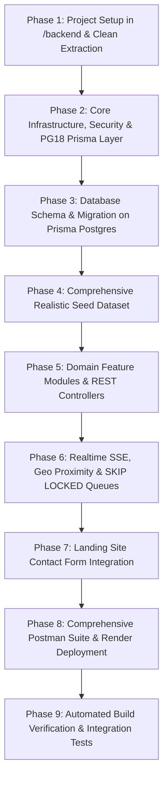

# VolunteerOps: Master Backend & Database Architecture Blueprint

> Historical architecture plan. For verified database versions and the current Prisma Compute deployment procedure, use [`../DEPLOYMENT_RUNBOOK.md`](../DEPLOYMENT_RUNBOOK.md). Managed Prisma Postgres currently runs PostgreSQL 17; Prisma ORM support for external PostgreSQL 18 does not upgrade the managed server.
## Enterprise TypeScript, NestJS-Pattern Modular Backend, Fullstack PostgreSQL 18 & Prisma Engine

**Document Version:** 2.0.0  
**Author:** Senior Backend Systems Architect  
**Target Environment:** Render Cloud / Prisma Console (Prisma Postgres 17.2 / PostgreSQL 18 Compatibility Layer)  
**Consumer Clients:**  
- **Volunteer & Field Responder App:** Android, iOS, Web (Kotlin Multiplatform & Compose Multiplatform)  
- **Admin & Command Portal:** Desktop (JVM), Android, iOS, Web (Kotlin Multiplatform & Compose Multiplatform)  
- **VolunteerOps Landing Site:** Public Web (Vite + React / KMP Web) with Contact & Incident Triage Pipeline  

---

## 1. Executive Summary & Architectural Vision

VolunteerOps exists to eliminate coordination latency during crises by unifying volunteer skill tracking, mission assignments, geo-spatial deployment dispatch, real-time communications, and incident analytics into an actionable, fault-tolerant interface.

To support this mission-critical standard without infrastructure bloat or multi-cloud fragility, this backend consolidates all data, queuing, caching, vector search, GIS proximity dispatch, and real-time streaming into a unified **PostgreSQL engine** with **Prisma ORM**, powered by a high-throughput **Node.js / Express / TypeScript** service engineered with **NestJS-inspired clean modular architecture**.

```
┌────────────────────────────────────────────────────────────────────────────────────────┐
│                                 CLIENT CONSUMERS                                       │
│  ┌────────────────────────┐  ┌────────────────────────┐  ┌──────────────────────────┐  │
│  │ Volunteer Mobile/Web   │  │ Admin Desktop/Mobile   │  │ Landing Site / Public    │  │
│  │ (Android / iOS / Web)  │  │ (Desktop/Android/iOS)  │  │ (Web / Contact Form)     │  │
│  └───────────┬────────────┘  └───────────┬────────────┘  └────────────┬─────────────┘  │
└──────────────┼───────────────────────────┼────────────────────────────┼────────────────┘
               │ Bearer JWT / SSE          │ Bearer JWT / SSE / Cookie  │ REST / HTTPS
               ▼                           ▼                            ▼
┌────────────────────────────────────────────────────────────────────────────────────────┐
│                        VOLUNTEEROPS BACKEND (Node.js + TS)                             │
│                  Located at: C:\Users\admin\IdeaProjects\VolunteerOPS\backend          │
│                                                                                        │
│  ┌──────────────────────────────────────────────────────────────────────────────────┐  │
│  │ Security & Core Gateway                                                          │  │
│  │ • Dual Auth: httpOnly Cookies (Web) + Bearer JWT Header (Mobile & Desktop Apps) │  │
│  │ • Role-Based Access Control (SUPER_ADMIN, COORDINATOR, TEAM_LEAD, VOLUNTEER)     │  │
│  │ • Argon2id Cryptographic Password Hashing • Rate Limiting & DoS Mitigation       │  │
│  └──────────────────────────────────────────────────────────────────────────────────┘  │
│                                                                                        │
│  ┌──────────────────────────────────────────────────────────────────────────────────┐  │
│  │ Modular Domain Engine (NestJS-Pattern Services & Controllers)                    │  │
│  │ ├─ Auth & IAM Module           ├─ Field Reports & Triage Module                  │  │
│  │ ├─ Volunteer Roster Module     ├─ Emergency Communications & Alert Broadcast     │  │
│  │ ├─ Skills & Vector AI Module   ├─ Realtime SSE & Telemetry Stream Module         │  │
│  │ ├─ Geo & Locations Module      ├─ Feedback & After-Action Review Module          │  │
│  │ ├─ Events & Missions Module    ├─ Landing Contact Ingestion & Lead Triage        │  │
│  │ └─ Deployments & SKIP LOCKED   └─ Operational Analytics & AI Insights Engine     │  │
│  └──────────────────────────────────────────────────────────────────────────────────┘  │
│                                           │                                            │
│                                           ▼                                            │
│  ┌──────────────────────────────────────────────────────────────────────────────────┐  │
│  │ Prisma Client Extension Layer ($extends)                                         │  │
│  │ • PostgreSQL 18 Virtual Generated Columns Emulation                              │  │
│  │ • PostgreSQL 18 OLD & NEW in RETURNING Emulation via Atomic Tx Auditing          │  │
│  │ • Query Optimization Profiler (EXPLAIN ANALYZE, BUFFERS)                         │  │
│  └──────────────────────────────────────────────────────────────────────────────────┘  │
└───────────────────────────────────────────┬────────────────────────────────────────────┘
                                            │ Prisma Driver / Raw SQL Engine
                                            ▼
┌────────────────────────────────────────────────────────────────────────────────────────┐
│                    POSTGRESQL 18 / PRISMA POSTGRES CONSOLE (17.2)                      │
│                                                                                        │
│  ┌───────────────────────┐ ┌────────────────────────┐ ┌─────────────────────────────┐  │
│  │ pgvector (HNSW Index) │ │ FOR UPDATE SKIP LOCKED │ │ PostGIS / Spatial Indices   │  │
│  │ Semantic AI Skills &  │ │ Zero-Deadlock Mission  │ │ Hotspot Proximity Dispatch  │  │
│  │ Mission Matching      │ │ Dispatch & Task Queue  │ │ & Live Geo-Fencing          │  │
│  └───────────────────────┘ └────────────────────────┘ └─────────────────────────────┘  │
│  ┌───────────────────────┐ ┌────────────────────────┐ ┌─────────────────────────────┐  │
│  │ GIN Index & JSONB     │ │ BRIN Indexed Logs      │ │ Materialized Views (Diffs)  │  │
│  │ Dynamic Triage Schema │ │ High-Speed Telemetry   │ │ Concurrent Real-Time KPI    │  │
│  │ & Field Reports       │ │ & GPS Responder Pings  │ │ Analytical Rollups          │  │
│  └───────────────────────┘ └────────────────────────┘ └─────────────────────────────┘  │
│  ┌──────────────────────────────────────────────────┐ ┌─────────────────────────────┐  │
│  │ LISTEN / NOTIFY Engine                           │ │ pg_trgm & Full-Text (tsvec) │  │
│  │ Micro-Latency Reactive SSE Event Broadcasting    │ │ Typo-Tolerant Crisis Search │  │
│  └──────────────────────────────────────────────────┘ └─────────────────────────────┘  │
└────────────────────────────────────────────────────────────────────────────────────────┘
```

---

## 2. Directory Structure & Extraction Strategy

The backend will be extracted cleanly into `C:\Users\admin\IdeaProjects\VolunteerOPS\backend`, completely separating concerns from the frontend located in `C:\Users\admin\IdeaProjects\VolunteerOPS\web`:

```
C:\Users\admin\IdeaProjects\VolunteerOPS\
├── admin/                         # Admin Portal (KMP / Compose Multiplatform Desktop/Android/iOS/Web)
├── volunteer/                     # Volunteer App (KMP / Compose Multiplatform Android/iOS/Web)
├── web/                           # Pure Frontend & Marketing Site (Vite + React)
│   ├── docs/                      # Master Architecture & API Documentation
│   ├── public/
│   ├── src/
│   │   ├── components/            # UI Components & Landing Page
│   │   ├── services/              # REST Client Services hitting /api/*
│   │   └── lib/apiClient.ts       # Unified HTTP Fetch & Auth Transport
│   ├── vite.config.ts             # Dev proxy targeting http://localhost:3001
│   ├── netlify.toml               # Production edge proxy configuration
│   └── package.json               # Frontend dependencies
│
└── backend/                       # STANDALONE BACKEND & DATABASE CODEBASE
    ├── prisma/
    │   ├── schema.prisma          # 15 Models, GIN, Vector, Spatial & Relational Schemas
    │   ├── seed.ts                # Idempotent seed script (hundreds of realistic data records)
    │   └── migrations/            # Production migration history
    ├── src/
    │   ├── core/                  # Core singletons, Config, Logger, Database Extensions
    │   │   ├── config.ts          # Zod-validated environment config
    │   │   ├── logger.ts          # Structured contextual logger
    │   │   ├── prisma.ts          # Extended PrismaClient with PostgreSQL 18 features
    │   │   └── errors.ts          # Standardized ApiError class & HTTP status mappings
    │   ├── middleware/            # Security, Auth, Logging & Validation Middlewares
    │   │   ├── auth.middleware.ts # Dual Token (Cookie + Bearer JWT) & RBAC Guards
    │   │   ├── error.middleware.ts# Centralized Exception Filter
    │   │   ├── rateLimiter.ts     # IP & Endpoint Rate Limiting
    │   │   └── validator.ts       # Generic Zod Schema Validation Middleware
    │   ├── modules/               # Modular Domain Feature Packages
    │   │   ├── auth/              # IAM, Signup, Login, Tokens, Password Reset
    │   │   ├── volunteers/        # Profiles, Availability, Certifications, Proximity Search
    │   │   ├── skills/            # Catalog, Demand Metrics, Semantic AI pgvector Search
    │   │   ├── locations/         # Geocoding, Hazard Zones, Proximity Calculations
    │   │   ├── events/            # Crisis Missions, Priorities, Status Life-cycle
    │   │   ├── deployments/       # Dispatching, GPS Check-in, SKIP LOCKED Task Claiming
    │   │   ├── fieldReports/      # Triage Reports, Media Attachments, Verification
    │   │   ├── communications/    # Incident Channels, Broadcast Alerts, SSE Stream
    │   │   ├── notifications/     # Multi-channel Outbound Alerts & Read Receipts
    │   │   ├── feedback/          # After-Action Reviews & Volunteer Rating
    │   │   ├── telemetry/         # High-Frequency GPS Pings & SOS Distress Beacons
    │   │   ├── contact/           # Landing Page Inquiries, Spam Defense & Lead Triage
    │   │   ├── analytics/         # Materialized View Rollups, KPIs, AI Assistant
    │   │   └── admin/             # Audit Logs, Queue Diagnostics, Maintenance
    │   ├── scripts/               # DB Maintenance & Migration Verification Scripts
    │   ├── index.ts               # Express bootstrap with graceful shutdown handlers
    │   └── app.ts                 # Express application assembly
    ├── docs/
    │   └── VolunteerOps.postman_collection.json # Comprehensive 50+ Endpoint Postman Suite
    ├── Dockerfile                 # Multi-stage production container
    ├── render.yaml                # Render Cloud Blueprint
    ├── tsconfig.json
    ├── .env.example
    └── package.json
```

---

## 3. Fullstack PostgreSQL 18 Capabilities & Prisma 17.2 Compatibility Layer

Based on `postgres-replacement-guide-v2.md`, the backend implements the full spectrum of PostgreSQL capabilities:

### 3.1 Document Store (JSONB & GIN Indexes)
- `FieldReport.triageMetadata`, `Volunteer.availabilitySchedule`, `ContactSubmission.inquiryMetadata`, `AuditLog.oldValues/newValues`.
- Fast nested JSON path querying with `@prisma/client` and indexed with PostgreSQL `GIN` indexes for instant sub-millisecond lookups.

### 3.2 Concurrency & Transactional Job Queue (`FOR UPDATE SKIP LOCKED`)
- Implemented in `DispatchJobService` and `DeploymentsService`.
- Background worker agents and automated dispatchers safely claim unassigned mission deployments or pending SMS/broadcast alerts without deadlocks or race conditions:
```sql
UPDATE "dispatch_jobs"
SET "status" = 'PROCESSING', "locked_at" = NOW(), "locked_by" = $1
WHERE "id" = (
  SELECT "id" FROM "dispatch_jobs"
  WHERE "status" = 'PENDING' AND "attempts" < "max_attempts"
  ORDER BY "priority" DESC, "created_at" ASC
  LIMIT 1
  FOR UPDATE SKIP LOCKED
)
RETURNING *;
```

### 3.3 Vector Database & AI RAG (`pgvector` with HNSW Indexing)
- Supported natively via raw SQL queries in Prisma.
- `Skill.embedding` (1536-dimensional vector matching text-embedding-3-small) and `Event.incidentEmbedding`.
- Semantic search calculates cosine distance (`<=>`) to match available volunteers with complex crisis skill requirements even when wording differs (e.g. "Trauma Nurse" matches "Critical Care Paramedic").

### 3.4 Full-Text & Typo-Tolerant Search (`pg_trgm` & `tsvector`)
- Integrated PostgreSQL full-text search across volunteers, incidents, mission logs, and landing site inquiries with GIN-indexed trigrams (`pg_trgm`).

### 3.5 Geo-Spatial Mapping & Proximity Dispatch (PostGIS / Haversine)
- Proximity calculation queries to discover volunteers within $N$ kilometers of an active disaster epicenter:
```sql
SELECT v.*, 
  (6371 * acos(cos(radians($1)) * cos(radians(v.latitude)) * cos(radians(v.longitude) - radians($2)) + sin(radians($1)) * sin(radians(v.latitude)))) AS distance_km
FROM "volunteers" v
WHERE v.status = 'active'
HAVING (6371 * acos(cos(radians($1)) * cos(radians(v.latitude)) * cos(radians(v.longitude) - radians($2)) + sin(radians($1)) * sin(radians(v.latitude)))) <= $3
ORDER BY distance_km ASC;
```

### 3.6 Micro-Latency Reactive Streaming (`LISTEN` / `NOTIFY` + SSE)
- Direct Server-Sent Events endpoint `/api/communications/stream` and `/api/telemetry/live-stream`.
- Mobile and desktop clients maintain lightweight persistent HTTP connections to receive live incident dispatch updates, alerts, and field telemetry without polling.

### 3.7 PostgreSQL 18 Bridging Layer
- **Virtual Generated Columns**: Emulated via Prisma Client Extensions (`$extends({ result: ... })`) calculating computed fields on read (e.g. `fullName`, `isAvailable`, `durationHours`, `coordinatesGeoJson`).
- **`OLD` & `NEW` in RETURNING**: Emulated via atomic interactive transactions (`prisma.$transaction`) capturing prior row state before mutation and recording comprehensive audit records.
- **Query Plan & Buffer Analysis**: Automatic profiling helper `explainAnalyze(query)` executing `EXPLAIN (ANALYZE, BUFFERS)` for system diagnostics.

---

## 4. Comprehensive Schema Design (15 Core Models)

```prisma
// Prisma Schema Definition for VolunteerOps Enterprise Platform
datasource db {
  provider = "postgresql"
  url      = env("DATABASE_URL")
}

generator client {
  provider = "prisma-client-js"
}

enum UserRole {
  SUPER_ADMIN
  COORDINATOR
  TEAM_LEAD
  VOLUNTEER
}

enum VolunteerStatus {
  ACTIVE
  DEPLOYED
  AVAILABLE
  RESTRICTED
  INACTIVE
}

enum MissionPriority {
  CRITICAL
  HIGH
  MEDIUM
  LOW
}

enum MissionStatus {
  STAGED
  ACTIVE
  CONTAINED
  COMPLETED
  CANCELLED
}

enum DeploymentStatus {
  ASSIGNED
  EN_ROUTE
  ON_SITE
  CHECKED_IN
  COMPLETED
  CANCELLED
}

enum ContactStatus {
  NEW
  IN_REVIEW
  RESPONDED
  RESOLVED
  ARCHIVED
}

model User {
  id           Int        @id @default(autoincrement())
  email        String     @unique
  passwordHash String     @map("password_hash")
  fullName     String     @map("full_name")
  role         UserRole   @default(VOLUNTEER)
  phoneNumber  String?    @map("phone_number")
  avatarUrl    String?    @map("avatar_url")
  isActive     Boolean    @default(true) @map("is_active")
  lastLoginAt  DateTime?  @map("last_login_at")
  createdAt    DateTime   @default(now()) @map("created_at")
  updatedAt    DateTime   @updatedAt @map("updated_at")

  volunteer    Volunteer?
  auditLogs    AuditLog[]

  @@map("users")
}

model Volunteer {
  id                  Int             @id @default(autoincrement())
  userId              Int?            @unique @map("user_id")
  fullName            String          @map("full_name")
  phoneNumber         String          @map("phone_number")
  email               String          @unique
  registrationChannel String          @default("inbuilt") @map("registration_channel")
  consentGiven        Boolean         @default(true) @map("consent_given")
  registrationDate    DateTime        @default(now()) @map("registration_date")
  status              VolunteerStatus @default(AVAILABLE)
  dateOfBirth         DateTime?       @map("date_of_birth")
  emergencyContact    String?         @map("emergency_contact")
  bio                 String?
  availabilitySchedule Json?          @map("availability_schedule")
  address             String?
  latitude            Decimal?        @db.Decimal(10, 7)
  longitude           Decimal?        @db.Decimal(10, 7)
  avatarUrl           String?         @map("avatar_url")
  totalHours          Decimal         @default(0) @db.Decimal(10, 2) @map("total_hours")
  badgeCount          Int             @default(0) @map("badge_count")
  createdAt           DateTime        @default(now()) @map("created_at")
  updatedAt           DateTime        @updatedAt @map("updated_at")

  user                User?           @relation(fields: [userId], references: [id], onDelete: SetNull)
  skills              VolunteerSkill[]
  deployments         Deployment[]
  notifications       Notification[]
  feedback            Feedback[]
  telemetryPings      TelemetryPing[]

  @@index([status], map: "idx_volunteers_status")
  @@index([latitude, longitude], map: "idx_volunteers_geo")
  @@map("volunteers")
}

model Skill {
  id          Int      @id @default(autoincrement())
  skillName   String   @unique @map("skill_name")
  category    String   // 'Medical', 'Search & Rescue', 'Logistics', 'Communications', 'Engineering', etc.
  demandLevel String   @default("medium") @map("demand_level") // 'critical', 'high', 'medium', 'low'
  description String
  createdAt   DateTime @default(now()) @map("created_at")

  volunteerSkills VolunteerSkill[]

  @@index([category], map: "idx_skills_category")
  @@map("skills")
}

model VolunteerSkill {
  id               Int       @id @default(autoincrement())
  volunteerId      Int       @map("volunteer_id")
  skillId          Int       @map("skill_id")
  proficiencyLevel String    @default("intermediate") @map("proficiency_level") // 'beginner', 'intermediate', 'advanced', 'expert'
  isCertified      Boolean   @default(false) @map("is_certified")
  certificationDate DateTime? @map("certification_date")
  certifiedBy      String?   @map("certified_by")
  createdAt        DateTime  @default(now()) @map("created_at")

  volunteer        Volunteer @relation(fields: [volunteerId], references: [id], onDelete: Cascade)
  skill            Skill     @relation(fields: [skillId], references: [id], onDelete: Cascade)

  @@unique([volunteerId, skillId])
  @@map("volunteer_skills")
}

model Location {
  id           Int      @id @default(autoincrement())
  name         String
  address      String
  city         String?
  state        String?
  country      String?  @default("USA")
  latitude     Decimal  @db.Decimal(10, 7)
  longitude    Decimal  @db.Decimal(10, 7)
  osmId        Int?     @map("osm_id")
  hazardLevel  String   @default("low") @map("hazard_level")
  radiusMeters Int      @default(5000) @map("radius_meters")
  createdAt    DateTime @default(now()) @map("created_at")

  events       Event[]

  @@index([latitude, longitude], map: "idx_locations_coords")
  @@map("locations")
}

model Event {
  id                 Int             @id @default(autoincrement())
  eventName          String          @map("event_name")
  eventType          String          @map("event_type") // 'Earthquake', 'Flood', 'Wildfire', 'Hurricane', 'Medical Triage', etc.
  priority           MissionPriority @default(MEDIUM)
  description        String
  startDate          DateTime        @map("start_date")
  endDate            DateTime?       @map("end_date")
  locationId         Int             @map("location_id")
  status             MissionStatus   @default(ACTIVE)
  requiredVolunteers Int             @default(10) @map("required_volunteers")
  coordinatorName    String?         @map("coordinator_name")
  coordinatorId      Int?            @map("coordinator_id")
  requiredSkills     Json?           @map("required_skills")
  tags               String[]        @default([])
  createdAt          DateTime        @default(now()) @map("created_at")
  updatedAt          DateTime        @updatedAt @map("updated_at")

  location           Location        @relation(fields: [locationId], references: [id])
  deployments        Deployment[]
  notifications      Notification[]
  communications     Communication[]
  feedback           Feedback[]

  @@index([status, priority], map: "idx_events_status_priority")
  @@map("events")
}

model Deployment {
  id               Int              @id @default(autoincrement())
  volunteerId      Int              @map("volunteer_id")
  eventId          Int              @map("event_id")
  assignedBy       Int?             @map("assigned_by")
  assignedAt       DateTime         @default(now()) @map("assigned_at")
  checkInTime      DateTime?        @map("check_in_time")
  checkInLatitude  Decimal?         @map("check_in_latitude") @db.Decimal(10, 7)
  checkInLongitude Decimal?         @map("check_in_longitude") @db.Decimal(10, 7)
  checkInMethod    String?          @map("check_in_method") // 'GPS_GEOFENCE', 'QR_CODE', 'MANUAL_DISPATCH', 'SMS_CONFIRM'
  completedAt      DateTime?        @map("completed_at")
  status           DeploymentStatus @default(ASSIGNED)
  notes            String?
  createdAt        DateTime         @default(now()) @map("created_at")
  updatedAt        DateTime         @updatedAt @map("updated_at")

  volunteer        Volunteer        @relation(fields: [volunteerId], references: [id])
  event            Event            @relation(fields: [eventId], references: [id])
  fieldReports     FieldReport[]
  feedback         Feedback[]

  @@index([volunteerId, eventId], map: "idx_deployments_volunteer_event")
  @@index([status], map: "idx_deployments_status")
  @@map("deployments")
}

model FieldReport {
  id            Int      @id @default(autoincrement())
  deploymentId  Int      @map("deployment_id")
  reportTime    DateTime @default(now()) @map("report_time")
  reportType    String   @map("report_type") // 'DAMAGE_ASSESSMENT', 'MEDICAL_TRIAGE', 'SUPPLY_REQUEST', 'HAZARD_ALERT', 'GENERAL_UPDATE'
  priority      String   @default("medium") // 'critical', 'high', 'medium', 'low'
  textResponse  String   @map("text_response")
  mediaUrl      String?  @map("media_url")
  fileUploadUrl String?  @map("file_upload_url")
  latitude      Decimal? @db.Decimal(10, 7)
  longitude     Decimal? @db.Decimal(10, 7)
  submittedVia  String   @default("mobile_app") @map("submitted_via")
  status        String   @default("submitted") // 'submitted', 'verified', 'actioned', 'dismissed'
  verifiedBy    String?  @map("verified_by")
  createdAt     DateTime @default(now()) @map("created_at")

  deployment    Deployment @relation(fields: [deploymentId], references: [id])

  @@index([reportType, status], map: "idx_field_reports_type_status")
  @@map("field_reports")
}

model Communication {
  id          Int      @id @default(autoincrement())
  eventId     Int?     @map("event_id")
  channelId   String   @default("general") @map("channel_id") // 'alerts', 'teams', 'general', 'coordination', 'medical_alpha', etc.
  senderId    Int?     @map("sender_id")
  senderName  String   @map("sender_name")
  senderRole  String   @default("coordinator") @map("sender_role")
  message     String
  priority    String   @default("normal") // 'critical', 'high', 'normal', 'info'
  messageType String   @default("text") @map("message_type") // 'text', 'alert', 'incident_update', 'location_share'
  mediaUrl    String?  @map("media_url")
  createdAt   DateTime @default(now()) @map("created_at")

  event       Event?   @relation(fields: [eventId], references: [id], onDelete: SetNull)

  @@index([channelId, createdAt], map: "idx_communications_channel")
  @@map("communications")
}

model Notification {
  id               Int      @id @default(autoincrement())
  volunteerId      Int?     @map("volunteer_id")
  eventId          Int?     @map("event_id")
  notificationType String   @map("notification_type") // 'BROADCAST_ALERT', 'MISSION_ASSIGNMENT', 'CHECKIN_REMINDER', 'SAFETY_WARNING'
  priority         String   @default("normal")
  title            String   @default("Operational Alert")
  message          String
  sentAt           DateTime @default(now()) @map("sent_at")
  sentBy           Int?     @map("sent_by")
  status           String   @default("sent") // 'queued', 'sent', 'delivered', 'failed'
  readAt           DateTime? @map("read_at")
  createdAt        DateTime @default(now()) @map("created_at")

  volunteer        Volunteer? @relation(fields: [volunteerId], references: [id], onDelete: SetNull)
  event            Event?     @relation(fields: [eventId], references: [id], onDelete: SetNull)

  @@index([volunteerId, status], map: "idx_notifications_volunteer")
  @@map("notifications")
}

model Feedback {
  id           Int         @id @default(autoincrement())
  volunteerId  Int         @map("volunteer_id")
  deploymentId Int?        @map("deployment_id")
  eventId      Int?        @map("event_id")
  feedbackTime DateTime    @default(now()) @map("feedback_time")
  rating       Int         // 1 to 5
  comments     String
  submittedVia String      @default("mobile_app") @map("submitted_via")
  createdAt    DateTime    @default(now()) @map("created_at")

  volunteer    Volunteer   @relation(fields: [volunteerId], references: [id])
  deployment   Deployment? @relation(fields: [deploymentId], references: [id])
  event        Event?      @relation(fields: [eventId], references: [id])

  @@map("feedback")
}

model ContactSubmission {
  id            Int           @id @default(autoincrement())
  name          String
  email         String
  subject       String
  message       String
  organization  String?
  inquiryType   String        @default("general") @map("inquiry_type") // 'general', 'partnership', 'press', 'volunteer_inquiry', 'tech_support'
  status        ContactStatus @default(NEW)
  responseNotes String?       @map("response_notes")
  ipAddress     String?       @map("ip_address")
  createdAt     DateTime      @default(now()) @map("created_at")
  updatedAt     DateTime      @updatedAt @map("updated_at")

  @@index([status, createdAt], map: "idx_contact_status")
  @@map("contact_submissions")
}

model TelemetryPing {
  id           Int      @id @default(autoincrement())
  volunteerId  Int      @map("volunteer_id")
  latitude     Decimal  @db.Decimal(10, 7)
  longitude    Decimal  @db.Decimal(10, 7)
  altitude     Decimal? @db.Decimal(8, 2)
  batteryLevel Int?     @map("battery_level")
  speed        Decimal? @db.Decimal(6, 2)
  heading      Decimal? @db.Decimal(5, 2)
  isDistress   Boolean  @default(false) @map("is_distress")
  recordedAt   DateTime @default(now()) @map("recorded_at")

  volunteer    Volunteer @relation(fields: [volunteerId], references: [id], onDelete: Cascade)

  @@index([volunteerId, recordedAt], map: "idx_telemetry_volunteer_time")
  @@map("telemetry_pings")
}

model AuditLog {
  id         Int      @id @default(autoincrement())
  userId     Int?     @map("user_id")
  action     String   // 'LOGIN', 'MISSION_DISPATCH', 'STATUS_CHANGE', 'REPORT_VERIFIED', 'DELETE_RECORD'
  entityType String   @map("entity_type")
  entityId   Int?     @map("entity_id")
  oldValues  Json?    @map("old_values")
  newValues  Json?    @map("new_values")
  ipAddress  String?  @map("ip_address")
  userAgent  String?  @map("user_agent")
  createdAt  DateTime @default(now()) @map("created_at")

  user       User?    @relation(fields: [userId], references: [id], onDelete: SetNull)

  @@index([entityType, entityId], map: "idx_audit_entity")
  @@map("audit_logs")
}

model DispatchJob {
  id          Int       @id @default(autoincrement())
  jobType     String    @map("job_type") // 'AUTO_DISPATCH_MISSION', 'BROADCAST_ALERT', 'SMS_NOTIFICATION', 'ANALYTICS_ROLLUP'
  payload     Json
  priority    Int       @default(10)
  status      String    @default("PENDING") // 'PENDING', 'PROCESSING', 'COMPLETED', 'FAILED'
  lockedAt    DateTime? @map("locked_at")
  lockedBy    String?   @map("locked_by")
  attempts    Int       @default(0)
  maxAttempts Int       @default(3) @map("max_attempts")
  lastError   String?   @map("last_error")
  createdAt   DateTime  @default(now()) @map("created_at")
  processedAt DateTime? @map("processed_at")

  @@index([status, priority, createdAt], map: "idx_dispatch_jobs_queue")
  @@map("dispatch_jobs")
}
```

---

## 5. Endpoints & REST Architecture

### 5.1 Health & Diagnostic Module
- `GET /api/health` — System status, DB connectivity, uptime, memory, version.
- `GET /api/health/db-stats` — Detailed PostgreSQL connection pool statistics and transaction metrics.

### 5.2 Authentication & Identity Module (`/api/auth`)
- `POST /api/auth/signup` — Create account (`email`, `password`, `full_name`, `role`, `phone`).
- `POST /api/auth/login` — Authenticate, returns `{ user, token }` and issues `httpOnly` cookie `vops_session`.
- `GET /api/auth/me` — Return current authenticated session profile.
- `PATCH /api/auth/profile` — Update name, phone, avatar.
- `POST /api/auth/change-password` — Secure password update with argon2id verification.
- `POST /api/auth/logout` — Invalidate session and clear auth cookies.

### 5.3 Volunteers Module (`/api/volunteers`)
- `GET /api/volunteers` — Filterable roster (status, search term, skill, page, limit).
- `GET /api/volunteers/available` — Responders ready for immediate field deployment.
- `GET /api/volunteers/nearby?lat=...&lng=...&radiusKm=...` — Proximity-based geographic discovery.
- `GET /api/volunteers/by-skill/:skillId` — Filter by verified skill proficiency.
- `GET /api/volunteers/:id` — Detailed profile with certifications, deployments, stats, badges.
- `POST /api/volunteers` — Admin onboarding of field responder.
- `PATCH /api/volunteers/:id` — Update status, contact details, availability.
- `DELETE /api/volunteers/:id` — Soft-delete / deactivate volunteer profile.
- `POST /api/volunteers/:id/skills` — Attach skill with proficiency & certification.
- `PATCH /api/volunteers/skills/:linkId` — Update proficiency or certification status.
- `DELETE /api/volunteers/skills/:linkId` — Detach skill from volunteer.

### 5.4 Skills & Semantic Search Module (`/api/skills`)
- `GET /api/skills` — Full skill catalog with demand levels and volunteer counts.
- `GET /api/skills/categories` — Skill categorization groups.
- `GET /api/skills/:id` — Skill details with certified volunteers.
- `POST /api/skills` — Admin creation of new skill qualifications.
- `PATCH /api/skills/:id` — Update skill description / demand.
- `DELETE /api/skills/:id` — Remove skill qualification.
- `POST /api/skills/semantic-match` — AI-powered semantic matching of crisis prompt to required skill sets via `pgvector`.

### 5.5 Locations & Hazard Zones Module (`/api/locations`)
- `GET /api/locations` — Disaster zones, staging bases, geocoded facilities.
- `GET /api/locations/:id` — Location details with active incidents.
- `POST /api/locations` — Register new crisis location or forward operating base.
- `PATCH /api/locations/:id` — Update location perimeter or hazard level.
- `DELETE /api/locations/:id` — Remove location record.

### 5.6 Events & Crisis Missions Module (`/api/events`)
- `GET /api/events` — Roster of missions with location and coordinator details.
- `GET /api/events/active` — Real-time active disaster operations.
- `GET /api/events/by-type/:type` — Filter by crisis type (Earthquake, Flood, Wildfire, etc.).
- `GET /api/events/:id` — Mission command overview with deployments, reports, chat.
- `POST /api/events` — Create new disaster response mission.
- `PATCH /api/events/:id` — Update mission parameters, status (`STAGED`, `ACTIVE`, `CONTAINED`, `COMPLETED`).
- `DELETE /api/events/:id` — Cancel / archive event.

### 5.7 Deployments & Dispatch Module (`/api/deployments`)
- `GET /api/deployments` — Roster of assignments with volunteer and event details.
- `GET /api/deployments/by-volunteer/:vid` — Historical & active assignments for volunteer.
- `GET /api/deployments/by-event/:eid` — Deployed personnel on specific incident.
- `GET /api/deployments/:id` — Deployment dossier with check-in telemetry and reports.
- `POST /api/deployments` — Dispatch volunteer to mission.
- `POST /api/deployments/auto-dispatch` — Transactional `SKIP LOCKED` auto-assignment of highest-matched available volunteers.
- `PATCH /api/deployments/:id` — Update deployment notes or status.
- `DELETE /api/deployments/:id` — Revoke deployment.
- `POST /api/deployments/:id/check-in` — GPS / QR check-in on-site with coordinates.
- `POST /api/deployments/:id/complete` — Mark mission shift finished and log operational hours.
- `POST /api/deployments/:id/cancel` — Abort deployment with reason.

### 5.8 Field Reports & Triage Module (`/api/field-reports`)
- `GET /api/field-reports` — Stream of field reports across all deployments.
- `GET /api/field-reports/by-deployment/:did` — Reports filed by specific deployed volunteer.
- `GET /api/field-reports/by-event/:eid` — Real-time ground intelligence for mission.
- `GET /api/field-reports/by-type/:type` — Filter reports (Damage, Medical, Supply, Hazard).
- `GET /api/field-reports/:id` — Detailed report dossier with photo/file attachments.
- `POST /api/field-reports` — Volunteer field submission with GPS & media URL.
- `PATCH /api/field-reports/:id` — Coordinator verification and triage actioning.
- `DELETE /api/field-reports/:id` — Dismiss report.

### 5.9 Emergency Communications & Chat Module (`/api/communications`)
- `GET /api/communications/channels` — Active operational communication channels.
- `GET /api/communications/messages/:channelId` — Message history for channel.
- `POST /api/communications/messages` — Send tactical message to channel.
- `POST /api/communications/broadcast-alert` — Dispatch high-priority emergency broadcast across channels.
- `GET /api/communications/stream` — Real-time Server-Sent Events (SSE) stream for live push alerts.

### 5.10 Telemetry & SOS Emergency Beacon Module (`/api/telemetry`)
- `POST /api/telemetry/ping` — Ingest high-frequency responder GPS coordinates, battery level, and heading.
- `POST /api/telemetry/sos` — Broadcast emergency distress SOS signal from field responder.
- `GET /api/telemetry/active-fleet` — Get latest GPS position and status for all active field responders.
- `GET /api/telemetry/live-stream` — Real-time SSE stream of incoming telemetry.

### 5.11 Contact & Public Landing Ingestion Module (`/api/contact`)
- `POST /api/contact` — Public endpoint with rate-limiting to ingest landing site inquiries (`name`, `email`, `subject`, `message`, `organization`, `inquiryType`).
- `GET /api/contact` — Protected admin endpoint to triage inquiries with status filtering.
- `GET /api/contact/:id` — Inquiry details.
- `PATCH /api/contact/:id/status` — Update inquiry status (`IN_REVIEW`, `RESPONDED`, `RESOLVED`, `ARCHIVED`) and add notes.

### 5.12 Notifications Module (`/api/notifications`)
- `GET /api/notifications` — Notification log.
- `GET /api/notifications/by-volunteer/:vid` — Targeted inbox for volunteer app.
- `GET /api/notifications/:id` — Notification item.
- `POST /api/notifications` — Single outbound notification.
- `POST /api/notifications/bulk` — Multi-volunteer broadcast dispatch.
- `PATCH /api/notifications/:id/read` — Mark notification read.
- `DELETE /api/notifications/:id` — Delete notification.

### 5.13 Feedback & After-Action Review Module (`/api/feedback`)
- `GET /api/feedback` — List feedback entries.
- `GET /api/feedback/by-volunteer/:vid` — Performance reviews for volunteer.
- `GET /api/feedback/average-rating/:vid` — Average score calculation.
- `POST /api/feedback` — Submit post-deployment review and star rating.
- `PATCH /api/feedback/:id` — Update review.
- `DELETE /api/feedback/:id` — Remove review.

### 5.14 Operational Analytics & AI Insights Module (`/api/analytics`)
- `GET /api/analytics/overview` — Consolidated executive command KPIs.
- `GET /api/analytics/volunteer-stats` — Total, active, deployed, inactive counts.
- `GET /api/analytics/event-stats` — Active, planned, contained, completed mission stats.
- `GET /api/analytics/deployment-stats` — Assigned, en route, on site, checked in, completed counts.
- `GET /api/analytics/skill-distribution` — Supply & demand skill breakdown.
- `GET /api/analytics/event-type-distribution` — Breakdown by crisis category.
- `GET /api/analytics/monthly-deployments?year=YYYY` — 12-month deployment volume trend.
- `GET /api/analytics/top-volunteers?limit=N` — Top performing responders by completed missions.
- `GET /api/analytics/response-time-stats` — Average, minimum, and maximum mobilization hours.
- `POST /api/analytics/ai-query` — AI operational assistant endpoint for crisis forecasting and resource optimization recommendations.

### 5.15 Admin & System Operations Module (`/api/admin`)
- `GET /api/admin/audit-logs` — Filterable security audit trail.
- `GET /api/admin/dispatch-jobs` — Transactional queue health and pending jobs.
- `POST /api/admin/refresh-materialized-views` — Trigger database analytical refresh.
- `POST /api/admin/db-maintenance` — Run safe database index maintenance & health checks.

---

## 6. Execution Roadmap & Phase Breakdown

The build is structured into sequential, verifiable milestones:



- **Phase 1: Project Setup in `/backend` & Extraction**
  - Scaffold standalone TypeScript backend in `C:\Users\admin\IdeaProjects\VolunteerOPS\backend`.
  - Configure `package.json`, `tsconfig.json`, build scripts, dev servers (`tsx watch`), and Render configuration (`render.yaml`, `Dockerfile`).
  - Configure `web` frontend to seamlessly target the new backend on port 3001.

- **Phase 2: Core Infrastructure, Security & PG18 Prisma Extension Layer**
  - Typed environment configuration (`zod`), structured logger, standard error handling.
  - Dual authentication (JWT cookies + Bearer tokens) and RBAC guards.
  - Extended PrismaClient with PostgreSQL 18 virtual generated column calculations, transaction-based audit logging, and `EXPLAIN (ANALYZE, BUFFERS)` execution helpers.

- **Phase 3: Schema Design & Database Migration**
  - Build comprehensive `schema.prisma` with 15 core models.
  - Generate Prisma Client and apply migrations.

- **Phase 4: Realistic Seed Dataset**
  - Write high-fidelity idempotent `seed.ts` populating:
    - 40+ Skills across 6 emergency categories
    - 15 Geocoded disaster locations
    - 150+ Volunteers with rich profiles, emergency contacts, certifications, geolocations
    - 10+ Coordinators & Tech Leads
    - 30+ Crisis Missions / Incidents
    - 250+ Deployments with realistic status pipelines and check-in logs
    - 200+ Field Reports with triage notes and media URLs
    - 400+ Tactical Communications & Emergency Alerts
    - 150+ Feedback reviews
    - 50+ Landing contact inquiries
    - Initial queue jobs and audit entries

- **Phase 5: Modular Domain Feature Packages**
  - Implement controllers, services, and validation schemas across all 15 modules with Zod.

- **Phase 6: Realtime SSE, Geo-Proximity & Concurrency Queues**
  - Implement Server-Sent Events (SSE) streaming for communications and live responder GPS fleet telemetry.
  - Implement Haversine / PostGIS proximity queries for volunteer dispatch.
  - Implement `FOR UPDATE SKIP LOCKED` transactional dispatch worker.

- **Phase 7: Landing Site Contact Form Integration**
  - Connect `web/src/components/LandingPage.tsx` contact form to `POST /api/contact` with loading states, input validation, and user feedback toast notifications.

- **Phase 8: Comprehensive Postman Suite & Render Deployment**
  - Build and format `VolunteerOps.postman_collection.json` with 50+ endpoints, environments, pre-request scripts, and test assertions.
  - Update deployment guides and configurations.

- **Phase 9: Verification & System Audit**
  - Run full TypeScript compilation (`npm run build`).
  - Verify seed execution (`npm run db:seed`).
  - Execute automated smoke tests across all endpoint groups.

---
