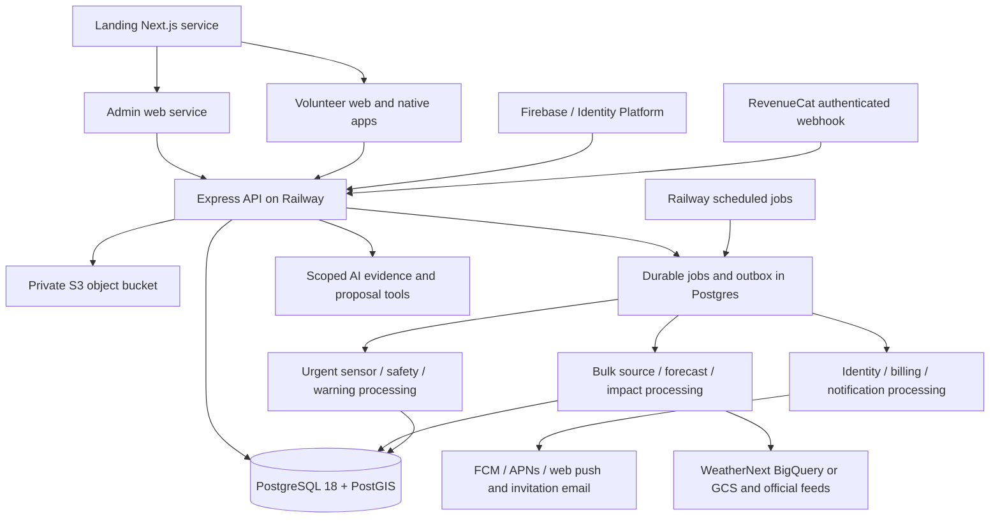

# ResQ production implementation roadmap — Railway

**Audit date: 1 October 2026. Status: implementation guide, not a production-readiness certificate.**

This is the controlling delivery roadmap for the four repositories `backend`, `volunteer`, `admin`, and `web`. It consolidates the existing disaster-engine specification, setup documents, client plans, and the owner's latest requirements into **exactly seven ordered stages**. Railway replaces the previous hosting targets. Prisma remains the application's database tooling; Prisma Console/Compute is not the deployment destination.

The outcome is an operational platform: independently registered volunteers, approved partner workspaces, consented recruitment, live mission workflows, paid Sentinel and agent capabilities, functional Android sensing/relay, authenticated administration, truthful public pricing, and an exercised production deployment. A build, a map demonstration, or deployment of today's code does not meet that outcome.

## How to execute this guide

1. Work through Stages 1–7 in order. Each numbered work package is implementation work, even where an earlier prototype exists. Keep a ticket for every package and its acceptance criteria.
2. A stage is complete only when its backend, relevant clients, migrations, manual configuration, and acceptance evidence are complete. Record commit IDs, environment, test/device versions, results, and unresolved exceptions. Do not promote a stage because its screens compile.
3. Create additive migrations under `migrations/app/` using the existing Prisma 8 migration owner; synchronize `prisma/schema.prisma` for Prisma 7 compatibility. Do not start a second migration history, run destructive demo seeds, or infer legacy ownership from email domains.
4. Keep demonstration and drill data separate from live data. Replace local repositories with live implementations deliberately; failed live calls must not silently fall back to believable sample missions or forecasts.
5. Read the [Railway production runbook](railway-production-deployment-runbook.md) alongside Stages 1 and 7. The [documentation audit](resq-documentation-audit.md) records source coverage and retired documents. The [Sentinel specification](volunteerops-sentinel-disaster-engine.md) remains the detailed scientific/behavioral reference, subject to the explicit decisions below.
6. Proposed endpoint/model/file names below are implementation targets, unless marked existing. Publish their final shapes in versioned OpenAPI and shared client fixtures before integrating them. Do not interpret a proposed command as an existing package script.
7. Request provider access, store accounts, signing credentials, institutional SSO metadata, and scientific review in Stage 1; these can proceed in parallel with development. No delivery-date promise substitutes for these dependencies.

## Decisions and scope precedence

| Topic | Decision governing implementation |
| --- | --- |
| Hosting | Railway project with isolated staging and production environments, backend API, workers, database, object storage, admin, volunteer web, and landing web. No new deployment to the retired providers. |
| Backend | Preserve modular Express/TypeScript and the current Prisma 8/Prisma 7 compatibility arrangement. A framework or ORM rewrite is not required. |
| Database | PostgreSQL 18 plus PostGIS, verified TLS, separate migration/runtime/maintenance identities, transaction-local tenant scope and RLS. Railway image/template choice must prove these capabilities; a database tile alone is insufficient. |
| Public membership | A volunteer can register and use a personal account without an organization invitation. Organization-private operations still require active membership. This supersedes old wording that made every unassigned account an unusable holding state. |
| Organization creation | Preserve owner-approved partner provisioning and institutional verification. Public signup or purchase cannot create an active coordinator workspace or grant administrator status. |
| Recruitment | Add a platform-wide volunteer discovery projection and revocable profile links. This supersedes the older blanket prohibition on a volunteer directory. Recommended default: volunteers explicitly choose discoverability and fields; coordinators see eligible discoverable profiles, not all private account records. |
| Joining | New-user invite, existing-user invite, approved join request, and profile/directory-initiated invitation all converge on one audited membership acceptance flow. Sharing a profile is permission to contact/invite, not permission to enroll someone silently. |
| Pro | Paid Sentinel exploration/advanced insights and agent functionality require backend-enforced entitlements. Payment, identity, membership, role, region, consent, and scientific readiness are independent checks. |
| Safety and payment | Proposed product rule: existing mission instructions, received authoritative warnings, SOS/safety responses, account recovery/deletion, and purchase management remain usable without Pro. Put advanced analysis/agent assistance behind Pro; do not stop an active emergency response when a renewal fails. Confirm this product boundary before publishing offers. |
| Weather authority | WeatherNext 3 hourly forecasts are the primary forecast dataset; official emergency authorities retain warning authority. Other sources corroborate or expose gaps, never silently masquerade as WeatherNext. |
| Automated actions | Approved policies may produce protective warnings, safety requests, and drafts. Actual mobilization/movement orders require an authorized human's current approval. An agent or subscription cannot override that boundary. |
| Platforms | Deliver operational workflows on Android, iOS, JVM desktop, JavaScript and Wasm as supported by the actual projects. Android sensing/Nearby comes first. Unsupported hardware features remain explicit, while operational screens still work. |
| Admin URL | Serve the requested `https://www.admin.resq-app.co.ke` from the admin Railway web service. `admin.resq-app.co.ke` may be a separately configured redirect alias; do not silently substitute it. |
| Prices | No price, trial duration, seat count, AI allowance, or annual discount has been approved. Define products/entitlements now; publish amounts from configured store/web offerings and an approved commercial catalogue. |
| Full scope | All seven stages are required for the requested full platform. Experimental models can remain explicitly shadow-only until scientific approval; claiming validated live disaster prediction is a separate release gate. |

## Audited starting point

These are code observations and previously recorded evidence, not tests rerun by this documentation task.

| Area | Existing implementation | Remaining production work |
| --- | --- | --- |
| Backend identity | Firebase ID/session verification, bootstrap, profile, logout/revocation, immutable identity mapping; legacy password routes retired. | Complete all client journeys, enterprise provider verification, recovery, deletion, durable invitation email and assurance parity. |
| Organizations | Platform provisioning/lifecycle, invitation acceptance/revocation, memberships, audit, transactional admission and RLS. | Independent volunteer UX, directory/profile sharing/join requests, full platform/admin screens, domain automation, imports and offboarding. |
| Core operations | Legacy modules for volunteers, skills, locations, missions, deployments, reports, communications, telemetry, notifications, feedback, analytics and administration. Ownership columns/RLS added. | Their global routes intentionally return `503 TENANT_MIGRATION_REQUIRED`. Implement scoped replacements and client repositories; do not remove the gate first. |
| Jobs | Durable PostgreSQL claims, retries, leases/fencing; identity/device/source/forecast workers and bounded retention. | Scheduling, complete outbox/delivery, privileged service identities, health supervision, urgent capacity isolation and production crash recovery. |
| Storage | Scoped metadata and signed S3-compatible upload/completion/download flow with checksums and conditional requests. | Railway bucket compatibility, malware quarantine, lifecycle/orphan reconciliation, privacy requests, archive/restore and client media UX. |
| Sentinel | WeatherNext 3 BigQuery adapter, bounded forecast revisions/assessments, USGS ingestion, region policies, insight endpoints and read-only Gemini evidence assistant. | Real dataset access, GCS/Zarr path, other hazards, impact/readiness models, automated orchestration, sensor fusion and operational decisions. |
| Maps | Backend `/sentinel/` Mapbox explorer with forecast controls; landing site has genuine Mapbox rendering. | App-native adapters, remaining map placeholders, all operational layers, safe links/offline behavior and responsive map/list parity. |
| Volunteer | KMP/Compose app; mobile RevenueCat abstraction, paywall/restore/customer management; Android Firebase adapter; web Sentinel bridge. | Operational repository remains local; backend identity bridge incomplete; web/JVM subscriptions unavailable; iOS identity and native Sentinel integration incomplete. |
| Admin | KMP/Compose app with extensive practice screens and web Sentinel bridge. | Operational repository remains local; Firebase/membership adapters unconfigured; no completed billing/entitlement UX or live command workflows. |
| Landing | Next.js site, public routes and real maps. | Approved pricing/features, live app destinations, deletion/support/legal journeys, truthful integrations and production delivery. |
| Local evidence | Prior checkpoint recorded 122 backend tests on PG18/PostGIS, migration/restore rehearsal, portal/client build checks and object-store exercises. | Repeat appropriate tests after changes. Those records do not prove configured Railway, payment, Firebase, WeatherNext, physical devices or scientific validity. |

Historical documents sometimes say local JWT is still active, clients are unchanged, only 72 tests exist, or PostgreSQL tools are unavailable. Those statements describe earlier snapshots. Conversely, a file named “implementation” or a successful blueprint validation is not evidence that its feature is deployed.

## Target system and trust boundaries

Clients never connect directly to PostgreSQL or receive database, RevenueCat server, cloud-provider, object-store or Firebase Admin secrets. Presigned object URLs are short-lived scoped capabilities. Public Mapbox/Firebase configuration is distinguished from secret credentials. `LISTEN/NOTIFY` and SSE wake clients; durable database rows and cursors recover missed events.

Keep urgent jobs independent of forecasts and raster processing. A logical queue is not a separate paid service requirement, but any consolidation must preserve fair scheduling, bounded pools, failure containment and measured latency. Use Railway always-on workers for the urgent path; do not enable sleeping/serverless behavior on that path. Shared source data can be ingested once, while private assessments, overlays, receipts and actions retain explicit ownership.

## Seven-stage overview

| Stage | Priority and outcome | Completion evidence |
| --- | --- | --- |
| 1 | Reliable Railway/database/security foundation and delivery contracts. | Isolated staging boots with verified PG18/PostGIS/TLS/RLS, restorable data, working storage contract and repeatable CI. |
| 2 | Independent identity, organization admission, recruitment and consent. | All five enrollment scenarios work across clients without privilege or data leakage. |
| 3 | Live core operations and complete base frontend integration. | Missions, rosters, communications, reports and personal workflows use scoped APIs, not demo repositories. |
| 4 | RevenueCat, backend Pro enforcement, paywalls and public offers. | Purchase/restore/refund/transfer/expiry tests pass and direct API bypass is denied. |
| 5 | Full multi-source Sentinel intelligence, forecast explorer and scoped agent. | Reproducible forecasts/evidence/impact workflows, model gates, provider budgets and cross-client insights. |
| 6 | Working sensing/relay, safety delivery and human-approved mobilization. | Physical-device trials, multi-hazard drills, urgent latency and assignment contention evidence. |
| 7 | Railway production rollout, all distribution targets and operational handover. | Live-domain tests, restore exercise, security/load/accessibility evidence and named activation approval. |

Original Sentinel step coverage: old Step 1 maps to new 1–3; old Step 2 to new 2; old Step 3 to new 5; old Step 4 to new 6; old Step 5 to new 3/6; old Step 6 to new 6; old Step 7 to new 3/5/6/7. Billing, personal discovery and landing-site work are additional scope, not replacements for old requirements.

## Stage 1 — Railway, data integrity and secure delivery foundations

**Entry:** preserve current working changes and existing production/source data. **Owners:** backend/platform, with client leads reviewing contracts. **Exit:** usable staging infrastructure and a reproducible delivery path; no public operational release yet.

### S1.01 — Establish configuration and release ownership

1. Inventory repositories, current branches/commits, lockfiles, actual runtime versions, application IDs, service URLs, local-only credentials and legacy data ownership. Keep credentials out of the evidence record.
2. Create a Railway workspace/project selection record and distinct staging/production environments. Choose region based on database latency, Google source location and partner residency requirements; Kenya location does not justify an invented Railway Kenya region.
3. Define the API origin (`api.resq-app.co.ke` proposed), volunteer origin (`app.resq-app.co.ke` proposed), requested admin hostname, landing apex/`www` redirect, asset links and environment-specific Firebase/RevenueCat apps. Configure exact origins, never wildcard credentialed CORS.
4. Produce secret-free `deploy/railway/` templates and service-specific configuration. Retire old provider deployment workflows/configuration after Railway replacements pass; keep Prisma ORM generation and migration tooling.
5. Start external requests: WeatherNext dataset approval; Google Cloud project/service account; Firebase/Identity Platform providers/MFA; RevenueCat and store accounts; domain/DNS access; transactional email; Mapbox tokens; model/data licensing; physical Android devices and macOS/iOS builds.

### S1.02 — Provision a database that meets the actual contract

1. Select and pin a PostgreSQL 18/PostGIS image/template; verify extension availability and supported image/volume layout. Explicitly configure the PG18 data directory and persistent mount. Railway deploys a database service; operations/backup responsibilities must be assigned, not presumed outsourced.
2. Configure server TLS with a trusted certificate matching the connection hostname, client CA trust and `sslmode=verify-full`. Private networking alone does not satisfy current TLS readiness. Test both production service and operator migration access paths.
3. Create migration owner, restricted API/worker runtime, and narrowly granted retention identities. Runtime cannot own tables, be superuser, inherit elevated roles or bypass RLS. Give specialized workers only the additional operations they actually require.
4. Restore a consistent source backup only into an isolated source rehearsal, preserving numeric IDs, relationships, sequence positions and audit history; migrate the separate canonical target first and import application data without old migration ledgers, following the migration companion. The recorded rehearsal retained 2,004 rows across 16 application tables; repeat against the latest source instead of treating that number as permanent.
5. Run the canonical migration chain and full schema verification. Reconcile duplicate active deployments before adding uniqueness, and explicitly classify/quarantine legacy rows with missing organization ownership.
6. Verify tenant context resets on pooled commit/rollback, composite foreign keys, immutable/audit permissions, PostGIS spatial operations and geometry indexes. Calculate total connections across API replicas, all workers, migrations and reserve headroom.
7. Configure scheduled database backups and independently test restore. A filesystem snapshot alone is not PostgreSQL point-in-time recovery; implement WAL archiving if committing to the proposed five-minute RPO.

### S1.03 — Make API and workers deployable on Railway

1. Review `Dockerfile`, `src/index.ts`, `src/app.ts`, `src/core/config.ts`, database config/readiness and worker entrypoints. Bind HTTP to `0.0.0.0` and Railway's supplied port; set distinct API and worker commands.
2. Add trusted-proxy configuration appropriate to the verified ingress path. Test spoofed forwarding headers and client-IP rate limiting; do not blindly trust every proxy.
3. Split liveness, database/schema readiness and feature readiness. Remove misleading unconditional “OPERATIONAL” claims from public discovery when subsystems are unavailable; avoid exposing sensitive internals in health output.
4. Handle SIGTERM: stop new claims, finish or safely abandon bounded work, close HTTP/DB listeners and let leases recover. Supervise worker freshness, oldest job, retries/dead letters and provider lag.
5. Provide a dedicated migration artifact/job containing Prisma 8 tooling and the migration tree. Run migrations once per release under the migration identity, never on every API replica's boot and never with its runtime credentials.
6. Retain fenced jobs and transactional outbox semantics. Add explicit job kinds, payload versions, deadlines, idempotency/business keys, fair organization quotas and backpressure; remote effects need their own idempotency/reconciliation.

### S1.04 — Validate object storage end to end

1. Provision separate production/staging Railway buckets and backend-only credentials. Verify actual S3 API behavior rather than assuming all S3-compatible providers are identical.
2. Exercise current `src/modules/scoped-storage/`: signed PUT, expected length/type, SHA-256, `If-None-Match`, completion HEAD/fallback hash, ETag/version, `If-Match` download, expiry, anonymous denial and two-organization authorization.
3. Test browser presigned upload/download from the exact admin and volunteer origins, including preflight/CORS and allowed headers. If native Railway bucket behavior cannot enforce required conditions, implement a bounded authenticated gateway or validated private S3 service; do not weaken integrity to pass.
4. Add pending/quarantined/clean/rejected/deleted metadata states, scan jobs, content sniffing, safe download headers, orphan reconciliation, quotas and lifecycle. Never serve unscanned report evidence as trusted active content.
5. Plan object and metadata recovery together: database rollback does not restore deleted files. Use separate backup credentials/storage and verified restore/version procedures. Keep raw weather rasters and model artifacts outside database row blobs.

### S1.05 — Publish contracts and shared client foundations

1. Generate OpenAPI from reviewed routes/schemas, explicitly listing implemented versus planned routes. Preserve actual existing prefixes under `/api/organizations/:orgId/...`.
2. Define error shape/codes, UTC timestamps, decimal/ID serialization, pagination, idempotency headers, expected versions, request IDs, upload states, async job status, replay cursors and retry semantics. Add required CORS headers deliberately.
3. Introduce a typed API transport in each KMP client and the Next site where needed. Native uses Firebase bearer credentials; browser uses the verified cookie/session flow or documented bearer adapter. No mobile refresh tokens in logs, URLs or shared preferences without platform secure storage.
4. Define repository interfaces with live, explicitly labelled practice and test implementations. The app's composition root chooses the environment; a network error never chooses practice mode.
5. Build CI checks for type safety, unit/API contracts, PG18/PostGIS integration, migration/schema parity, dependency audit and reproducible application builds. Provide a local disposable database setup so tests do not touch production.

### S1.06 — Establish observability and operational controls

1. Instrument request/job/provider/model IDs, durations and outcomes without tokens, raw audio or precise personal location in logs. Propagate traces across jobs and external provider calls.
2. Alert on expired leases, queue age, failing identity revocations, upload quarantine backlog, provider freshness, forecast spend, storage/DB growth, webhook delay and readiness failure.
3. Define staging drill isolation, secret rotation, on-call destinations, scoped feature kill switches and rollback ownership. Prepare audit export with independent access control.
4. Track commercial cost by service and by weather/AI/storage usage. Set budgets and per-organization/per-user quotas; no fixed monthly price promise before measuring.

**Stage 1 acceptance:** clean environment deploy; database restore/fingerprint parity; non-owner RLS isolation across HTTP/jobs/storage; verified TLS including negative certificate tests; storage browser contract; worker kill/restart with no lost committed jobs; migration artifact proven; no secret in a built frontend. Record unresolved Stage 1 database/storage/security configuration instead of marking Stage 1 complete. WeatherNext/model/store approvals requested here remain tracked dependencies for their later stage gates and do not prevent unrelated foundation work.

## Stage 2 — Public signup, organizations and volunteer recruitment

**Entry:** Stage 1 contracts/security. **Outcome:** one personal identity can use ResQ independently and join several approved workspaces without duplicate accounts.

### S2.01 — Finish identity across every supported target

1. Keep Firebase as identity provider and PostgreSQL as current authorization authority. Preserve immutable Firebase project/UID mappings and existing internal user IDs; never attach a privileged legacy record solely by matching email.
2. Implement email/password signup, verification, sign-in, recovery, logout, revoke-all and safe linking. Volunteer supports configured Google/Apple/Facebook/Microsoft identities. Admin entry follows approved corporate/institutional authentication and membership policy; social account creation never grants coordinator access. Implement only institution-approved providers and expose unsupported flows honestly.
3. Wire Android's existing Firebase adapter into the backend bootstrap/profile/session flow. Implement iOS, browser and desktop adapters or a verified system-browser handoff using state/PKCE, one-use exchange and recent-auth assurance. No tokens in callback URLs or invented long-lived app JWTs.
4. Complete session-cookie CSRF/origin protections, safe return URLs, expiry/disabled-user behavior and account-switch cache clearing. Test App Links/Universal Links/browser refresh and cold-start deep links. Publish Android `/.well-known/assetlinks.json` and iOS `/.well-known/apple-app-site-association` with real signing identities. Installation does not automatically preserve link state: resume from recipient-bound server invitations or a safe manual code, not a token leaked through store/referrer URLs.
5. Add personal settings, consent export/revocation, email/provider-change handling, account deletion request/status and self-service recovery. Distinguish deleting an account from leaving an organization or cancelling a store subscription.

### S2.02 — Model personal profiles separately from workspace records

1. Create a minimal platform `VolunteerProfile` linked to the internal user: chosen display name, biography, broad region, volunteered skills, availability preference and explicit discoverability settings. Sensitive contact/address/DOB/emergency-contact fields remain owner-only unless specifically shared.
2. Keep workspace credentials, qualification approvals, operational availability, mission history, private notes and performance in membership-scoped records. Verification badges must state who verified what and when; self-declared skills are distinct.
3. Preserve legacy volunteer IDs and mission links with a reviewed mapping table/migration. Do not create one duplicate Firebase account per workspace, or overwrite a global profile when one coordinator edits their roster.
4. Implement personal API projections so an unassigned volunteer has a real home/profile, invitation inbox and eligible public opportunities. Public/personal Sentinel later uses an explicitly public/licensed dataset projection, never a fake organization membership.
5. Reconcile availability and conflict checks across organizations using private shared responder locks; tell a coordinator “unavailable/conflict,” not another organization's mission details.

### S2.03 — Implement the five enrollment journeys

| Journey | Required sequence | Acceptance |
| --- | --- | --- |
| Independent signup | Firebase signup → verify → backend bootstrap → personal profile/consents → personal home. | No invitation required; no privileged role/workspace access granted. |
| New user invited | Open controlled invite URL → preview safe workspace identity → signup/login → verify recipient → explicitly accept → context switch. | Invite survives installation/sign-in safely; wrong recipient and expired/replayed tokens fail. |
| Existing user invited | Coordinator issues invite → in-app inbox/email → user accepts while signed in → membership appears. | Same user ID and purchases retained; other memberships unaffected. |
| Volunteer shares profile | User creates revocable profile link → coordinator views permitted fields → sends invitation → volunteer accepts. | Profile URL never exposes private contact/mission data or silently creates membership. |
| Directory recruitment / join request | Authorized coordinator filters discoverable volunteers and invites; volunteer may request an eligible workspace/mission, followed by scoped review. | Decline/block/revoke/rate-limit supported; no approval inferred from email domain or purchase. |

1. Extend existing invitation records/acceptance rather than create a separate weaker code path. Use hashed high-entropy secrets, recipient/organization/role/issuer binding, expiry, revocation, replay prevention and transactionally idempotent acceptance.
2. Add invitation list/detail/resend/decline and delivery status, join-request lifecycle, expired/removed-membership review and imports with preview/per-row results. Email delivery requires an outbox and actual sender integration, not simply returning a token.
3. Bind the intended verified identity/email before acceptance; handle Apple private relay and changed email with explicit identity proof, not implicit account merging. Switching to the correct account preserves the invite without exposing the secret to analytics.
4. Do not reactivate a removed member through an old invite. Recheck issuer authority, workspace status, scopes and recent assurance inside the accepting transaction.

### S2.04 — Build directory and profile-sharing controls

1. Add `DirectoryPreferences`, revocable `ProfileShare`, contact/invite throttles, block/report records and access audit. Use opaque public IDs/slugs distinct from sequential internal IDs.
2. Implement cursor-paginated, indexed discovery by volunteered skill, coarse region, verified qualification indicator and opt-in availability. No precise live GPS, private certifications, emergency contacts or cross-workspace mission history.
3. Provide safe unauthenticated profile previews only if the user explicitly permits them; require an approved coordinator context for recruitment actions. Robots/noindex, rate limits and anti-enumeration protect non-public profiles.
4. Directory visibility changes and link revocation invalidate caches immediately. Leaving a workspace does not remove the person's independent account. Allow users to reject/block repeated invitations.
5. Build coordinator directory/list/detail/filter/invite UI, volunteer discoverability preview/share/revoke UI, and a clear pending/accepted/declined invitation inbox.

### S2.05 — Complete enterprise admission and platform administration

1. Finish partnership intake → owner review → provision → activate → institution verification → nominated admin enrollment. Preserve separate organization lifecycle and verification readiness.
2. Add units/regions, exact-domain DNS proof with expiry/dispute handling, approved manual verification, and configured SAML/OIDC connections. Identity Platform credentials/issuer metadata stay server-side.
3. Enforce organization SSO/MFA/recent-auth policy on every privileged request and context switch. Linked social/password credentials cannot bypass an SSO-only policy; missing evidence triggers step-up.
4. Build platform overview, partner lifecycle, users/grants, scopes, audit, provider readiness, entitlements and time-bound support-access screens in the existing admin app. Protect last active owners/admins and record reasons for privileged interventions.
5. Complete suspension/offboarding handover, invitation cancellation, queued-work reauthorization, stream closure, shared-resource release and remote Firebase revocation retries. Organization admins remove memberships; only explicit global paths disable the shared identity.
6. Add bilateral, expiring incident/resource coordination grants and an identified lead organization. A shared domain or platform directory is not a cross-tenant data-sharing grant.

**Stage 2 acceptance:** run all five enrollment journeys on browser and supported native targets; A/B/unassigned/owner role matrix; invite race/replay/wrong-recipient tests; signup never grants coordinator; directory opt-out/revoked link tests; provider collision/recovery/deletion tests; SSO-only bypass rejection; suspended membership loses HTTP/worker/storage/stream access. Verify actual invitation email and signed deep links.

## Stage 3 — Live operational APIs and complete base applications

**Entry:** verified identity and memberships. **Outcome:** existing useful app features operate on shared durable data. This stage precedes advanced disaster automation and billing activation.

### S3.01 — Replace gated legacy operations with scoped services

1. Inventory every legacy controller/service and corresponding client action. Introduce `/api/organizations/:orgId/...` operational routes and `/api/me/...` personal routes with server-resolved membership/region context, strict inputs and field-level projection.
2. Rewrite global queries in users, volunteers, skills, locations, events, deployments, field reports, communications, telemetry, notifications, feedback, analytics and admin modules. Every detail/mutation/aggregation/export needs the same authorization as its list.
3. Keep `TENANT_MIGRATION_REQUIRED` until the replacement route family passes isolation tests and clients have moved. Remove or explicitly retire old routes afterward; no unscoped alias bypass.
4. Backfill only reviewed legacy ownership; enforce composite foreign keys. Separate public taxonomy/directory projections from private records. Add indexes from bounded query plans; prohibit arbitrary SQL/search operators from clients.
5. Add scoped contact-lead triage for platform support: public submission is not permission to list leads or grant access. Preserve spam mitigation, consent and retention.

### S3.02 — Make mission and assignment lifecycles transactional

1. Define mission/event draft, staged, active, paused, completed and cancelled transitions and permitted actors. Reconcile existing enum names in the API rather than letting clients invent equivalent statuses.
2. Add mission applications/interest, withdrawal, eligibility, capacity and waitlist required by volunteer screens. Implement personal saved-mission save/unsave/list with archived/withdrawn/revoked-membership behavior. Expression of interest is not an assignment or movement order.
3. Replace legacy `autoDispatch` with explicit locked allocation. Lock shared responder and capacity, enforce active assignment/reservation uniqueness, and commit deployment, roster state, inventory reservation, audit and outbox together.
4. Make check-in, arrival, handover, completion and cancellation idempotent with current authorization/expected version. Support reviewed manual/location-unavailable check-in; zero coordinates are valid.
5. Replace the current default eight-hour completion credit with recorded/approved service intervals, corrections and audit. Retried completion cannot increment hours twice. Validate timezones, end-before-start and overlaps.
6. Cancellation releases responders/resources and supersedes undelivered instructions atomically. Both clients explain stale-version/capacity conflicts and refresh before retry.

### S3.03 — Complete the non-Sentinel product inventory

| Domain | Backend implementation | Client completion |
| --- | --- | --- |
| Profile/settings | Personal preferences, emergency-contact privacy, consent, membership qualifications. | Profile, privacy, workspace selection, accessibility/language and deletion. |
| People/skills | Roster/dossier, taxonomy, credential evidence/review/expiry, imports/search. | Admin People/Skills/review; volunteer declared vs verified competency and remediation. |
| Locations/resources | PostGIS locations, shelters/facilities, inventory ledger, transfers and reservations. | Real map/list, editors, shortages and correction history; no negative stock. |
| Missions/deployments | Lifecycle, applications, schedules, approval, check-in/out and hours. | Volunteer opportunity feed/calendar/briefing; admin Mission Control and roster. |
| Reports/incidents | Offline drafts, triage, incident linkage, clean media and audit. | Composer/location/attachments/retry/history; admin triage/review. |
| Communications | Channels/messages/threads, unread cursors, recipient preview, moderation and deliveries. | Real inbox/chat/broadcasts, reply/read and failed/expired states. |
| Notifications | App/environment-bound registration, preferences, inbox and recipient states. | List/detail/deep links, read/acknowledge, OS permissions and fallback inbox. |
| Training/achievements | Courses/enrollment/progress, reviewed completion/certification, badge/hour rules. | Replace mock lessons/badges/certificates; admin qualification verification. |
| Analytics/feedback | Scoped hour/capacity/mission metrics, after-action review and audited exports. | Actual charts/filter/date ranges/downloads; no random live trends. |
| Support/help | Role guidance, contact intake and promised case-status functionality. | Working help/contact/error recovery, distinct from emergency dispatch. |
| Search | Authorized text/trigram search first; optional semantic matching with licensed versioned embeddings. | Filtered search/explanations; semantic scores cannot bypass qualifications. |

Training and achievements are requirements from the volunteer app inventory even though the older backend schema lacks them. Implement prerequisites, enrollment capacity, ordered lesson/check progression, assessed completion and correction rules; a client boolean is not certification.

### S3.04 — Replace local repositories across the apps

1. In both `App.kt` composition roots, select live repositories only after identity/bootstrap/context succeeds. Implement transport, DTO/domain mapping and repository tests across common/platform sources.
2. Preserve Oswald/Overlock typography, navy/ResQ accents, navigation and artwork. Adapt existing screens; the backend portal is not a replacement for either app.
3. Implement durable cache/outbox per user/environment/organization. Encrypt sensitive native storage, clear appropriate caches on logout/switch and prevent cross-account access. Sync only operations designed for offline use.
4. Define partial acknowledgements, backoff, deduplication, conflicts, revoked scope and draft ownership. Never queue offline deployment approval as a future authorized action.
5. Provide loading/empty/error/offline/stale/denied/unconfigured/unsupported/conflict states. Show refresh time and pending changes; locally queued is not sent/approved. Bind existing admin Security pause/policy/session/device controls to scoped audited server enforcement; local practice toggles cannot remain the production control mechanism.
6. Deliver actual iOS/JVM/native/web operations where promised. Opening `/sentinel/` in a native browser is interim integration, not native identity/map/repository completion.

### S3.05 — Add durable real-time updates and notifications

1. Persist scoped stream events and opaque cursors; SSE supports snapshot/replay, heartbeat, bounded buffers and gap/resnapshot. `LISTEN/NOTIFY` is a wake-up signal, not the record of truth.
2. Authenticate streams and reauthorize on expiry, revocation, context change and replay. Retire the old unauthenticated telemetry stream during scoped cutover. A cursor is not authorization.
3. Implement FCM outbox, invalid-token cleanup, retry/backoff/quotas, revision/collapse keys, deadlines and recipient deduplication. Configure APNs/web push for actual supported targets.
4. Distinguish queued, provider-accepted, device-received, human-acknowledged/responded, superseded and expired. Durable inbox recovers missing pushes.
5. Bind registrations to app/environment/user/device/consent. Token rotation/logout/account-switch removes the prior recipient association.

### S3.06 — Complete Mapbox and frontend hosting integration

1. Inventory every map placeholder. Reuse landing ResQ styles with Android/iOS SDK and web GL JS adapters appropriate to KMP. Admin/volunteer are not Next.js apps.
2. Render bounded scoped GeoJSON/aggregates with selection, legends, filters, viewport loading/clustering, freshness and list equivalents. Separate basemap from private overlays.
3. Preserve attribution, URL-scoped public tokens, GPU/error fallback and init/disposal/resize. No private source data in Mapbox Studio or map URLs.
4. Build Compose JavaScript with pinned JDK/Gradle/Node and serve via a Railway HTTP service (verified Railpack static support or pinned static-server container). Test deep links, Wasm/font MIME, real asset 404s, no-cache HTML and immutable hashed assets.
5. Landing access/signup/account pages open real app URLs with safe intent preservation. Keep practice previews isolated/labelled; package reproducibly from pinned sibling commits. The existing admin demo Sentinel iframe/link must use isolated fixtures or an explicit full-page production handoff; no production token/session/operation inside the marketing demo.
6. Fix public API examples and old-provider source/build defaults, then rebuild embedded bundles; updating runtime variables alone cannot replace compiled URLs.

**Stage 3 acceptance:** real coordinator invites volunteer, publishes mission, receives application, approves assignment, sees check-in/report/message and corrected hours in both apps. Retries do not duplicate effects; concurrent coordinators cannot double-book or overspend inventory. Production screens use live repositories; practice mode is isolated. No global route/stream exposes private data.

## Stage 4 — RevenueCat, Pro authorization, paywalls and offers

**Entry:** stable identity and scoped APIs. **Outcome:** purchases confer defined backend-enforced capabilities. Existing volunteer mobile RevenueCat work is a starting point, not a backend billing system.

Catalogue dependency rule: organization-sponsored subscription/seat tables, checkout, marketing and acceptance cases in this guide are conditional on owner selection of that model. The core entitlement system must support scoped administrative/contract grants regardless. Record a declined commercial extension explicitly; it is not a missing implementation of approved individual Pro.

### S4.01 — Define catalogue and permission rules

1. Create a versioned feature catalogue shared by API contracts and marketing. Proposed families: Free and individual ResQ Pro monthly/annual; organization-sponsored Pro/seats are a proposed extension conditional on an approved commercial model. Keep contract/grant scope extensible, but do not make unapproved seat commerce a blocker for individual Pro. Prices, trial rules, seat limits, AI credits and availability remain owner inputs. Reconcile existing lifetime offering deliberately; an existing UI option does not approve its commercial terms.
2. Preserve existing `resq_pro` and package identifiers `$rc_monthly`, `$rc_annual`, `$rc_lifetime`; these are durations, not three feature tiers. Map the entitlement to granular backend capabilities such as `sentinel.explore`, `sentinel.advanced_insights`, `agent.chat`, `agent.proposals`, `analytics.export` and quota buckets. Adding a product does not enable every capability.
3. Define individual vs workspace sponsorship. Individual Pro unlocks personal/public insights and allowed features in existing memberships; organization seats apply within their organization unless catalogue explicitly includes personal access.
4. Implement seat allocation/revocation, invite reservations, over-capacity rules, billing-admin roles and contractual grants. Membership alone does not invent a paid seat. Workspace suspension overrides private paid access.
5. One authorization function combines active identity, membership where needed, capability/region, entitlement, consent and provider/model readiness. Apply at request, job enqueue/execution, export, stream subscribe/replay and agent tools.
6. Preserve essential safety/account/purchase-management paths under the proposed product policy. Revalidate pending premium jobs after expiry; do not abandon assistance cases or retract protective instructions.

### S4.02 — Add durable backend billing and reconciliation

1. Add `BillingCustomer`, `ProductMapping`, `SubscriptionSnapshot`, `EntitlementGrant`, `OrganizationSubscription`, `SeatAssignment`, `UsageLedger`, `BillingWebhookInbox` and `BillingAudit`: unique provider/environment IDs, timestamps/version and grant provenance.
2. Preserve the existing raw Firebase UID App User ID in the same RevenueCat project across platforms; never use email/device/organization ID. Isolate test/production through reviewed project/app configuration. A future UID prefix change requires an explicit purchase/alias migration across every client and backend, not a unilateral namespace change. Preserve mappings across email changes and workspaces.
3. Add authenticated entitlement/customer-status/refresh endpoints. Backend queries RevenueCat using server credentials; client `CustomerInfo`, receipts, product IDs or `isPro=true` cannot self-grant access.
4. Authenticate webhooks using configured Authorization secret and optional supported HMAC signing. For `X-RevenueCat-Webhook-Signature: t=<unix>,v1=<hex>`, verify HMAC-SHA256 over timestamp + "." + exact raw JSON bytes before JSON parsing, using constant-time comparison and bounded delivery timestamp skew. Retries are re-signed; do not use event_timestamp_ms for delivery freshness. Account for current signing-secret rotation invalidating the old key immediately. Verify webhook availability on the actual RevenueCat plan.
5. Persist unique inbox event before acknowledgement and enqueue reconciliation transactionally. Handle duplicate/reordered events, transfers/aliases, cancellation, grace/billing retry, refunds, revocation, expiry, extensions and sandbox/production separation. Reconcile authoritative state rather than last-arriving event; serialize/fence customer refreshes and reconcile both identities on transfers. Return HTTP 200 only after durable inbox/outbox commit. Cancellation or a billing issue does not itself revoke a still-active entitlement/grace period. Lifetime access has nullable expiry but remains revocable/refundable; willRenew and activeSubscriptions are not authorization checks.
6. Add periodic reconciliation because provider retries are finite. Apply payload retention/privacy rules; expose lag/dead-letter diagnostics and bounded operator replay.
7. Reserve AI/forecast usage atomically under concurrent requests with idempotent finalize/release and cost attribution. Device or organization switching cannot reset personal quotas.
8. Define outage policy: bounded last-verified cache where acceptable, no indefinite invented grants, clear temporary-unavailable state. Essential safety remains independent.

### S4.03 — Complete purchases and paywalls on each platform

1. Preserve volunteer mobile purchase/restore/customer-management abstraction; verify installed KMP SDK target APIs. Common compilation does not establish web/JVM support. Configure platform public keys in the same RevenueCat project, actual store products/base plans/subscription groups, current offering/paywall, server notifications and Customer Center; release builds reject test_ keys.
2. After Firebase sign-in, await RevenueCat login and backend reconciliation before entitlement-dependent navigation. Clear prior-account state on logout/switch. Test selected anonymous-purchase/transfer policy.
3. Implement browser purchase using current RevenueCat Web SDK/Billing and an eligible supported payment provider. Complete return/verification/cancel/manage; do not assume Kenyan merchant eligibility or automatic native/web product equivalence.
4. Add admin billing/seat UI. Desktop without supported purchase SDK uses secure authenticated browser checkout and refreshes backend entitlements; no fake success or embedded secret key.
5. Build comparison/paywall, eligible/ineligible trial, pending/cancelled/successful purchase, restore empty/success, grace/retry, expired/refunded, manage/cancel and sponsored states. Price/currency/period come from actual offering.
6. Gate navigation/deep links, portal and API, not just the app tab. Entitlement denial returns structured capability error and appropriate upgrade destination; permission failures do not disclose private workspace existence.
7. Supply restore/manage/support and transfer diagnostics. Account deletion is distinct from Apple/Google subscription cancellation; explain both and run the appropriate data-removal workflow.

### S4.04 — Publish consistent tier information

1. Add `/pricing` to landing routes/navigation/footer/sitemap and app CTAs, with shared-catalogue comparison, availability/limits, currency/period, renewal/trial terms, support and legal links.
2. Add Settings → Plan and contextual upgrades; sponsored users should not be asked to repurchase the same scoped benefit.
3. Reconcile `/features`, `/disaster-engine`, `/commercial`, `/admins`, `/volunteer` and customer/partner pages. Paid analysis is not guaranteed disaster prediction or coordinator authority.
4. Replace entity/contact/jurisdiction text using owner-approved facts; review privacy/terms/cancellation/refunds and RevenueCat/payment/AI/location/sensing disclosures. Publish working account-deletion web entry.
5. Analytics must not capture invitation secrets, payment credentials or sensitive observations. Verify paywall accessibility, readable terms and honest purchase states.

**Stage 4 acceptance:** purchase/restore/reinstall/cross-device/account-switch; duplicate/reordered/missing webhook; refund/transfer/grace/expiry; spoofed client-state and direct API bypass rejection; sponsored-seat scope and quota concurrency; essential safety after expiry. Store approval, merchant eligibility and final prices are manual dependencies, not assumed outcomes.

## Stage 5 — Complete Sentinel intelligence, forecast maps and the agent

**Entry:** scoped operational model and tested premium authorization. **Outcome:** a reproducible, multi-source disaster intelligence system whose outputs expose evidence, uncertainty, coverage and permitted actions. Google access can remain pending during adapter tests; live acceptance cannot.

### S5.01 — Establish canonical evidence and source orchestration

1. Create canonical hazards, immutable source revisions, observations, evidence links, reversible clusters, region coverage, model/policy revisions, impact zones and readiness assessments. Preserve source issue/valid/received times, original identifiers, units, licence and provenance.
2. Separate globally shareable authoritative facts from organization-owned device/manual evidence and private overlays. Store sensitive raw data only when necessary/licensed; permissions follow through derived data, exports and assistant context.
3. Implement provider registry with source authentication, geographic coverage, update cadence, checkpoints, pagination, revision/cancellation handling, cache/retention policy, health, budgets and replay fixtures.
4. Handle schema drift, timeouts, rate limits, malformed/oversized payloads, unsafe XML/entities, source outages and stale/contradictory evidence. Allowlist endpoints and reject SSRF/untrusted redirects in URL/file ingestion.
5. Schedule source pulls reliably. Existing USGS minute-driven behavior must not be replaced with a slower cron while claiming identical freshness. Separate region assessment schedules from shared global ingestion; use service authorization rather than a perpetually replayed expired human session.
6. Add authorized manual bulletin submit/review/publish/supersede/cancel with original source document, geography and validity. A second reviewer is required before manual entry can trigger outward automatic warnings.

### S5.02 — Finish WeatherNext 3 BigQuery and GCS/Zarr paths

1. Obtain the actual Google Cloud project ID, linked/approved dataset or bucket, region and authorized runtime identity. An owner email is not a project ID. Enable required APIs, budget alerts and least-privilege job/data permissions. Keep Google credentials solely in runtime secrets.
2. Validate actual WeatherNext 3 hourly schema against provider documentation: initialization cycle, valid time, lead time, grid coordinates, ensemble/statistic, variable names, units, vertical references, missing values and attribution/licensing. Do not label WeatherNext 2 VMG as WeatherNext 3.
3. Retain bounded BigQuery area/time/row limits and query cost ceilings. Use deterministic query/job keys; persist provider job IDs immediately, resume/poll/checkpoint and page/tile results. Cancellation, timeout and lost workers must not repeatedly submit identical paid queries.
4. Implement GCS Zarr v3 adapter as an alternative approved ingestion path: read metadata, select variables/cycles/region/time, fetch bounded chunks, decode supported codecs, handle missing chunks/array shape, and checkpoint. Use a dedicated batch worker if memory/CPU exceeds Node's budget; do not load global ensemble arrays into the API process.
5. Normalize both adapters into the same versioned forecast contract and test equivalence on licensed fixtures: UTC hours, cells, missing values, units and ensemble/percentile meaning. Deduplicate a forecast consumed from both channels; they are not independent evidence votes.
6. Persist compact regional forecast revisions/derived indices in PostgreSQL, larger licensed artifacts in object storage, and provider lineage throughout. Validate retention rules before storing or redistributing raw Google data.
7. Add automatic region refresh jobs, current/latest revision selection, freshness TTL, cancellation/supersession and bounded backfill. On WeatherNext outage, expose unavailable/stale or explicitly labelled fallback; never silently promote another source as authoritative WeatherNext.
8. Run a real authorized query/chunk download with measured cost and lineage after approval, then prove a new model cycle supersedes old maps/insights without corrupting historical revisions.

### S5.03 — Implement every hazard and readiness source

| Hazard/context | Required sources and processing | Required interpretation |
| --- | --- | --- |
| Earthquake | Extend USGS; GDACS/authorized national feeds, revision/cancellation and station/device corroboration. | Awareness feeds are not guaranteed advance warning; phone candidates remain distinct from authority confirmation. |
| Flood | GloFAS basin forecasts, river/local gauges, CAP/national warnings, WeatherNext rainfall and permitted contextual weather. | Calibrated basin thresholds, antecedent conditions and exposure; no universal rainfall-to-inundation formula. |
| Wildfire | FIRMS hotspot clustering, official/local corroboration, fire-weather context, terrain and exposure. | Hotspot is not confirmed fire perimeter; wind/weather risk is not ignition proof. |
| Storm/cyclone | CAP/GDACS/national warnings, tracks/corridors, wind/rain ensembles and pressure context. | Preserve forecast spread; phone barometer is supplementary. |
| Landslide | Official warnings, rainfall/soil/slope/susceptibility and validated regional model. | Missing data or unvalidated model returns unavailable; phone motion/acoustic evidence cannot certify it. |
| Tsunami | Trusted official warning/clearance and coastal evacuation-support zones. | No tsunami warning/all-clear from earthquake or phone cluster alone. |
| Google Weather API | Optional current/hourly/daily/history point context under applicable terms. | Separate from WeatherNext; validate permitted derived use, storage and combination with Mapbox. |
| Community/IoT | Authenticated device/gauge readings and geotagged human observations, approved media and quality flags. | Distinct origins, consent/provenance, verification and reversible deduplication. |
| Seasonal preparedness | KMD/ICPAC/WRA and region-specific authorities, including reviewed manual bulletins where no API exists. | Outlook/campaign valid periods are not local disaster countdowns. |
| Connectivity | Consent-aware eligible heartbeat baseline, outage/low participation/background-app checks. | Report possible connectivity degradation with uncertainty, never infer a disaster from missing pings alone. |

For each source: request access/licence, implement adapter and fixtures, negative/schema/expiry tests, durable schedule/checkpoint, live smoke proof, health dashboard and operational owner. Do not invent a national agency's public API. Expired seasonal bulletins must not become permanent configuration.

### S5.04 — Build spatial impact, models and preparedness campaigns

1. Implement PostGIS/GiST geometry validation, SRID 4326 exchange, geography/projected distances in metres, dateline handling, boundary/zero-coordinate tests and spatial-temporal indexes.
2. Ingest licensed population, settlement, facility, road/access, shelter, basin, terrain/slope, soil/susceptibility and resource datasets. Record update time, coverage, uncertainty and licence; missing exposure is not zero exposure.
3. Generate revisioned critical/major/watch zones and exposure estimates with explainable inputs. Keep sensor density, observed intensity, predicted hazard footprint and confirmed damage as different layers.
4. Implement region-calibrated hazard indicators and confidence/probability semantics. Current heuristic thresholds remain unvalidated evidence scores; forecast precipitation probability is not disaster probability. Correlated weather sources are not independent votes; weather cannot raise seismic confidence.
5. Maintain model registry: version/artifact hash/licence, features/units, calibration region/devices, training/evaluation provenance, uncertainty/rejection rules, expert approval and rollback. Separate `DISABLED`, `PILOT/SHADOW`, `VALIDATED_LIVE` and `DRILL`.
6. Evaluate recorded events and non-events using time/geography-separated data and proper forecast vintages; compare with/without weather and simple baselines, measure false alarms/misses/calibration/lead time. Synthetic tests prove software behavior, not scientific validity.
7. Add preparedness campaigns, county/basin milestones, source validity, responsible owners, evidence and revision/cancellation. Start Kenya configuration with licensed geography and reviewed English/Kiswahili guidance; support other regions/languages/timezones without copying Kenyan thresholds worldwide.
8. Compute readiness from verified skills, willingness, equipment, shelter/access, assistance burden and data completeness. Show missing inventory and uncertainty, and propose staging actions without issuing movement orders.

### S5.05 — Complete the forecast/radar experience

1. Extend admin Sentinel/Radar with region/search, hazard/source/layer toggles, initialization-cycle and valid-time controls, variable/unit selection, ensemble/statistic/percentile, animation controls, legends, provenance and freshness. Label confidence and model-validation status visibly.
2. Display forecast fields using tiled/bounded data delivery suitable for resolution/size, not an unbounded browser GeoJSON dump. Add viewport/time pagination, cache keys including entitlement/scope, cancellation and accessible tabular summaries.
3. Add official hazards, impact zones, aggregate coverage, approved team/resource overlays, assistance and staging. Precise volunteer positions require explicit role/consent; aggregate small cohorts to protect privacy.
4. Provide volunteer-relevant summaries for followed regions, hazards affecting assigned missions, preparation/safety guidance and source updates. Unassigned Pro users use public/personal projections only; no private institution data in their subscription.
5. Implement source/evidence/hazard detail with timelines, contradictions, superseded assessments and authorized next actions. Retain last-known timestamp on outage, suppress expired instructions/countdowns, and allow a non-map path for every essential task.
6. Integrate these as navigable app screens with shared identity/context and premium checks. Secure the separately accessible backend portal equally so an iframe URL is not a paywall bypass.

### S5.06 — Finish the evidence-grounded agent

1. Extend the existing read-only Gemini adapter behind a provider interface; configure actual model/project/key, budgets, timeouts and regional/privacy policy. The interface can evolve without exposing provider credentials to apps.
2. Build scoped retrieval/tools for current hazards, source revisions, forecasts, permitted reports, readiness and mission context. Record source IDs/versions/timestamps in responses and expose an explicit insufficient-evidence answer.
3. Treat user text, provider documents, uploaded media and retrieved passages as untrusted input. Tool arguments are strict allowlists; no arbitrary SQL, URLs, filesystem operations or cross-tenant search. Instructions inside evidence cannot grant authority.
4. Persist conversation ownership, retention/deletion, citations, usage and audit; stream with expiry/revocation handling, cancellation and quotas. User/organization switching cannot reuse another context's chat history.
5. Add admin chat with suggested questions, evidence links, uncertainty and follow-up; add only relevant volunteer assistance within their scope. Do not turn the volunteer app into a command console.
6. Implement proposal tools as durable drafts with explicit preview, rationale, changes, recipients, expiry and expected versions. The Stage 6 approval service is the only route to operational execution; recheck user permissions and entitlements there. Agent service credentials cannot approve their own proposal.
7. Evaluate groundedness/citation accuracy, refusal of unsupported conclusions, prompt-injection/cross-tenant attempts, latency/cost, outdated sources and repeat requests. Agent unavailability must not block normal mission/safety workflows.

**Stage 5 acceptance:** each hazard adapter has replay/negative/live evidence; BigQuery and GCS adapters pass shared contract tests (live access where configured); forecast cycles/revisions/cost limits are correct; geometry/exposure tests pass; stale/cancelled warnings disappear appropriately; A/B/personal-Pro map/agent isolation holds; premium bypass is denied; no unvalidated probability/countdown is marketed as operational truth. Scientific live promotion requires separately signed evidence.

## Stage 6 — Sensing, relays, safety and approved mobilization

**Entry:** live scoped operations, evidence models and durable delivery. **Outcome:** the full sensing/response vision is implemented, including real devices and user-facing workflows. This stage cannot be satisfied by additional design documents.

### S6.01 — Implement Android acquisition and capability-aware clients

1. Add common contracts plus Android `SensorManager` adapters for accelerometer, optional gyro/gravity and barometer. Enumerate actual sensor availability/rates and show unsupported states on other targets.
2. Provide separate explicit opt-in for motion, pressure, microphone, location and relay; visible start/pause/stop sessions, revocation and battery/thermal limits. Relay-only participation is valid.
3. Process motion locally into bounded feature windows with monotonic timing/wall-clock uncertainty, stationarity, orientation/gravity/handling separation, clipping/calibration and sampling quality. No continuous raw waveform upload.
4. Handle Android background/foreground-service permissions and OS lifecycle using supported APIs; device reboot, permission loss, low battery and app suspension must stop or degrade honestly. Publish required disclosures and foreground-service justifications.
5. Implement optional licensed on-device acoustic inference with pinned artifact/hash/labels and representative tests. Discard raw audio promptly; upload only consented feature/classification summaries. A generic sound classifier is not a validated landslide model.
6. Account for pressure bias/elevation/indoor context. Add device-placement/activity-aware fall/immobility candidates with cancellable local prompt; a phone drop is not proof of injury.
7. Implement encrypted local outbox, bounded queue/TTL, backoff, per-item receipts and account/consent isolation. Revocation stops capture/deletes eligible pending data; already relayed opaque packets are bounded by expiry and backend checks.

### S6.02 — Implement secure sensor ingress and fusion

1. Version feature schemas: observation/expiry, origin device credential, message ID, clock/location accuracy, coarse cell, quality flags, feature/model version and allowlisted numeric values/units. Authenticate cryptographic origin, not a JSON identity field.
2. Validate consent/version, device trust/revocation, signature, size/rate and deadlines. Commit before per-item accepted/duplicate/rejected response. Preserve global origin/message dedup across transports and partitioned history.
3. Partition high-volume history by time with appropriate BRIN/spatial indexes, independent globally unique receipt keys and retention/archive jobs. Protect precise location and enforce tenant/consent policy through aggregates.
4. Implement a dedicated urgent correlation path using distinct eligible devices, overlapping spatial/time windows, quality/timing uncertainty and independent official evidence. Leases/version checks prevent duplicate candidates; repeated relays are not independent sensors.
5. Build executable source/arrival estimator with confidence intervals, fit/coverage rejection and approved model versions. Return absolute lower/upper arrival times only when validated with positive remaining lead; suppress unknown/expired/negative lead.
6. Evaluate phone drops, vehicles, construction, clock/GPS errors, compromised devices, sparse coverage, delayed evidence and bursts. Evidence may lower confidence; never confirm an earthquake solely from a configurable radius/count.

### S6.03 — Implement Nearby multi-hop relays

1. Use Android Nearby Connections as peer transport, not as proof of trusted identity or a built-in internet mesh. Provide enrollment/session controls, discovery/connect limits and explicit Google Play services requirements.
2. Define canonical envelope encoding, signature/key IDs, key rotation and trust expiry before implementation. Protect device private keys using Android Keystore; provision trust online or through an approved local enrollment process before outages.
3. Encrypt evidence/safety payload to the backend so relays see only minimal routing metadata. Include protocol/message/origin, payload hash/signature, observed/expiry, recipient class and bounded hop budget. No large photos/raw audio on urgent relay path.
4. Implement persistent store-and-forward A→B→C, deduplication, loop prevention, queue size/TTL, bandwidth/battery limits, retries and gateway handoff. Nearby discovery IDs and relay count are not independent evidence identities.
5. Track local queued, peer custody and signed backend receipt as distinct states. A peer ACK does not mean backend acceptance, hazard confirmation or help dispatched. Verify backend receipt before pruning according to policy.
6. Permit only reviewed server-signed warning envelopes for downstream warning relay; validate origin, expiry, supersession and recipient scope. Never allow arbitrary peer messages to trigger trusted warnings.
7. Test physical multi-hop/no-gateway/reconnect/tamper/replay/expired/revoked-origin cases, clock drift, crowded radios and interrupted app processes. No promise of connectivity when no connected peer path exists.

### S6.04 — Deliver safety and warning workflows completely

1. Implement Take Action vs Be Aware policy outputs with approved local guidance, audience, validity, source/model/policy revision and cancellation/supersession. No automatic all-clear based on elapsed time or SAFE response.
2. Build volunteer full-screen in-app alert, hazard detail, manual SOS, SAFE/NEED ASSISTANCE/CAN RESPOND, safety-check deadline and cancel/confirm prompt. Respect OS controls; no promised DND bypass or guaranteed push arrival.
3. Implement deduplicated assistance cases, severity/status, acknowledgement, coordinator assignment, escalation timers and resolution/handover with human ownership. An assistance request is not proof that a responder was dispatched.
4. Show urgent safety banner independent of premium upsells, with offline queued/expired status and phone/radio fallback. Never sell premium access in place of an actionable emergency response.
5. Add admin assistance queue, responder safety detail, consented locations, warning review/delivery timeline and permitted retries/supersession. Operator suspension/offboarding includes active-case handover.
6. Register app-specific push channels, sound/importance preferences and supported full-screen notification behavior only where platform/distribution rules allow. Recheck on actual release-signed devices.
7. Build coverage/connectivity views from eligible heartbeat baselines; display backend outage/sparse samples instead of fabricating disaster extent.

### S6.05 — Complete readiness-driven mobilization

1. Derive role/equipment demand and shortages from versioned impacts/playbooks and current capacity. Explain each suggested responder/resource and exclusion; scores are advisory.
2. Enforce credentials/expiry, willingness, availability, accessibility constraints, overlapping hazards, access/road restrictions and explicit cross-organization sharing. Geographic proximity is not safe access.
3. Create expiring responder/resource reservations with shared-identity locks across organizations. Recompute proposals on source/policy/resource change; distinguish willing, reserved, assigned, en route, checked in and released.
4. Human approval endpoint requires current scoped capability, recent assurance, expected proposal version and idempotency. Revalidate hazard, route exclusion, credentials, seat/capability policy and capacity inside the transaction; commit deployment/audit/outbox atomically.
5. Implement reject/edit/recompute/approve, conflict resolution, cancellation, escalation and handover screens. Staging is a draft/readiness action until actual deployment approval; no AI-only dispatch or silent movement instructions.
6. Record notification deliveries, field reports, outcomes, false alarms, assistance resolution and after-action review. Model/playbook revisions follow reviewed learning workflow, not automatic retraining on sensitive data.

### S6.06 — Complete every safety/command screen and performance gate

1. Volunteer: hazard/arrival detail, action timeline, mission/staging briefing, safety responses, field-report queue, sensor participation/capabilities, privacy controls, relay custody/queue and offline downloads.
2. Admin: live radar and evidence dossier, impact/exposure detail, candidate/model gates, assistance/safety, shortages/resource allocation, proposal review, deployment map, delivery evidence, campaigns, source/worker health and immutable audit.
3. Native offline maps use supported SDK packs with region/zoom/storage limits, Wi-Fi/battery preference, progress/cancel and eviction. Browser/desktop show actual capabilities; never scrape or relay Mapbox tile packs.
4. Measure the proposed envelope: 10,000 registered volunteers; 1,000 concurrent clients; 1,000-device burst over five seconds; 10,000-recipient warning. Target P95 accepted observation→candidate ≤1 second, eligible warning→first gateway attempt ≤2 seconds. These exclude sensor/network/provider/device latency and remain targets until measured.
5. Prove fair isolation: heavy forecast/raster/backfill/old relays cannot starve fresh safety jobs, and one tenant cannot monopolize the queue. Validate lease expiry, crash/restart, source cancellation and replay without duplicate outward action.

**Stage 6 acceptance:** recorded-event/non-event evaluation; physical Android capture and A→B→C relay evidence; push/deep-link/consent/revocation tests; end-to-end heavy-rain and seismic-shadow drills; atomic competing approvals; expired evidence suppression; measured latency/fairness. Expert-approved region/model/device configurations alone may enter validated live mode. Store permission acceptance, hardware limitations and scientific uncertainty remain explicit.

## Stage 7 — Production deployment, distribution and handover

**Entry:** all preceding implementation and acceptance gates, provider configuration and approved commercial catalogue. **Outcome:** deployed, monitored, recoverable services and truthful public/native distribution, with a named operational owner.

### S7.01 — Close cross-platform and security verification

1. Run backend unit/HTTP/integration tests on real disposable PG18/PostGIS, schema/migration parity, non-owner RLS, upload/scan, billing, provider, agent and concurrency suites. Verify container Linux behavior, not only Windows compilation.
2. Build all supported KMP targets from pinned toolchains; run common/JVM tests, browser JS/Wasm smoke tests, Android release builds and macOS/iOS device builds. Record unsupported targets honestly and implement missing operational adapters before claiming platform completion.
3. Exercise responsive widths 360/390, 600/768 and 1067/1440 CSS-pixel/dp equivalents, boundaries, resizing/rotation, keyboard/insets and 130%/200% text. Preserve camera/filter/draft/selection and browser/native back behavior.
4. Verify keyboard/focus/semantics, contrast, text+icon severity, 48dp targets, reduced motion, screen readers, map/list equivalence and purchase/recovery errors. Streaming updates cannot steal focus or continuously announce countdown ticks.
5. Run dependency/reachability and secret scans, SBOM/image checks, abuse/rate-limit, file content/SSRF, prompt injection, cross-tenant export/cache/stream and backup privilege review. Reassess prior development-tooling advisories; no force downgrade without compatibility review.
6. Test real Firebase providers/MFA/action links, RevenueCat transactions/webhooks, authorized WeatherNext queries, Mapbox tokens/maps/offline packs, FCM/APNs/web push and invitation email. Mocks do not close those gates.

### S7.02 — Rehearse migration, recovery and Railway operations

1. Deploy immutable staging artifacts for API, workers, migrator, admin, volunteer and landing. Validate runtime vs build-time variables and source commits; no sibling source tree is assumed in isolated Railway builds.
2. Rehearse clean provisioning and source-data import with row counts/fingerprints, ID/sequence integrity, migrated ownership, roles and object references. Capture test evidence and a timed rollback/recovery exercise.
3. Enable backups/WAL or the proven provider recovery path, database metrics, object archive/recovery and independent audit retention. Demonstrate RPO/RTO; proposed RPO ≤5 minutes and RTO ≤60 minutes require actual support and timing.
4. Test deploy/restart/drain/failover, database outage, expired certificate, key rotation, disk-full/backlog, provider outage, payment webhook loss and noisy-tenant load. Define alert thresholds and on-call actions from measured results.
5. Use Railway reference variables and secrets with least privilege. The API must not receive migration-owner credentials; browsers receive only public origins/configuration. Avoid leaking credentials in CLI output or build logs.
6. Approve go/no-go record: all stage evidence, known limitations, capacity/budget, manual fallback, rollback trigger and named signatories. No automatic scale/sleep change on urgent workers without latency revalidation.

### S7.03 — Publish domains and all web services

1. Follow the Railway runbook to create services and domains. Configure exact `www.admin.resq-app.co.ke` CNAME and ownership/TLS records displayed by Railway; test nested-hostname certificate coverage, especially if a DNS/CDN proxy is enabled.
2. Configure landing `resq-app.co.ke`, its chosen `www` redirect, volunteer and API hostnames. Add only tested aliases and canonical redirects; no redirect loop or discarded invite/checkout intent.
3. Align Firebase authorized/action-link domains, cookie/session origins, CSP frame ancestors, CORS, Mapbox URL restrictions, bucket CORS, RevenueCat checkout/webhooks and email links. Test Safari/Firefox embedded-session behavior and full-page portal fallback.
4. Verify admin/volunteer static deep links, missing asset 404s, Wasm/font MIME and cache headers. Next landing must run its actual Node server or explicitly supported output, not old Vite `dist` instructions.
5. Refresh contact, account/deletion/support/download and pricing destinations. Generate current OpenAPI examples, canonical URLs, robots/sitemap/OG metadata and noindex private operational routes/profiles as appropriate.
6. Smoke-test from outside Railway: signup→verification→invite→membership→purchase→forecast→mission→report→notification, plus authorized/unauthorized tests on each origin. HTTPS alone is not end-to-end readiness.

### S7.04 — Distribute signed applications

1. Reconcile actual package/bundle IDs and versions before first public release. Volunteer source is `com.resq.app` while older verification docs describe another package; admin source still uses `com.example.admin`. Check already-published store identity before changing anything.
2. Configure signing ownership, CI secret access, version codes, release channels, Firebase app fingerprints, App Links/Universal Links, APNs entitlements and RevenueCat store app/product mapping.
3. Publish accurate privacy/data-safety/account-deletion disclosures, permission/foreground-service explanations, age/content classification, screenshots and terms. A local APK test is not store approval.
4. Complete closed/internal testing, release-signed push/purchase/deep-link/restore checks and rollback/hotfix process. iOS approval/build/device checks require the appropriate Apple account/macOS environment.
5. Supply genuine Android/iOS/desktop download URLs and checksums where appropriate; do not present debug APKs or nonexistent targets as production downloads. Document native sensing differences without hiding operational feature gaps.

### S7.05 — Cut over and operate

1. Take a fresh source backup and object inventory, agree a write-freeze window, perform final synchronization/verification and migrate only once. Do not write independently to old and new databases.
2. Deploy verified artifacts/configuration, switch DNS/client origins, check authentication/cookies and monitor error/queue/provider/billing/delivery metrics. Begin with approved organizations and region/model modes.
3. Retain old infrastructure/data for the approved recovery window. Deleting obsolete documentation did not delete those services; retire them only after verified migration, backup retention and owner-approved service shutdown.
4. After new writes, rollback requires reconciliation of database, object, identity, payment and outward-message effects. Never restore the old unscoped API or obsolete JWT path as a quick recovery.
5. Hand over service/environment inventory, secret locations/rotation owners, runbooks, dashboards, on-call rota, provider contacts, cost ceilings, restore evidence, support/billing procedures and regional activation records.
6. Review operational metrics and incidents regularly: source freshness, false alarms/misses, assistance outcomes, credential expiry, subscription reconciliation, scan backlog, quotas, retention and schema/index growth. Renew dataset licences/certificates and rehearse recovery.

**Stage 7 acceptance:** live-domain journey proof; signed app/store evidence; no demo fallback in production; backup/object restore within agreed goals; measured urgent capacity and failover; complete privacy/billing/access checks; staffed response and named approval. “Production ready” means all these records exist, not that Railway shows green deployments.

## Implementation contract register

These routes are a delivery checklist, not a claim of an already complete API. Use existing naming conventions and version the final OpenAPI. Authentication, entitlement and organization errors must remain distinct without exposing private objects. Lists are bounded and cursor-paginated; mutations use idempotency/expected versions where effects can race.

| Contract family | Existing or required boundary | Stage / consumers |
| --- | --- | --- |
| `/api/auth/firebase/bootstrap`, `/session`, `/me`, `/profile`, `/sessions/revoke` | Existing Firebase routes; complete profile/session behavior and client wiring. Local password `/signup`, `/login`, `/refresh` remain retired. | 2 / all signed-in clients |
| `/api/me/profile`, `/dashboard`, `/preferences`, `/consents`, `/devices`, `/sessions`, `/account-deletion`, `/data-export` | Required personal APIs independent of organization membership; sensitive changes require reauthentication. | 2–3 / volunteer/admin personal settings |
| `/api/me/memberships` | Existing membership inventory; add required context/pagination/status projections. | 2 / both apps |
| `/api/me/invitations`, `/api/invitations/...` | Existing acceptance; add safe preview, inbox, decline and history. Invitation secret is not login. | 2 / all entry paths |
| `/api/volunteer-directory`, `/api/profiles/:publicId`, `/api/me/profile-links` | New consented discovery/share projections, not old global volunteer listing. | 2 / coordinator recruitment, volunteer privacy |
| `/api/organizations/:orgId/invitations`, `/memberships`, `/join-requests`, `/imports` | Existing invite/membership subset; complete all lifecycle/import/review cases. | 2 / workspace People |
| `/api/partnership-requests`, `/api/auth/organization-discovery` | Public safe intake/discovery with rate limits; no automatic privileged grants. | 2 / landing/admin enrollment |
| `/api/platform/organizations`, `/users`, `/grants`, `/support-access`, `/audit` | Existing provisioning subset; implement complete tech-admin control plane with step-up/audit. | 2 / platform admin |
| `/api/organizations/:orgId/domains`, `/enterprise-connections`, `/policies`, `/units`, `/coordination-grants` | New/completed enterprise, region/function scope and explicit bilateral sharing. | 2 / admin settings |
| `/api/organizations/:orgId/volunteers`, `/skills`, `/credentials`, `/locations`, `/resources` | Scoped replacements with dossier field projection and reviewed evidence. | 3 / both apps |
| `/api/organizations/:orgId/events`, `/deployments`, `/applications`, `/reservations`, `/time-entries` | Scoped lifecycle/approval/capacity/idempotency. `/api/me/...` returns the owner's permissible cross-workspace summary. | 3/6 / mission workflows |
| `/api/me/saved-missions`, `/api/missions/discover` | New saved/eligible-public opportunity projections; applying does not grant membership. | 3 / volunteer Explore |
| `/api/organizations/:orgId/field-reports`, `/incidents`, `/communications`, `/notifications`, `/feedback`, `/analytics` | Replace disabled global services, including exports and attachment authorization. | 3 / all operational screens |
| `/api/organizations/:orgId/regions/:regionId/storage/upload-intents`, `/:objectId/complete`, `/:objectId/download` | Existing signed-storage boundary; add scan/lifecycle/delete/retention state safely. | 1/3 / evidence/profile uploads |
| `/api/learning/...`, `/api/me/learning`, `/achievements`, `/certificates` | New content/progress/assessed completion with scope, provenance and correction. | 3 / volunteer learning/admin credentials |
| `/api/organizations/:orgId/stream`, `/api/me/stream` | Required authenticated snapshot/replay and loss recovery; scope rechecked while open. | 3/6 / live clients |
| `/api/contact` | Existing public submit; verify persistent delivery/triage and scoped listing. | 3/7 / landing support |
| `/api/me/entitlements`, `/api/billing/catalog`, `/customer`, `/refresh`, `/checkout` | New billing contracts; only verified server state grants access, no client-set Pro. | 4 / all paid UI |
| `/api/billing/revenuecat/webhook` | Proposed authenticated raw-body-aware durable inbox; no Firebase-user auth requirement, its own server authentication. | 4 / RevenueCat |
| `/api/organizations/:orgId/billing`, `/seats`, `/usage` | New scoped billing-admin APIs; workspace sponsorship never grants platform rights. | 4 / coordinator/platform billing |
| `/api/organizations/:orgId/sentinel/regions`, `/regions/:id/forecasts/latest`, `/forecasts/refresh`, `/insights`, `/hazards`, `/jobs/...`, `/agent/chat` | Existing subset uses these prefixes; add premium checks and full source/model/coverage/provenance. Confirm exact controller paths in OpenAPI. | 4–5 / admin and enrolled volunteers |
| `/api/me/sentinel/regions`, `/insights`, `/agent/chat` | New personal Pro projections of public/licensed data and the user's permitted context. | 4–5 / independent volunteer |
| `/api/organizations/:orgId/sentinel/hazards/:id/...`, `/sources`, `/models`, `/impact-zones`, `/exposure`, `/readiness`, `/policies` | Required canonical evidence, configuration and spatial intelligence. | 5 / command screens |
| `/api/organizations/:orgId/preparedness-campaigns`, `/bulletins` | Milestones/review/supersession/cancel with second-reviewer warning gate. | 5 / preparedness/admin |
| `/api/organizations/:orgId/me/devices/...` | Existing registration/consent/heartbeat; extend trust/capabilities/key rotation without breaking receipts. | 2/6 / device participation |
| `/api/organizations/:orgId/sentinel/sensor-observations/batch`, `/relay-envelopes/batch`, `/observations/batch` | New bounded signed origin ingress; authenticated forwarder cannot forge original observations. | 6 / Android/IoT/community |
| `/api/organizations/:orgId/sentinel/sensor-clusters`, `/arrival-estimates`, `/coverage` | New authorized aggregate/candidate/uncertainty projections. | 6 / approved radar/volunteer guidance |
| `/api/me/safety-checks`, `/api/organizations/:orgId/sentinel/safety-checks`, `/assistance-cases`, `/warnings` | New owner responses and coordinator escalation/delivery transitions, independent of premium analysis gating. | 6 / essential safety |
| `/api/organizations/:orgId/sentinel/mobilization-proposals/:id/approve` and lifecycle | New versioned human approval; atomic capacity/credential/context recheck. | 6 / authorized coordinator |
| `/api/health`, `/api/ready`, internal feature/worker diagnostics | Existing health/readiness subset; explicit liveness vs deployment/feature gates. | 1/7 / operators |

## Screen and navigation completion register

Each row needs a real entry point, permission-aware deep link, live repository/API, all applicable empty/error/offline states, accessibility and a reproducible acceptance scenario. A checked backend endpoint cannot close a frontend row.

| Surface | Screens/actions that must work | Stage |
| --- | --- | --- |
| Volunteer entry | Introductions; independent signup/login; social/enterprise where applicable; verification/reset; invitation resume; personal setup; authenticated home. | 2 |
| Volunteer account | Profile, languages/skills/credentials, privacy/discoverability, share-link preview/revoke, invitations, multi-workspace switch, sessions/devices, export/delete. | 2–3 |
| Volunteer Today | Actual assignment, availability, current safety state, contribution totals, reminders and learning progress. | 3/6 |
| Volunteer Explore | Eligible mission list/search/filter/save/apply/withdraw; application status; learning discovery and capacity. | 3 |
| Volunteer missions | Briefing, shifts/calendar, coordinator contact, acknowledged revisions, check-in/out/manual fallback, approved hours and feedback. | 3 |
| Volunteer reports/inbox | Offline report/media composer and sync status; real channels/messages/unread; notification detail/deep links/preferences. | 3 |
| Volunteer learning | Course/prerequisites/lessons/knowledge checks/progress; evaluated completion, badges, certificate provenance/expiry. | 3 |
| Volunteer Pro | Plan comparison/paywall, purchase/pending/restore, sponsored status, grace/expiry/refund, manage/cancel/support. | 4 |
| Volunteer Sentinel | Personal/member region summary, hazard/forecast detail, uncertainty/freshness, action timeline and scoped assistant. | 5 |
| Volunteer safety | Take Action/Be Aware, arrival interval only when eligible, SOS/SAFE/NEED ASSISTANCE/CAN RESPOND, assistance state, local cancellation prompt. | 6 |
| Volunteer device/offline | Sensor capabilities and separate consents, participation status, relay trust/peer custody/server receipts, queue/expiry, offline map downloads. | 6 |
| Admin entry/context | Firebase/SSO/MFA enrollment, recovery, activated workspace admission; explicit Platform vs Organization and region/unit selector. | 2 |
| Admin People | Workspace roster/dossier/credential review, directory recruitment, imports, invite lifecycle/join requests, scope-aware membership changes. | 2–3 |
| Admin Overview | Real incident triage, mission/staffing/resource totals, shortages, assistance alerts and operational freshness. | 3/6 |
| Admin Mission Control | Create/edit/schedule/stage/pause/cancel; applications/roster, task/shift management, approved assignment and conflict recovery. | 3/6 |
| Admin operations | Deployment map/list, incident/field-report review, supplies/inventory ledger, skill taxonomy, approved hours, after-action metrics/export. | 3 |
| Admin Messages | Recipient preview, channels/broadcast, warning details, actual per-recipient delivery/acknowledgement/expiry and supersession. | 3/6 |
| Admin billing | Plan/offering, organization subscription/seat allocation, sponsored/member scope, usage/quota and billing support. | 4 |
| Admin intelligence | Forecast map/time/variable/ensemble controls, hazard/evidence/impact dossier, coverage/freshness and cited agent conversation. | 5 |
| Admin preparedness | Campaigns/milestones/manual bulletins/review, basin/county readiness, shelter/access/resources and approved playbooks. | 5 |
| Admin response | Assistance queue, safety detail, resource/responder proposal comparison, approval/recompute/conflict/dispatch/handover. | 6 |
| Admin security/control | Sessions/roles/policy audit, scoped pause/kill switch, model/live gates, source/jobs/worker health and recovery actions. | 2/5–7 |
| Platform owner | Partner provisioning/activation/verification/offboarding, nominated admins, domains/SSO, support access, entitlements/quotas and audit archive. | 2/4/7 |
| Landing acquisition | Home/admin/volunteer/features/solutions/disaster-engine/commercial, partner/customer pages, accurate availability and real app CTAs. | 3–5 |
| Landing commerce | Pricing/comparison/terms, upgrade/checkout handoff, purchase help, manage/deletion entry and correct regional/currency information. | 4 |
| Landing trust/support | About/press/help/docs/API/integrations/contact/privacy/terms; accurate entity/contact details, source provenance and no unsupported claims. | 3/7 |
| Landing demos/downloads | Labelled isolated compiled demos, valid signed downloads/platform capability matrix, matching resources and release versions. | 3/7 |

## Data model and migration completion register

Keep the existing internal naming convention; these are logical entities, not an instruction to create duplicate tables with these exact names.

| Group | Records/constraints to implement or extend | Critical invariant |
| --- | --- | --- |
| Identity/admission | Firebase identities, users, grants, organizations/units/regions, memberships/scopes, policies/domains/connections, invites/join requests/import/provisioning operations. | One immutable identity; no public/admin role escalation; current admission for every action. |
| Personal recruitment | Personal volunteer profile, directory consent/visibility, profile shares, blocks/reports, saved missions/preferences. | Public projection never exposes private membership data; invitation requires acceptance. |
| Core operations | Events/shifts/tasks, applications, deployments, time entries, credentials, reports/incidents, channels/messages, resources/ledger/reservations, learning/progress/reviews/achievements. | Tenant composite ownership; atomic capacity/hours; credentials are verifiable and expire. |
| Billing | Customer/product map, provider event inbox, subscription/grant snapshots, seats, usage reservations/ledger, reconciliation/audit. | Unique provider events; server-verified current grants; purchase is not organization authorization. |
| Evidence/weather | Sources/checkpoints/revisions/licences, hazards/evidence, forecast cycles/tiles, region configuration, models/calibration, impact/exposure/readiness, campaigns/bulletins. | Forecast vintages/provenance immutable; licence/expiry and scientific readiness govern use. |
| Sensors/safety | Device trust/key history/consents, global receipts, partitioned features, candidates, arrival estimates, relay custody/receipts, safety checks/responses/assistance/warnings. | Origin dedup and deadlines survive retries/relays; precision/consent scope remains attached. |
| Execution/operations | Durable jobs/outbox/stream events, idempotency records, approvals, audit archive references, object metadata/scan/lifecycle and feature flags. | Fenced execution; one business action; auditable human approval for deployment. |

Use JSONB/GIN for bounded flexible evidence, PostGIS/GiST for spatial work, BRIN/partitioning for histories, full-text/trigram for search and reviewed pgvector/embedding infrastructure for semantic recommendations/RAG if retaining that capability from the original backend blueprint. Neither embeddings nor `LISTEN/NOTIFY` replace authorization or durable records. Implement semantic functionality with a measured baseline and privacy-safe source scope; any deliberate deferral must be recorded as an uncompleted capability, not silently counted as delivered.

## Manual setup and decision ledger

Prepare these in Stage 1 and verify them in their owning stage. The guide does not invent account IDs, merchant eligibility, prices, legal text, source licences or scientific acceptance thresholds.

| Owner input/action | Exact implementation consequence | Gate |
| --- | --- | --- |
| Railway workspace/project, region, billing and spending controls | Service/environment inventory; compatible DB/buckets/networking/backup; staging separate from production. | 1/7 |
| DNS account and hostnames | Requested admin nested domain, API/volunteer/landing TLS, redirect/action/deep-link records. | 2/7 |
| Source database/object access and ownership decisions | Fresh backup, verified legacy mapping, preservation/restore and final cutover. No passwords in chat/docs. | 1/7 |
| Firebase/Identity Platform project + platform apps | Real package/bundle IDs, certificates, providers, action domains, email verification, MFA and APNs/FCM. | 2/3/7 |
| Institutional partner approval and SSO metadata | Provisioned workspace, allowed providers/roles/regions, domain evidence, nominated admins and deprovisioning owner. | 2 |
| Transactional email sender/domain | SPF/DKIM/DMARC, invite/recovery-related application notifications, bounce/complaint handling and delivery evidence. Firebase action emails retain their supported flow. | 2/7 |
| Directory visibility and safety/paywall product policy | Confirm consented recruitment projection and essential-safety exception; update catalogue and notices consistently. | 2/4 |
| RevenueCat project/apps/products and payment/store accounts | `resq_pro` mappings, eligible web gateway, webhook authentication, test/live separation, restore/transfer policy and billing ownership. | 4 |
| Prices, annual/lifetime decisions, trials, seats, quotas | Versioned catalogue, actual store/web offerings, truthful app/site pricing and cancellation terms. No unlimited lifetime compute promise by default. | 4 |
| Google WeatherNext approval, actual project/dataset/bucket, identity | Real BigQuery/Zarr access/cost/coverage smoke tests; pending approval leaves live source unavailable. | 5 |
| Other hazard/data/model licences and access | Provider adapters, attribution, retention/derived-use policy, source freshness and replay/validation datasets. | 5/6 |
| Mapbox account/public tokens/styles | Allowed production origins, native package restrictions as supported, maps/terrain/offline capability and attribution. | 3/5/7 |
| AI provider/model credentials and data-processing approval | Scoped retrieval/proposals, quotas, logs/retention and evaluation. | 5 |
| Scientific/domain reviewers and local SOP owners | Numeric evaluation thresholds, coverage, region/model promotion and protective guidance. | 5/6 |
| Devices, macOS, store/signing accounts | Physical relay/sensor/push tests, iOS builds, signed releases, permissions/privacy/store approval. | 6/7 |
| Actual legal entity, support contacts, privacy/retention/transfer policy | Replace conflicting legacy legal copy; account deletion/export, billing and provider disclosures. | 4/7 |
| Named on-call, emergency partners and manual fallback | Alert destinations, escalation rota, drills, incident ownership and launch decision. | 6/7 |

## Completion evidence and release ledger

For each work package record: `stage_id`, owner, code commits across affected repositories, schema migration ID, contract version, environment, test run/artifact links, manual provider/config evidence, remaining blockers, approver and verification date. Retain historical results; do not rewrite them to imply a new deployment was tested.

| Gate | Required proof |
| --- | --- |
| Functionality | Every screen/API row above mapped to live behavior and a successful/negative scenario. No sample fallback under a real account. |
| Identity/tenancy | Independent signup and all invitation paths; A/B/unassigned/owner tests across requests/jobs/storage/cache/stream/agent/export; proper member removal and global deletion distinction. |
| Payment | Real sandbox/store/web lifecycle and reconciled backend authorization, transfer/refund/expiry/seat tests, pricing parity and safety exception. |
| Engine | All required hazard adapters/forecast paths, licensed data, immutable revisions, calibrated model or explicit shadow state, meaningful provider/agent acceptance. |
| Safety | Consent, signed ingress/relay, physical trials, warnings/assistance, human dispatch approval, no false delivery/safety claims and actual fallback drill. |
| Reliability | Worker fault/replay/priority load tests, DB/object recovery, bounded connections/quotas, alert delivery and operator exercises. |
| Clients | Android/iOS/JVM/JS/Wasm operational journeys, responsive/accessibility matrix, signed builds and exact web-domain tests. |
| Operations | Source-of-truth docs, secrets/roles/rotation, privacy/retention, release inventory, monitoring/budget/on-call and explicit activation decision. |

No stage is marked completed by this documentation work. Full-scope code completion, infrastructure deployment, provider access, scientific live approval and public store release remain distinct evidence fields. Where a provider/model gate cannot be met, record the affected capability as incomplete or explicitly unavailable; do not redefine full production completion to hide it.

## Current primary references

Hosting instructions and limits were checked against current official Railway documentation by the platform audit; see the [runbook's linked sources](railway-production-deployment-runbook.md). Recheck before provisioning because platform features/prices can change.

- [Railway PostgreSQL](https://docs.railway.com/databases/postgresql) and [storage buckets](https://docs.railway.com/storage-buckets): database operating responsibilities and S3 integration.
- [Railway cron jobs](https://docs.railway.com/cron-jobs) and [custom domains](https://docs.railway.com/networking/domains/working-with-domains): scheduling constraints, domain verification and TLS. Use the actual dashboard records.
- [RevenueCat KMP installation](https://www.revenuecat.com/docs/getting-started/installation/kotlin-multiplatform), [identifying customers](https://www.revenuecat.com/docs/customers/identifying-customers), [web SDK](https://www.revenuecat.com/docs/web/web-billing/web-sdk): platform adapters and stable customer identity.
- [RevenueCat webhooks](https://www.revenuecat.com/docs/integrations/webhooks): authentication/signing, delivery/retry behavior and event handling; implement against the selected project's current configuration.
- [WeatherNext models](https://developers.google.com/weathernext/guides/models), [BigQuery](https://developers.google.com/weathernext/guides/bigquery), [GCS](https://developers.google.com/weathernext/guides/gcs): authoritative model/access/schema details to validate after dataset approval.
- [Mapbox terrain example](https://docs.mapbox.com/mapbox-gl-js/example/add-terrain/) and [Firebase ID-token verification](https://firebase.google.com/docs/auth/admin/verify-id-tokens): existing integration references; target SDK/platform behavior needs current verification during implementation.
