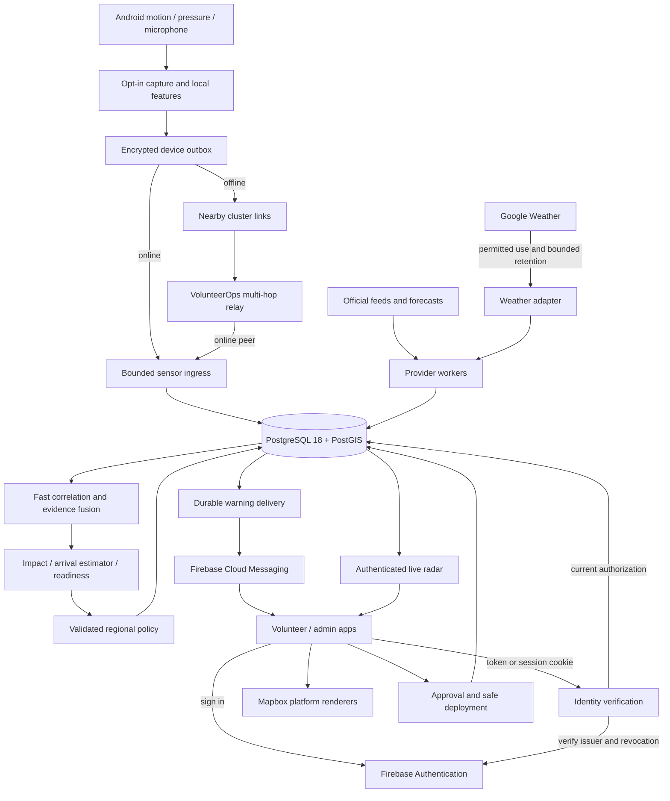
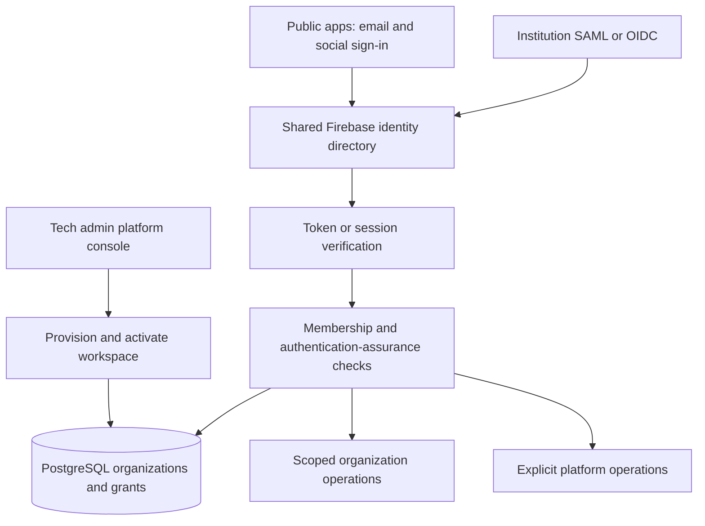

# Requirements

> Scope update, 1 October 2026: the [seven-stage ResQ platform roadmap](resq-production-implementation-roadmap.md) governs current delivery order, Railway hosting, independent volunteer signup/discovery and backend-enforced Pro access. This document retains detailed Sentinel behavior/scientific requirements; its old baseline descriptions and delivery steps are historical, not current implementation status. WeatherNext 3 hourly BigQuery or GCS Zarr remains the primary forecast source, while official authorities retain warning authority. Dataset access is pending; WeatherNext 2 VMG must not be presented as a WeatherNext 3 endpoint.


### Updated objective
Build **VolunteerOps Sentinel** across the backend, volunteer app and admin app: **Sense → Verify → Understand → Mobilize → Respond → Learn**.

**This revision supersedes the previous research-only treatment of Android sensors and mesh.** Deliver working, opt-in Android sensor acquisition, acoustic inference infrastructure, streaming evidence correlation, sensor heatmaps, responder safety detection and offline multi-hop relays. Implement them as explicitly labeled pilot capabilities with separately controlled production activation—not merely documentation, and not unvalidated life-safety claims.

### Confirmed decisions
- Shared modular Express/TypeScript backend; independently running API and workers.
- External managed **PostgreSQL 18 with PostGIS** for durable operations, geospatial processing, jobs and analytics.
- Operator-configured regions with explicit source, dataset and warning-policy coverage.
- Automatic policy-approved warnings, safety/availability requests and draft incidents/staging plans. **Actual deployment and movement orders require administrator approval.**
- **Nearby Connections** is the chosen Android peer transport. VolunteerOps supplies multi-hop store-and-forward routing above it; Google Play services is a dependency.
- Android sensing is implemented first. Other KMP targets support operational workflows and clearly report unsupported sensing/relay features rather than pretending to collect data.
- **Firebase Authentication with direct verification** replaces local password/JWT authentication: Firebase ID tokens on native clients, Firebase session cookies on web; PostgreSQL remains authoritative for account status, roles, memberships, credentials and permissions.
- Both apps support Firebase email/password registration, verification, login and recovery, plus **Google, Apple, Facebook and Microsoft** sign-in. Social identity never grants an administrator role.
- **Shared Firebase identity directory with Identity Platform enterprise federation:** institution-specific SAML/OIDC connections and corporate-email onboarding; PostgreSQL owns organization memberships, permissions and authentication-assurance requirements.
- **Owner-provisioned, gated self-service:** only the platform tech admin can provision and activate a partner workspace after partnership approval. Only then can its nominated administrators complete domain/identity verification and enrollment. Public registration cannot create an active organization or confer admin rights.
- **Platform tech admin** uses the same admin app with a separate platform context; organization admins have strictly lower, organization/region/function-scoped privileges. One identity may belong to several organizations without sharing their private data.
- **Full scope first**, as selected: retain all existing sensor, relay and multi-hazard deliverables before launch. The desired two-to-three-week window is not a delivery commitment; scientific, identity-provider, infrastructure and release gates remain mandatory. Prioritize Kenya configuration within a region-independent design, not a Kenya-only product.
- **Firebase Cloud Messaging (FCM)** is the online push provider. HTTPS APIs carry uploads and actions; PostgreSQL jobs/outbox and authenticated streams remain authoritative. No Firestore or Firebase Realtime Database migration.
- **Mapbox** supplies the apps' geographic maps through Android/iOS SDKs and Mapbox GL JS on web, with explicit KMP platform adapters and accessible fallback views.
- Add a **Google Weather API** adapter for location-based meteorological context and hazard-specific fusion. Live use, retention, derived risk computation and combination with Mapbox require confirmation of applicable Google terms; no promise that more inputs automatically improve predictive accuracy.

### Android capabilities and limits
`SensorManager` exposes motion and pressure readings; it does not expose Google's earthquake classification network. The official documentation reviewed does **not document a public third-party subscription API** for Google Android Earthquake Alerts. Therefore:
- Build VolunteerOps' own detection/evidence pipeline using public Android APIs.
- Help users enable built-in Earthquake Alerts through supported settings navigation where available, with manual instructions otherwise. Do not claim to inspect its enablement or receive its alerts without a documented supported API.
- Do not scrape notifications, use Accessibility interception, invoke private broadcasts or mimic Google's system privileges.
- Keep authorized early-warning-provider integration as an optional adapter with explicit credentials, coverage and contractual gates—not an assumed Google integration.

### Requested capabilities
| Capability | Deliverable |
|---|---|
| Earthquake Sentinel | USGS/GDACS event ingestion plus live Android seismic-candidate evidence, cross-device correlation, evolving source estimates and protective warning policies. Ordinary feeds provide awareness, not guaranteed advance warning. |
| Arrival-time display | Executable estimator and replay tests; expose an uncertainty-aware arrival interval only for a validated model/source with sufficient data and positive remaining lead time. Never hard-code or promise 18 seconds. |
| Weather-informed risk | Google Weather current conditions, hourly/daily forecasts and recent history, where permitted, combined with independent sensors and authoritative sources. Versioned, region-calibrated flood/storm/fire-weather/landslide risk indicators; show unavailable or unvalidated states rather than invented probabilities. |
| Flood early warning | GloFAS basin forecasts, local gauges/rainfall/CAP, permitted Google precipitation context, revision-aware readiness countdowns and evacuation-resource preparation. |
| Wildfire | FIRMS hotspot clustering, official/local corroboration, settlements/facilities/resource exposure. A thermal anomaly is not a confirmed fire perimeter. |
| Storm/cyclone | CAP/GDACS/national warnings and forecast corridors; phone pressure changes are supplementary observations, not standalone storm predictions. |
| Landslide | Official warnings and validated rainfall/slope/susceptibility/soil inputs; phone motion/acoustic evidence remains supplementary until independently validated. |
| Tsunami | Trusted official warnings and coastal zones drive evacuation-support planning. An earthquake or phone cluster alone cannot authorize tsunami warnings or all-clears. |
| Community sensor network | Android accelerometer/pressure feature reports, optional acoustic observations, authenticated IoT observations and manual geotagged reconnaissance. |
| Safety Guardian | Manual SOS, SAFE/NEED ASSISTANCE/CAN RESPOND, check-in deadlines and deployed-user opt-in fall/immobility candidates with a cancellable local safety prompt. |
| Connectivity map | Aggregate consented heartbeat disappearance against an eligible baseline; distinguish backend outages, sparse participation and suspended apps from possible regional connectivity degradation. |
| Crowd verification | Independent-report correlation, evidence provenance, reversible clustering, photographs and audited human/authority verification. |
| Impact zones | Versioned critical/major/watch polygons, reviewed staging candidates, uncertainty and source freshness. Sensor density heatmaps are a separate layer, not damage/flood-path maps. |
| Disaster Radar | Real geographic map/list, live evidence clusters, official hazards, source/device coverage, assistance cases and operational timelines. |
| Mobilization Autopilot | Explainable role/resource demand, qualifications, availability, expiring reservations, safe-access exclusions and atomic administrator-approved deployment. |
| Readiness and learning | Region supply/demand/shortage scores with data completeness; response latency, false alarms, assistance outcomes and reviewed model/playbook revisions. |
| Offline relays | Nearby cluster links plus signed/encrypted, bounded, deduplicated multi-hop envelopes; an online peer forwards evidence to Sentinel. No guarantee that a connected path or internet gateway exists. |

### Two-tier alerts
- **Take Action:** approved protective instructions for likely affected recipients; pause recruitment and movement into danger. In-app full-screen presentation is supported; notification full-screen intent is conditional on Android capability, explicit permission and applicable distribution policy. Otherwise use an allowed high-importance notification.
- **Be Aware:** lower-disruption awareness/standby messages and separate safety/availability requests. Outside a red zone does not automatically mean safe; consider overlapping hazards and uncertainty.
- Respect OS/user notification controls; do not promise Do Not Disturb bypass, wake-up, loud playback or push arrival.
- Do not infer shaking has ended from elapsed time or a SAFE response. Clearance follows authoritative updates and approved local procedures.

### User-facing completion criteria
- Deliver navigable, data-connected **admin and volunteer screens**, not only engine endpoints, background services or standalone map demonstrations. Every major Sentinel capability has a role-appropriate entry point, understandable status and permitted next action, as specified in **Screens and Responsive UX**.
- Support the existing Android, iOS, JVM desktop, JavaScript and Wasm app targets with adaptive mobile, tablet and wide-window layouts. Responsive operational workflows are required even where a platform cannot provide sensing, push or a native map renderer.
- Extend each app's existing typography, colors, artwork, icons, cards, navigation and accessibility conventions. Do not replace the current app design or turn the volunteer experience into an administrator console.
- Surface automatic warnings, safety requests and staging as an understandable action timeline: what happened, why, delivery state, what needs review and what the user can do next. Automatic staging is never presented as an approved deployment.

### Deliverable documentation
Implementation will save `docs/sentinel-implementation-plan.md`, `docs/sentinel-api-contracts.md`, `docs/sentinel-android-sensing-and-relay.md`, `docs/sentinel-model-validation.md`, `docs/sentinel-operations-runbook.md`, plus separate `docs/sentinel-volunteer-implementation.md` and `docs/sentinel-admin-implementation.md`.

Add separate **`docs/firebase-setup.md`**, **`docs/mapbox-setup.md`** and **`docs/google-weather-setup.md`** checklists, plus `docs/enterprise-identity-setup.md`, `docs/platform-owner-bootstrap.md`, `docs/organization-onboarding.md`, `docs/postgresql18-setup.md`, `docs/container-hosting-setup.md`, `docs/dns-email-setup.md`, `docs/storage-setup.md`, `docs/observability-setup.md`, `docs/app-distribution-setup.md` and `docs/kenya-seasonal-readiness.md`. Include `docs/kubernetes-setup.md` as an explicitly optional alternative, not a deployment prerequisite. Each identifies code/configuration completed, exact project-specific values or console actions still needed from the owner, credential placement without exposing secrets, verification commands and remaining blockers. Do not claim provider configuration is complete when only integration code exists.

The client documents record completed changes and exact remaining work if their workspaces cannot be edited. This planning session does not write project files or implement code.

# Technical Design

### Existing code and integration boundaries
- `src/app.ts` mounts Express routers; follow existing controller → Zod validation → service patterns using `ah`, `requireAuth`, `validateBody` and `serialize`.
- `prisma/schema.prisma` already has `Event`, `Deployment`, `VolunteerSkill`, `Location`, `FieldReport`, `Notification` and audit records. Link hazards to staged `Event` missions rather than turning external hazard observations directly into deployments.
- `FieldReport` requires a deployment: add community/sensor observations that can exist before assignment and can link to deployed field reports without double-counting evidence.
- `src/modules/deployments/deployments.service.ts::autoDispatch` does not implement the locking described by its comment. `Deployment` lacks active-assignment uniqueness; check-in/completion update related rows separately. Fix these before mobilization activation.
- `src/modules/notifications/notifications.service.ts` persists rows but does not deliver pushes. Add gateway/outbox delivery, not misleading `sentAt` semantics.
- `src/modules/telemetry/telemetry.controller.ts` lacks ownership enforcement and exposes an unauthenticated live stream. Secure existing telemetry and all new streams.
- `src/modules/auth/auth.schema.ts` permits privileged public signup role choices. `AuthService.signup/login` in `src/modules/auth/auth.service.ts` currently hashes/verifies Argon2 passwords and issues local access/refresh JWTs. `src/modules/auth/auth.controller.ts` sets access/refresh/legacy cookies and exposes login, signup, refresh and password-change routes.
- `src/middleware/auth.middleware.ts::authenticate` currently verifies only `JWT_SECRET`, with no fresh database account/role lookup. `requireRole` also permits a legacy `ADMIN` bypass. Replace these with Firebase identity verification plus current PostgreSQL authorization; preserve numeric internal user IDs and remove legacy privilege shortcuts.
- Both `prisma/schema.prisma::User` and `prisma8/contract.prisma::Users` require `passwordHash`. Make legacy hashes nullable after adding an immutable, unique Firebase project/UID mapping; preserve existing user IDs, assignments and audit references during migration.
- `src/core/prisma.ts` currently uses the Prisma 7 compatibility client through Accelerate. `DEPLOYMENT_RUNBOOK.md` assigns migrations to Prisma 8 through `prisma8/contract.prisma` and `migrations/app/`; preserve one migration history and synchronize the compatibility schema.
- `package.json` has a placeholder test command. Add a real executable backend test suite.
- Both client READMEs describe local demonstration workspaces, not live authenticated apps. `volunteer/shared/build.gradle.kts` has Android and common source sets but no current HTTP/sensor/relay library integration. The inspected volunteer Android manifest requests location, not internet/push/relay permissions.

### Architecture


### Backend components
Add focused modules under `src/modules/sentinel/` for regions, providers, observations, evidence/correlation, impact, safety, warning policy, readiness and mobilization. Add `src/workers/` entrypoints and reusable job/outbox infrastructure under `src/core/`. Proposed new names are implementation targets, not claims of existing files.

Sensor ingress validates bounded envelopes and commits them before acknowledgement. Deduplicate before expensive processing. A separate latency-priority worker pool handles fresh sensor windows and safety actions; bulk feeds, raster processing, old relay uploads and analytics cannot starve it. Worker jobs carry observation timestamps and deadlines; stale evidence goes to historical analysis, not current alarms.

Use per-region overlapping time/spatial windows, spatial indexes and correlation leases/version checks to prevent duplicate candidates across workers. Do not equate a configurable 5 km/5 second cluster with a confirmed earthquake. Start with explainable feature and independent-device thresholds, retaining enough compact temporal information for later wave-propagation analysis.

### PostgreSQL 18 consolidation
Use the PostgreSQL capabilities retained in the [current roadmap](resq-production-implementation-roadmap.md#data-model-and-migration-completion-register):
- PostGIS/GiST for spatial joins, neighborhoods, regions and zones. SRID 4326 interchange; geography/projected coordinates for meters; handle dateline and invalid geometries.
- Logged job/outbox tables with short `FOR UPDATE SKIP LOCKED` claims, leases, fencing tokens, bounded retries, dead letters and replay. External calls occur outside transactions.
- At-least-once processing with unique business/action/recipient keys. No end-to-end exactly-once claim for push or relays.
- `LISTEN/NOTIFY` only as a wake-up hint; durable rows, polling and cursor replay recover disconnected consumers. Dedicated session connections for listeners.
- Partitioned sensor/heartbeat history with BRIN and suitable spatial/time indexes; separate globally unique receipt/deduplication keys where partitioned uniqueness requires it.
- JSONB/GIN for bounded source envelopes and feature metadata; typed fields for security, lifecycle and core queries.
- Materialized/summary views for readiness and analytics, with freshness labels; fresh transactional reads for dispatch authorization.
- PostgreSQL text search and optional `pg_trgm`; no Redis/Kafka/vector database requirement. `pg_cron` is optional, not a hosting prerequisite.
- Organization/region scope and RLS using transaction-local identity, non-owner runtime roles and no `BYPASSRLS`. Separate public hazard facts from private operational overlays and precise locations.
- Keep media in the existing object store. No raw audio upload by default. Never use unlogged tables for observations, alerts, jobs or audit.

### Hosting and migration
Modify `src/core/prisma.ts`, `src/core/config.ts`, Prisma configuration and deployment definitions for compatible direct PostgreSQL driver/pooling support. Preserve computed client extensions without requiring Accelerate caching for safety decisions.

Deploy the API and workers on Railway; select PostgreSQL 18/PostGIS only after proving image/extension, TLS, pooling, region and recovery support. Railway template databases are operator-managed services. Keep urgent workers always on; follow the Railway runbook for deployment and recovery responsibilities.

Use additive migrations, restored-database rehearsal, schema parity checks, legacy organization/region backfill and coordinate backfill. Reconcile duplicate active assignments before adding constraints. Execute production cutover only with explicit operational authorization, verified backups and controlled write freeze/final synchronization. After new writes, rollback needs data reconciliation, not merely an old URL. Never run destructive demo seeds against production.

### Source ingestion and regional intelligence
Maintain source checkpoints and immutable revisions with observed/issued/received/effective/expiry times, authority, geometry and provenance. Persist revisions/checkpoints atomically where source licenses permit retention. Google Weather content uses its own short-lived content store and purge rules rather than permanent raw-payload/evidence history. Retain only legally permitted audit metadata after expiry. CAP tests/exercises never reach live channels; apply update/cancel references and language variants.

Implement USGS, GDACS, FIRMS area feeds, configured CAP authorities, GloFAS forecast acquisition/preprocessing and local gauge/IoT sources. GloFAS requires product/access/licensing and GRIB/NetCDF handling verification; GDACS contracts must be checked before activation. Validate feed schemas, trusted hosts, sizes, XML external-entity protections, quotas, retries and clock fields.

Use versioned population/facility/road/shelter/resource/basin/slope/susceptibility datasets. Official footprints outrank heuristic buffers. Missing data appears as unavailable coverage, not invented exposure or zero risk. Hotspots are not perimeters; sensor clusters are not physical damage contours. Route around verified active road restrictions only through an exclusion-capable routing adapter or validated graph; otherwise mark routing unavailable and require review.

### Safe operational orchestration
Record heuristic evidence score separately from authority, model validity and calibrated probability. Deduplicate syndicated sources, devices and relayed copies; preserve contradictions and reversible merges.

Regional playbooks generate staffing/resource needs with explanations. Match verified/unexpired credentials, availability, location freshness, equipment, organization, language, fatigue and safe-access constraints. Extend `VolunteerSkill` verification/expiry rather than treat self-report as medical/SAR authorization.

Separate proposal → willingness → reservation → approval → deployment. Approval locks/revalidates capacity, volunteer eligibility and current hazard restrictions, consumes reservations and writes deployment/audit/outbox atomically. Enforce one active assignment per responder; make check-in/completion/cancellation idempotent and transactional. All existing assignment entrypoints use the same safeguards.

Forecast changes cancel/reschedule readiness milestones. NEED ASSISTANCE opens one deduplicated assistance case and escalation, not an automatic responder deployment. Readiness and retrospective analytics expose source freshness, shortages, false alarms, overrides and model/playbook versions; learning does not automatically rewrite safety policies.

# Enterprise Organizations and Platform Administration

### Current gaps and implementation boundaries
`prisma/schema.prisma::User` has one global `UserRole`, and `Volunteer` has globally unique identity/profile fields but no organization membership. `src/modules/users/users.controller.ts` exposes user listing, role and status changes through broad coordinator/admin guards. `UsersService.findAll/findById` in `src/modules/users/users.service.ts` query global records; `updateRole/updateStatus` mutate global identity and write audit separately. `users.schema.ts` accepts `SUPER_ADMIN` in role updates. `src/modules/volunteers/volunteers.controller.ts` exposes global available/nearby lists and profile/skill mutations without explicit organization context. These are migration targets, not safe building blocks to leave unchanged.

Add `src/modules/organizations/` for workspaces, domains, memberships, invitations and enrollment, and `src/modules/platform/` for owner-only operations, using existing Express/Zod/service conventions. Refactor auth/users/volunteers and every reused operational service to accept a server-resolved authorization context. Add database constraints and RLS through the existing Prisma 8 migration history and compatibility schema. Do not grant existing `SUPER_ADMIN` rows new platform authority without explicit migration review.

### Identity, authentication and authorization


- Upgrade Firebase Authentication to **Identity Platform** for SAML/OIDC; keep the chosen shared identity directory, not one Firebase project or identity tenant per organization. One immutable Firebase identity maps to an internal user with multiple memberships. Organization choice is an access context, never an assertion of authority.
- Corporate email/password means Firebase verification of mailbox control followed by database enrollment checks. A domain is a discovery/eligibility signal, not a password or proof of employment/authority. A Microsoft/Google social login is not automatically the institution's enterprise SSO.
- Configure a distinct trusted SAML/OIDC provider connection for each participating institution where needed; validate issuer, audience, metadata, exact redirect/ACS URLs and signed claims through supported SDKs. Never construct a login URL from user-supplied domain metadata. Firebase SAML supports service-provider-initiated flows; do not promise IdP-initiated parity.
- Enforce organization-specific allowed authentication methods and assurance on **every privileged request**, including session cookies, organization switches and sensitive mutations. Require verified email, recent authentication and MFA for tech/org admins; prefer Firebase TOTP where supported, or validated institution MFA evidence under an explicit policy. A linked password/social session cannot bypass an SSO-only organization policy. Missing/ambiguous assurance fails closed or requires supported step-up; account provider linkage alone is insufficient.
- Use supported Firebase platform adapters and system-browser flows for unsupported KMP/native SSO combinations. Extend the previously specified PKCE/state-bound one-use browser handoff without introducing VolunteerOps long-lived JWTs, custom-token shortcuts that lose MFA assurance, or tokens in URLs. A target lacking a verified secure flow remains blocked for enterprise access, not silently downgraded.
- Verified-domain discovery returns only safe public organization/provider metadata after owner activation, with rate limits and generic unknown/inactive responses. Explicit organization slug/invitation handles overlapping domains. Normalize IDNA/case and exact labels; disallow wildcard/public-suffix ownership and suffix-string matching. DNS TXT challenges are random, expiring, single-use and bound to the provisioned workspace/domain. Domain proof and mailbox proof are separate. Domain changes, disputes and expiry require revalidation and auditable approval.
- No email-only privileged account linking, domain-derived roles, arbitrary group-to-admin mapping or automatic platform grants. Institution group mappings are allowlisted and bounded to approved organization roles; first admins and subsequent privileged invitations require explicit grants.

### Partner workspace lifecycle and enrollment
Keep partnership/workspace state separate from domain/SSO enrollment readiness:
1. Public users can submit a rate-limited partnership request or authenticate into an independent personal account. Personal home/profile/opportunities and eligible personal Pro features do not require an organization; private organization operations still require approved membership.
2. You review the partnership and create `PROVISIONED` organization records, nominated admin identities/emails, authorized domains, regions, entitlements, quotas and data-handling settings in the platform console.
3. Your explicit activation changes the workspace to `ACTIVE` and enables its time-limited enrollment links and domain verification. Operational access still requires verified identity/domain or an owner-approved alternative, an active membership and sufficient assurance.
4. Nominated admins prove identity and institutional control; SSO configuration is tested before it becomes required. An owner-issued enrollment grant permits only the specific onboarding/domain/SSO steps while membership is pending, not operational data access. The initial admin's allowed role is pre-authorized by you, not chosen during signup. Institutions unable to edit a parent domain's DNS use an audited owner-approved evidence route; a new applicant cannot claim a UN/Red Cross parent identity automatically.
5. Organization admins can invite lower/equal permitted organization roles, bulk-import volunteer roster drafts and approve join requests under that workspace's policy. Imports validate/deduplicate in a preview, create invitations/unclaimed membership profiles rather than passwords or silently linked Firebase identities, and expose per-row outcomes. Personal-email volunteers and approved external coordinators can join by invitation without institutional email.
6. `SUSPENDED`, `OFFBOARDING` and `ARCHIVED` workspaces block new admission/actions as appropriate. Revoke online scope, streams and pending jobs/invitations, stop future private deliveries, and audit reassignment/cancellation of active missions. Do not silently abandon assistance cases or automatically erase evidence; show an explicit operational handover checklist.

Public Play Store availability is compatible with restricted workspace admission: no installation link, invite code or app flavor confers access. Expiring hashed invitation secrets are bound to organization, intended recipient, role, issuer and maximum uses; acceptance is transactionally single-use and requires an appropriate verified identity. App/deferred-install links use controlled HTTPS/App Links with a safe manual-code fallback and no automatic sign-in or role mutation. Domain-eligible self-service enrollment defaults to volunteer/join-pending and is enabled only after owner activation; it never creates administrators.

### Data model and tenant isolation
Add `Organization`, `OrganizationUnit`, `OrganizationDomain`, `EnterpriseConnection`, `OrganizationMembership`, `MembershipScope`, `Invitation`, `JoinRequest`, `ProvisioningOperation`, `PlatformGrant`, `AuthenticationPolicy`, `FeatureEntitlement` and `PlatformAuditEvent` (final names follow conventions). Keep workspace, domain verification and SSO readiness states distinct. Use optimistic versions and immutable decision/audit history.

- `OrganizationMembership` is unique by organization/user and carries lifecycle plus permitted roles; department/country-office and region scopes narrow access. UN agencies/country offices may be separate organizations or internal units, chosen explicitly at provisioning. A parent label, logo or shared domain never creates inherited access to separate organizations.
- Platform roles (`TECH_ADMIN`) are separate from organization roles (`ORG_ADMIN`, `COORDINATOR`, `TEAM_LEAD`, `VOLUNTEER`). Use explicit capability mappings such as `organization.manage`, `members.invite`, `dispatch.approve`, `sentinel.configure` and region/unit restrictions; clients cannot supply effective grants. Organization admins cannot change platform grants or exceed owner-set entitlements/safety limits.
- Preserve a minimal shared personal identity/volunteer profile; move operational availability, organization credentials, membership status, totals/achievements and private notes to membership-scoped records. Do not reveal another organization's deployments or credential evidence. Link invited, unclaimed roster entries only through verified invitation/identity reconciliation.
- Add organization ownership to missions, deployments, reports, resources, private impact overlays, messages, assistance cases, audit, reservations and storage metadata. Use composite foreign keys/constraints to prevent cross-organization links, not just query filters. Backfill legacy records to an explicitly approved legacy organization; quarantine ambiguous ownership rather than assign it to a real partner by default.
- Public authoritative hazard facts can be shared; private device features, precise locations, rosters and incidents cannot. First-party sensor evidence has an explicit owner/consent scope; cross-organization aggregation uses approved privacy-preserving policy and provenance, not automatic access to another organization's sensors.
- Resolve `organization_id`/unit/region context from authenticated membership for each request and transaction. Recheck worker jobs, outbox recipients, storage downloads, exports, stream replay, caches and analytics; include organization in keys. Platform operations use explicit audited access paths/policies, never database-superuser connections or client-selected RLS bypass flags.
- A person can switch between organizations without signing up twice; cache/outbox keys include identity and organization, draft reports never change owner on switch, and revoked-scope queued actions are rejected on synchronization. Lock the shared responder identity for assignments across memberships to prevent double booking without exposing the other organization's roster or mission details.
- Default cross-organization data access to denied. Support explicitly approved, expiring coordination grants for named shared incidents/resources with both organizations' approval and recorded volunteer consent where necessary; one lead organization owns deployment approval. No implicit global federation or unscoped private roster exposure. The current roadmap explicitly adds a consented platform-directory projection and revocable profile-sharing links, without cross-tenant disclosure.

### Tech-admin control plane in the existing admin app
Provide a persistent **Platform** versus **Organization** context indicator and owner-only entry points; reuse People, Security, Settings and the current navy/Oswald/Overlock design. Your privileged identity is an explicit database grant, not the first signup or an email-domain match.

- Platform overview: organizations, activation/readiness blockers, source/worker health, quotas, regional release state and auditable interventions.
- Client lifecycle: provision/activate/suspend/offboard partners, units/regions, nominated admins, domains/SSO status, entitlements and contractual configuration.
- User administration: invite/create accounts through Firebase workflows without viewing passwords, grant/revoke authorized roles, suspend/recover accounts, and request account deletion with impact preview. Organization admins manage memberships only; removing a volunteer from one institution does not delete their shared account or other memberships. Administrative global Firebase disable/delete is tech-admin-only and respects last-owner protections, retention and active-response handover. Separately support verified users' own account-deletion requests through the public apps and required web entry point, with recent reauthentication, transparent retention/hold handling and auditable completion rather than denying self-service privacy rights.
- Feature control: versioned feature flags, approved playbooks, role capabilities, region/source enablement, model readiness gates, templates and quotas with validation, preview, rollback and audit. This means configuration of implemented functionality—not arbitrary SQL, uploaded executable code, editing application source or self-deploying new features from the UI. New code follows the normal development/release path. Privilege cannot mark an unvalidated scientific model certified.
- Bootstrap your chosen Firebase UID through an authenticated, one-time, out-of-band operator command using secret-managed deployment credentials, recent verified identity/MFA and an empty-grant guard. No default credentials or public bootstrap route. Document secured break-glass recovery, notification/audit and key rotation; protect the last active tech admin from deletion/demotion. Platform privileges remain broad, but sensitive/destructive actions require step-up, scope/impact confirmation and reason.
- Platform support access to organization data is explicit, time-bound and audited with a visible banner; never silently impersonate a coordinator or suppress an audit. Store before/after metadata and actor/context, not secrets or unneeded personal data. Export append-only audit evidence to a separately access-controlled archive.
- Firebase/SSO provisioning, email sends and database updates are not one atomic transaction: model idempotent provisioning operations with durable outbox, retries, reconciliation and incomplete-state diagnostics. Suspension denies access in PostgreSQL immediately while remote revocation retries; a failed IdP operation cannot silently reactivate a user.

### API and admission contract
Retain `/api/auth/me` with platform capabilities, active memberships, authentication-assurance state and permitted contexts. Add versioned, scoped APIs:

| API family | Contract |
|---|---|
| `POST /api/partnership-requests`, `POST /api/auth/organization-discovery` | Bounded public requests/discovery with no automatic tenancy or privileges. |
| `/api/platform/organizations`, `/:id/activate`, `/:id/suspend`, `/:id/offboard` | Tech-admin-only idempotent lifecycle transitions with expected version and impact/audit details. |
| `/api/platform/users`, platform grants and entitlements | Global user/account controls, safe bootstrap exclusions, destructive-action preview and step-up. |
| `/api/organizations/:orgId/domains`, enterprise connections | Challenge/status/configuration under owner activation and grant limits; credentials remain in secret storage. |
| `/api/organizations/:orgId/memberships`, invitations/imports/join requests | Scoped roster and access management; per-item import results and no global identity deletion. |
| `POST /api/invitations/accept`, `/api/me/memberships` | Verified, atomic acceptance and private organization selection. |
| `/api/organizations/:orgId/coordination-grants` | Explicit bounded inter-organization sharing/revocation. |

Return structured `ORG_NOT_ACTIVE`, `ENROLLMENT_PENDING`, `MEMBERSHIP_REQUIRED`, `SSO_REQUIRED`, `MFA_REQUIRED` and stale-version conflicts after appropriate authentication without exposing private organizational details publicly. Replace or safely deprecate legacy unscoped user/volunteer mutation endpoints rather than leaving parallel bypasses.

# Android Sensing and Relay

### Android/KMP structure
In the volunteer app, add common contracts and state machines to `shared/src/commonMain/`, Android implementations to `shared/src/androidMain/`, and application service/permission wiring under `androidApp/`. Inspect actual packages and repository classes before choosing final file paths.

Proposed interfaces: `SensorCapture`, `FeatureExtractor`, `AcousticClassifier`, `SensorOutbox`, `RelayTransport`, `RelayRouter`, `AlertPresenter` and `CapabilityRegistry`. Common code has no Android imports; unsupported targets return explicit capability states.

Update `volunteer/shared/build.gradle.kts` for Android-only Nearby Connections and a supported on-device inference runtime, plus shared networking/serialization/persistence dependencies. Update `volunteer/androidApp/src/main/AndroidManifest.xml` and app wiring with only needed permissions/service declarations. Verify current target-SDK rules rather than use foreground services as a blanket permission bypass.

### Working sensor capture
- Runtime sensor enumeration includes accelerometer, optional gyro/gravity and optional barometer; missing sensors degrade independently.
- Explicit opt-in capture sessions, visible status, pause/stop, battery/thermal budgets and deployment-scoped modes. Start sessions through permitted user interaction with the correct foreground-service declaration where needed. No unsupported continuous background guarantee.
- Accelerometer windows carry sample timing, rate, accuracy/calibration, clipping and device stationarity/orientation features. Separate gravity and normal device handling; short in-memory buffers produce compact temporal features rather than upload every sample.
- Record monotonic sensor timestamps and a measured wall-clock mapping with uncertainty, observation time, coarse location cell/accuracy/age, feature/model version and capability/quality flags. Do not treat server receipt time as shaking onset.
- Pressure features account for sensor bias, elevation changes, indoor conditions and weather reference data. Rapid pressure change alone cannot classify a cyclone or predict flooding.
- Acoustic capture uses separate microphone consent and explicit, visible sessions. Run inference locally, upload only an allowed label/score/time/features and model version; discard raw audio promptly and never upload it by default. Implement bounded inference with a compatible versioned model artifact and representative fixtures. A generic sound classifier is not a validated landslide/flood detector; unsupported target labels remain unavailable pending a suitable trained/calibrated model.
- Fall/immobility candidates apply deployment/activity/device-placement context, then a local cancellation prompt and timed human safety escalation. Dropping a phone must not be presented as proof the responder fell.

### Fusion and arrival estimation
Implement an explainable streaming candidate engine using distinct enrolled devices, stationarity/quality, spatial-temporal consistency, waveform features, timing uncertainty, coverage and independent official evidence. Nearby radio identity, relay count or repeated reports do not create independent sensors. Display candidate state and uncertainty before any warning-policy eligibility.

Implement an estimator interface returning an **absolute arrival-time interval** or an explicit unavailable reason. Inputs include a source origin/location/depth estimate, model-specific propagation assumptions, regional validity, target position uncertainty, clock uncertainty and fit residuals. Estimate arrival at the recipient, not merely a time from a magnitude-radius lookup.

Operational activation requires validated source/model performance and enough well-timed independent observations; coarse 5 km cells may be too uncertain for a short countdown. Never silently collect precise location to fix that—use separate consent or return unavailable.

The server/client subtract current time and delivery age, reject expired/stale/poor-fit estimates, and stop a countdown when confidence or revision validity is lost. Near-source blind zones and negative remaining lead time show protective guidance without a countdown. Never automatically assert shaking has ended.

Show uncertainty-aware wording such as an estimated arrival range only after validation. Maintain replayable estimation code even while user-facing countdowns are disabled. An 18-second estimate may occur for a specific validated event; it is not a service promise.

### Two-tier Android presentation
Create separate awareness and protective notification channels, accessible labels/icons, approved guidance and idempotent action handling. Use high-priority FCM only for eligible user-visible urgent notifications and respect provider limits/expiry.

Use in-app full-screen protective UI when the app is open. For background full-screen intents, check platform capability/permission (including `canUseFullScreenIntent()` where applicable) and distribution-policy eligibility; gracefully fall back to allowed heads-up/standard notifications. Do not misclassify the app as an alarm/calling app to obtain privileges. Permission denial, muted channels, app termination and Google Play services absence remain visible limitations.

Safety and capability questions are separate: SAFE, NEED ASSISTANCE and CAN RESPOND do not themselves grant deployment or credentials.

### Nearby multi-hop implementation
Use Nearby Connections `P2P_CLUSTER` for small messages. The API manages nearby links over supported radios; VolunteerOps cannot assume it selects a particular BLE/Wi-Fi Direct mode, provides an internet gateway, or automatically routes beyond connected peers.

Implement:
1. Explicitly enabled relay sessions, discovery/connection limits, peer authentication and controlled reconnect/backoff. For pilot enrollment, provision responder/device trust credentials online or through an approved local enrollment ceremony before the outage.
2. Verify Nearby connection tokens for initial user-assisted pairing, or use a reviewed provisioned-credential challenge bound to the peer session; do not accept unverified arbitrary peers as trusted responders.
3. Sign immutable origin envelopes with a device key protected by Android Keystore, using established cryptographic libraries/formats. Encrypt sensor/safety contents to the backend so intermediaries cannot inspect sensitive observations. Use rotating opaque relay identifiers and minimal routing metadata.
4. Include protocol version, message ID, origin credential reference, observation/expiry times, recipient class, payload hash, signature and bounded hop metadata. No raw audio, waveform streams or large photos on the urgent relay path.
5. Persist an encrypted local outbox with per-origin/peer/storage quotas, maximum hop count, TTL, duplicate suppression, priority, inventories and backpressure. Preserve original observation time across every hop.
6. Online peers submit original signed envelopes in bounded batches. Distinguish local queueing, peer custody and backend-accepted receipts; only a signed backend receipt confirms server acceptance. Retries and multiple gateways cannot inflate evidence counts.
7. Include backend-signed, explicitly targeted/region-scoped approved warning envelopes as a separate message class if disseminated via peers. A peer never invents/edits a warning. Uncertain recipient location, clocks, expiry or signature means no countdown/current-warning claim; show only appropriately labeled historical information where useful.
8. Keep fresh sensor evidence and delayed reconnaissance on separate processing paths. Expired sensor observations may aid analysis but cannot re-trigger an old hazard as current.
9. Handle expired/revoked credentials and stale revocation knowledge conservatively: limit offline trust windows, revalidate fully at ingress, and never promise instant offline revocation.

If Google Play services, radio permissions, peer consent, nearby devices or a gateway are unavailable, retain observations locally and report **not delivered**. Foreground/background limits, Doze, reboot, peer churn and physical radio conditions constrain reliability; multi-hop is best effort, not guaranteed zero-connectivity emergency coverage.

### Privacy and readiness states
Use independent consent for motion, pressure, microphone, location and relaying; participants may relay opaque messages without enabling sensors. Stop collection on revocation, clear eligible queued data and explain that packets already handed to peers cannot be instantly recalled offline. Bound their TTL and apply backend revocation/retention.

Expose sensor coverage, missing permissions, sample quality, last upload, clock uncertainty, relay queue age and model readiness. Keep precise volunteer positions restricted; aggregate heatmaps using minimum cohort sizes. Sensor intensity/coverage maps are never labeled as a blast radius or flood path without independent physical validation.

# Contracts and App Integration

### Records and contracts
Add logical records for organization/region membership, hazard sources/revisions/evidence, impact zones/exposure datasets, community observations, enrolled devices/consent, sensor receipts/feature windows/candidates, model versions/calibration gates, arrival estimates, safety checks/responses/assistance, relay receipts, mobilization proposals/reservations/approvals, resource assets/readiness and durable jobs/outbox/stream events.

Add `FirebaseIdentity` (unique project/UID and internal user mapping), application session/revocation audit metadata without duplicate Firebase refresh tokens, app/environment-bound `PushRegistration`, `WeatherQueryPoint`, expiring `WeatherSnapshot`, licensed `WeatherFeatureAssessment` and `ProviderUsagePolicy`. Final table names follow repository conventions; retention permission is part of the weather data contract, not just a cleanup preference.

Keep source event identity, immutable revision and canonical hazard separate. Use unique original device/message IDs independent of transport or receiving gateway. Partition high-volume history without losing cross-partition deduplication. Record model/policy version and input snapshot with every estimate or action.

Example logical sensor envelope:
```typescript
type SensorObservation = {
  schema_version: number;
  message_id: string;
  device_credential_id: string;
  kind: 'MOTION' | 'PRESSURE' | 'ACOUSTIC' | 'SAFETY_CANDIDATE';
  observed_at: string;
  expires_at: string;
  clock_uncertainty_ms: number;
  location: { cell: string; accuracy_m: number; age_ms: number };
  feature_version: string;
  model_version?: string;
  features: Record<string, number>;
  quality_flags: string[];
};
```
Validate exact feature allowlists/units and bounds by kind/version; missing location is permitted only for workflows that do not require spatial fusion. Authentication/signature is carried in a defined cryptographic envelope, not trusted from a JSON identity field. Arrival estimates contain lower/upper absolute arrival times, model/source revision, generation/expiry time and unavailable/uncertainty reasons, not a fixed duration.

### API additions
Publish OpenAPI and common fixtures in `docs/sentinel-api-contracts.md`, preserving existing request naming/serialization conventions.

| Endpoint family | Purpose |
|---|---|
| `POST /api/auth/firebase/bootstrap`, `POST /api/auth/session`, `DELETE /api/auth/session`, `GET /api/auth/me` | Idempotent verified-identity provisioning, web session creation/clearing and database-authorized profile. Native clients subsequently use Firebase bearer tokens. |
| `/api/sentinel/regions/:id/weather`, weather source health | Scoped, policy-permitted weather context and coverage; no arbitrary public weather proxy. |
| `/api/sentinel/hazards`, hazard detail/revisions/zones | Scoped radar and operational evidence. |
| `/api/sentinel/regions`, sources/policies | Authorized region geometry, source configuration, model gates and playbooks. |
| `/api/sentinel/devices`, `/me/consents` | Device enrollment, capabilities, credentials, notification tokens and consent/revocation. |
| `POST /api/sentinel/sensor-observations/batch` | Direct authenticated device evidence with per-item durable receipt. |
| `POST /api/sentinel/relay-envelopes/batch` | Authenticated forwarding peer plus independently validated original signatures; per-item duplicate/rejected/accepted results. |
| `/api/sentinel/sensor-clusters`, hazard arrival estimates | Restricted aggregate evidence maps and validated recipient-specific estimates. |
| `/api/sentinel/observations/batch` | Offline manual reports, media references and corroboration. |
| `/api/sentinel/me/heartbeats`, `/me/safety-checks` | Consent-aware connectivity and personal safety state. |
| `/api/sentinel/safety-checks/:id/responses` | Owner-only replies with observed and received timestamps. |
| `/api/sentinel/hazards/:id/mobilization-proposals` | Explainable draft team/resources. |
| `/api/sentinel/mobilization-proposals/:id/approve` | Idempotent, version-checked, scoped approval. |
| `/api/sentinel/regions/:id/readiness` | Capacity, shortages, score components and freshness. |
| `/api/sentinel/stream?cursor=` | Authenticated scoped updates, replay and explicit resnapshot on gaps. |

Use strict Zod schemas, payload/rate limits, ownership, RLS and optimistic conflict responses. Reauthorize streams at expiry/revocation. Add needed CORS headers for idempotency/version handling. Gateway acceptance, device receipt and human acknowledgement are separate delivery states.

### Volunteer live integration
Verified files include `volunteer/README.md`, `docs/MIGRATION.md`, `docs/VERIFICATION.md`, `shared/build.gradle.kts`, `androidApp/build.gradle.kts` and `androidApp/src/main/AndroidManifest.xml`. Exact screen/repository classes must be inspected in the client workspace before edits; no invented existing class names.

- Add Ktor networking, typed repositories, Firebase email/password and Google/Apple/Facebook/Microsoft auth adapters, account bootstrap and account-isolated cache/outbox. Firebase SDKs manage native token refresh; web exchanges a recently authenticated Firebase ID token for an HttpOnly Firebase session cookie with CSRF protection, without issuing a second VolunteerOps JWT.
- Add Mapbox mission/impact/staging maps and supported native offline region downloads, with the shared geographic contract and provider/platform fallbacks described below.
- Preserve separately labeled practice mode; never upload sample missions, credentials or sensor fixtures into live operations.
- Today/Missions/Inbox: protective alerts, safety requests, availability, reviewed staging invitations, response brief, check-in deadlines and honest delivery status.
- Sensor participation screen: opt-in modes, unsupported sensors, model labels, battery controls, microphone visibility and start/stop.
- Offline relay screen: Nearby enrollment/session state, permissions, peer custody versus server receipt and queued/expired messages.
- Geotagged field reports/photos with GPS/manual provenance, accuracy, pending upload state, durable offline retries and partial batch conflict handling.
- Native/desktop persistent queues and a browser persistence adapter; clear account separation and stale-warning suppression. Android sensing/relay is platform-specific; iOS/web/desktop operational features do not imply Android sensor parity.

### Admin live integration
Verified `admin/README.md` and `admin/shared/build.gradle.kts` describe a local KMP practice console; client migration documentation identifies the existing map as a response diagram.

- Add Firebase-authenticated live repositories and PostgreSQL-enforced administrator admission without erasing practice mode. Include email/password and all four selected social providers; successful Firebase login alone cannot open operational admin data.
- Mapbox geographic radar with accessible list fallback; distinct layers for raw observation aggregates, eligible sensor coverage, candidate clusters, validated hazards, impact polygons and staging locations. Weather panels/layers remain disabled unless the intended display and Mapbox combination are permitted.
- Evidence drawer: independent reporter count, quality, timing uncertainty, model/source version, conflicting evidence, false-positive review and authority status. No fabricated confidence percentages.
- Safety/assistance queues, aggregate connectivity, readiness and asset shortages.
- Region drawing/lasso with scoped recipient preview, protective-zone exclusions, rendezvous/task review and explicit deployment approval.
- Source/model/region activation controls, shadow/live/drill labeling, kill switches, revisions/cancellations, audit and retrospective outcomes.

### Access and documentation fallback
Both supplied GitHub URLs returned 404 during investigation; local Gradle/docs files were readable, while broad discovery was restricted to the backend workspace. Direct client edits remain planned after source inspection in each accessible workspace. If one is not editable, save its complete contracts, proposed component responsibilities, permissions/dependencies, acceptance tests and exact unfinished work in its separate backend `/docs` file. Do not claim implementation when only a handoff exists.

# Screens and Responsive UX

### Existing design to preserve
`volunteer/README.md` specifies Overlock interface text, restrained Oswald headings, supplied brand artwork/linear icons, translucent status badges, compact stacked content with five-destination bottom navigation, and a wide-screen rail. `admin/README.md` specifies Oswald/Overlock, vector icons, a navy command header, readable light surfaces and Overview/People/Missions/Messages/More navigation with a wide-screen rail.

`admin/docs/MIGRATION.md` documents focused drilldowns, two-pane wide communications, bounded keyboard-aware forms, inset-safe navigation and portable glass treatments with explicit text statuses. Avoid the recorded regressions: single-character squeezed columns, status-bar overlap and nonadaptive grids. `volunteer/docs/VERIFICATION.md` documents existing 360 dp/130% text and approximately 1067 dp tablet checks; repository tests alone do not establish visual correctness.

Reuse the actual shared theme tokens, components, navigation and state/repository patterns after inspecting each client source tree. Exact source class names remain unverified because cross-workspace source discovery is restricted; do not invent an existing design-system API. Extend `shared/src/commonMain/` screens/state with platform bridges only where needed. Preserve existing journeys and practice mode; no unrelated redesign.

### Volunteer screen coverage
Screens may be focused drilldowns of existing destinations rather than extra top-level tabs.

| Entry point / screen | Information and next action |
|---|---|
| Sign-in and onboarding | Firebase email/password and selected social providers, invitation acceptance, organization chooser, join-pending/denied/suspended states, verification/recovery/linking and permission explanations. Public installation does not create an operational membership. |
| Profile → organizations | Current institution/unit/region, membership role/status, pending invitations and explicit switching/leaving; identify which organization receives a report or consent without leaking another institution's data. |
| Today: safety and nearby hazards | Prioritized protective message, relevant hazard summary, source/freshness and immediate next action; personal safety check, availability and current assignment. Avoid showing raw sensor telemetry or speculative probabilities as the primary content. |
| Inbox/notifications → alert detail | Take Action/Be Aware guidance, affected area, issuer, update/cancellation, expiry and why the user was notified; acknowledge or answer SAFE/NEED ASSISTANCE/CAN RESPOND with separate pending/server-confirmed states. Show arrival intervals only when existing validation gates permit. |
| Explore → local hazard detail | List/Mapbox map of permitted nearby hazards, impact zones, verified restrictions and weather context where licensed; clear safety guidance and coverage limitations. No map gesture is required to reach essential information. |
| Missions → staging invitation / mission brief | Requested role, willingness, reservation/deadline, approval status, rendezvous, equipment and reviewed route; confirm availability without implying permission to travel, then access approved deployment/check-in/report actions. |
| Missions → safety and assistance | Manual SOS, active check-in deadline, cancellable local safety prompt and assistance-case status. Never show help as dispatched merely because a request was queued or received. |
| Field report composer and history | Report type, photo, GPS/manual location with accuracy/time, review/submit, offline queue, retry and corroboration status; allow pre-deployment reports without inventing an assignment. |
| Profile/settings → sensor participation and relay | Separate consents, capability/model readiness, start/stop, battery/permission state, peer custody/server receipt, queue expiry and clear unavailable-platform explanations. |
| Settings → downloads and delivery | Supported Mapbox offline-area management, storage/progress/cancel, notification permission guidance, delivery connectivity, privacy and account controls. |

### Admin screen coverage

| Entry point / screen | Information and next action |
|---|---|
| Sign-in → access/onboarding | Corporate email or organization-domain/slug discovery, enterprise SSO, approved social/password paths, MFA/recovery and named invitations; explicit not-provisioned, pending, denied or suspended admission. |
| Platform → partners and onboarding | Owner-only partnership/provisioning queue, activate/suspend/offboard, domain/SSO readiness, nominated admins, quotas, entitlements and setup blockers; visibly distinct from organization operations. |
| Platform → users, features and security | Global user/grant management, step-up and destructive-action preview, versioned configuration/rollback, audit and explicit support-access sessions. No arbitrary source-code editor or silent impersonation. |
| More → organization administration | Domain proof and SSO test/setup after activation, units/regions, roster import preview, admin/volunteer invitations, join requests, access reviews and bounded sharing grants. |
| Header → organization switcher | Active institution and scope on every sensitive screen; isolate caches/drafts and demand the new organization's SSO/MFA policy before access. |
| Overview → Sentinel summary | Prioritized active hazards, urgent assistance, staffing shortages and pending approvals; distinguish automatically staged work from approved/active missions and open the relevant drilldown. |
| Overview/More → Disaster Radar | Mapbox/list filters for region, hazard, severity, evidence and freshness; separate sensor coverage/candidates from validated zones, connectivity, facilities and reviewed staging. Map and list share selection. |
| Radar → hazard/evidence detail | Source/revision timeline, uncertainty, weather-risk explanations where permitted, affected population/resources with coverage, evidence conflicts and restrictions; inspect verification, warning and staging actions. |
| People/Overview → safety and assistance queue | Safe/can-respond/needs-assistance/no-response counts, scoped person/case detail, due checks and escalation status; take authorized follow-up actions without equating silence with injury. |
| Missions → mobilization review | Explainable role demand, shortages, eligible/excluded responders, reservations, roster and reviewed rendezvous/routes; compare proposed/current state, review recipients and approve with stale-version/conflict handling. |
| Messages → warning and delivery detail | Automatic/manual message reason, policy version, recipient scope, queued/provider-accepted/acknowledged/expired counts and cancellation history; authorized retry or superseding action without silently duplicating warnings. |
| More → readiness/resources and field intelligence | Regional skill/equipment/shelter shortages, inventory freshness, crowd reports and road/facility restrictions; drill into dossiers, evidence and permitted resource updates. |
| More → operations controls and audit | Source/worker/provider health, model gates, weather coverage/licensing status, configuration blockers, regions/policies, drill/live state and kill switches; scoped controls plus an immutable automatic/manual decision history. |
| Overview → seasonal readiness campaign | Kenya county/basin and global regional outlooks, validity/coverage, rainfall and river warnings, assistance/capacity gaps, milestone status and approved preparedness actions; seasonal outlooks are not countdowns to a local disaster. |

### Responsive interaction contract
- Base layout decisions on **available window width**, including split-screen and resizable desktop/browser windows, not OS or orientation alone. Reuse existing breakpoints when available; otherwise start with compact `<600 dp`, medium `600–839 dp`, expanded `>=840 dp` and verify content fit.
- **Compact:** preserve bottom navigation, stack cards, use list-to-detail navigation and a map/list toggle; move filters to a bounded sheet. Convert dense roster/evidence tables to labeled cards. Forms and alert details scroll with keyboard/inset-safe actions.
- **Medium:** use the existing rail where space permits, adaptive one/two-column cards and list/detail panes only when both remain readable; otherwise keep compact drilldowns. Never squeeze a desktop dashboard into tablet portrait.
- **Expanded:** use rail plus bounded-width content, list/map/detail panes and appropriately spaced data tables; keep guidance/forms readable instead of stretching them edge to edge. Contain necessary table scrolling without horizontal page overflow.
- Preserve filters, selection, draft reports, scroll and map camera through resize/rotation and pane changes. Respect browser history/back, keyboard focus/shortcuts and native back navigation; notification deep links authenticate, recheck access and open the current revision without performing an action automatically.
- Provide touch targets of at least 48 dp, keyboard-operable controls, semantic labels/focus order, contrast checks, text-plus-icon severity, dynamic text/200% zoom and existing reduced-motion preferences. Do not let streaming updates steal focus, reorder a focused row unpredictably or continuously announce countdown ticks.
- All screens expose loading, empty, recoverable error/retry, offline/stale, permission-denied, not-configured and unsupported-feature states where applicable. Retain last-known data with timestamps; cached or practice content is never represented as live. Explain unavailable actions and revalidate sensitive actions online rather than queue an offline deployment approval.
- Display operational times with timezone and relative freshness; separate heuristic scores, forecast probabilities and authority confirmation. Present plain-language summaries before technical evidence. Preserve attribution and weather licensing gates in every layout.

### Traceability and implementation evidence
Maintain a screen matrix in each existing `docs/sentinel-*-implementation.md`: entry route, existing component reused, backend contract, role/action permissions, compact/medium/expanded behavior, platform capabilities, UI states and verification status. Track implemented screens versus inaccessible-workspace handoffs explicitly. Supporting backend APIs/services is not sufficient to mark a user journey complete.

# Weather, Firebase and Mapbox

### Google Weather adapter and risk fusion
Add `src/modules/sentinel/providers/google-weather.provider.ts` following the planned provider interface, plus a weather feature service under `src/modules/sentinel/`. Keep restricted credentials in `src/core/config.ts`/deployment secrets, never in either app. Query configured region sampling points, basins, facilities and staging candidates instead of polling once per volunteer. Bound region area, point count, cadence, concurrency, pagination and spend; deduplicate queries and isolate provider failures from the urgent sensor path.

Documentation reviewed describes current conditions, hourly forecasts up to **240 hours**, daily forecasts up to **10 days**, and only **24 hours of hourly history**. These are API maxima, not guaranteed local coverage or update rates. Weather alerts, where available, enter the warning adapter with original issuer, area, expiry and provenance; verify schema and geographic coverage before enabling.

Normalize precipitation amounts/probability and accumulation period, temperature, humidity, wind/gust/direction, pressure and other supported fields. Preserve units, location, coverage, observation/retrieval time, forecast validity and issuance time if supplied; never invent provider timestamps. Align phone pressure units and reference level—surface pressure and sea-level pressure are not directly interchangeable.

Implement versioned, explainable hazard-specific features:
- **Flood:** forecast rainfall and observed rain/gauges plus GloFAS, basin/soil and drainage context; no universal precipitation-to-inundation formula.
- **Landslide:** rainfall accumulation/intensity plus validated slope, susceptibility and soil state. Short API history cannot supply seasonal antecedent rainfall; use separately licensed history or mark it unavailable.
- **Fire weather:** heat, low humidity and wind as spread-risk context, combined with fuel/drought data and FIRMS/official evidence. Weather does not prove ignition or a fire perimeter.
- **Storm:** wind/gust, pressure tendency and precipitation combined with national warnings and validated tracks. Repeated forecasts or shared upstream models are correlated evidence, not independent confirmations.
- **Earthquake/tsunami:** weather must not raise seismic confidence, predict an earthquake or supply a shaking countdown. Preserve existing seismic and official-tsunami gates.

Do not average confidence scores or relabel precipitation probability as disaster probability. Begin in shadow mode with feature/rule explanations; probabilistic outputs require region/hazard-specific calibration. Measure incremental value against the same pipeline without weather using time/geography-held-out event and non-event data, leakage-free forecast vintages, precision/recall, false alerts, lead time and calibration. Contradictory or low-quality readings may decrease confidence. Google content must not be used to train, test or validate models without explicit permission under applicable terms; use independently licensed datasets and synthetic software fixtures instead.

### Weather licensing and retention gates
Reviewed Google Maps Platform terms contain restrictions concerning derived content, machine-learning use, use with/near non-Google maps and High Risk Activities. Weather-specific terms restrict recreating a weather service and impose content-specific caching periods. **Do not presume disaster prediction or combination with Mapbox is licensed.** Confirm the actual account agreement, billing jurisdiction, product-specific exceptions and any necessary written permission before enabling operational fusion, weather-derived overlays or public warnings. A disclaimer or separate panel is not a contractual workaround. Mapbox and existing independently licensed sources remain usable if Google integration is blocked; do not silently substitute another paid provider.

Implement provider-policy flags for retrieval, processing, display, derivation and retention, disabled until approved. The reviewed non-EEA Weather caching table permits current conditions, hourly forecasts and public alerts for **1 hour**, daily forecasts for **24 hours**, today's forecast values for **30 days**, and hourly history for **240 hours**. Map content to the correct product class and delete within its limit; these are retention ceilings, not refresh schedules. Recheck terms at activation, including EEA differences. Mixed responses inherit the shortest limit unless fields are segregated.

Do not copy expiring Google values into permanent hazard revisions, notifications, queues, logs, exports, mobile offline caches, backups or analytics. Use an isolated expiring content store with a license-compatible backup/deletion strategy and restore-time expiration enforcement. Retain audit metadata/derived features only where permitted, and identify assessments whose inputs can no longer be replayed. Display required Google attribution wherever permitted content is shown, separately from Mapbox attribution. No speculative Google weather-tile overlay is included.

### Firebase identity and database-driven authorization
Add a server-only Firebase Admin adapter (proposed `src/core/firebase.ts`) for Auth verification and FCM. Prefer application default credentials/workload identity where supported, otherwise secret-managed service credentials. Separate development/staging/production project IDs and app registrations; fail closed on missing configuration or issuer/audience mismatch. Never trust Firebase Auth emulator tokens in production.

Refactor `src/middleware/auth.middleware.ts` and `src/modules/auth/{auth.controller,auth.service,auth.schema}.ts`:
- Verify Firebase ID token signature, issuer, audience, expiry and revocation/disabled-user status. Do not accept arbitrary Google OAuth access tokens or merely decoded JWTs. Web uses Admin SDK session cookies with revocation checks, recent authentication at creation and CSRF/origin protection.
- Resolve verified `(firebase_project_id, firebase_uid)` to existing numeric `User.id`, then load **current** `isActive`, onboarding/verification state, role, organization/region memberships and required credentials from PostgreSQL. Check every protected request and revalidate inside sensitive approval transactions; fail closed if authorization data is unavailable. Custom claims are hints, not permission authority.
- Provision only minimal unassigned identities/profiles idempotently after verified-email onboarding; handle UID/email conflicts transactionally. Bootstrap accepts a verified Firebase identity before a database mapping exists but grants no organization operational access until an invitation or approved membership exists in an owner-activated workspace. Admin access requires explicit database invitation/approval and organization-specific SSO/MFA assurance. Never grant roles from request bodies, email domains or chosen social providers.
- Link accounts only after authenticating the existing Firebase account and the new provider, with recent reauthentication. Never attach an existing privileged account merely because email strings match. Firebase UID is authoritative even with Apple private-relay addresses or provider email changes.
- Password reset, verification and password changes use Firebase flows. Do not forward/store plaintext passwords in the operations database. Synchronize verified email changes through conflict-checked updates without changing internal identity.
- Remove legacy `ADMIN` bypass and local JWT issuance/refresh after cutover; any migration compatibility is explicitly bounded, never indefinite dual-auth or token-format guessing. Update OpenAPI, `VolunteerOps.postman_collection.json` and both clients.
- Logout clears web cookies or Firebase client state, unbinds push registrations and clears account caches. Separate revoke-all revokes Firebase refresh tokens; database disablement immediately blocks online APIs. Recheck/close streams on expiry/revocation. Offline capture/relay retains separately signed, bounded device trust and cannot authorize new deployments.

**Existing users:** preserve `User.id` and relationships through a controlled migration registry, not email-only first-login attachment. Default to owner-approved provisioning/password-reset or invitation flows, with explicit identity checks for privileged accounts. Firebase documentation currently describes Argon2 import via the **Java Admin SDK** with bounded parameters; do not assume Node.js can directly import existing hashes or that parameters fit. An optional one-time import requires inspecting encoded parameters and rehearsing it without logging hashes. Never weaken hashes or invent passwords. Make `passwordHash` nullable in both Prisma representations; retire old JWTs/refresh tokens/cookies and delete legacy hashes only after verified migration and the approved recovery window. Do not import demo accounts into production.

### Firebase clients and FCM delivery
Both KMP apps expose shared `AuthRepository`, `SessionState` and `PushRegistration` contracts with platform adapters. Use Firebase native/web SDKs behind bridges, not Android imports in `commonMain`. For JVM desktop, use a reviewed system-browser bridge to a Firebase web sign-in flow with one-time, short-lived, PKCE/state-bound redemption and secure storage; never embed provider credentials in a WebView. Document unsupported target/provider flows explicitly rather than reverting to local authentication.

Implement email/password and all four selected social providers, cancellation/error states, verified-email onboarding, account collision/linking and Firebase token refresh. Microsoft login does not establish organization membership. Admin UI permissions come from `/api/auth/me`, with the same restrictions enforced server-side. Web client authentication uses transient Firebase state to establish a secure session cookie, not persistent unprotected browser tokens.

Extend `src/modules/notifications/notifications.service.ts` with an FCM outbox worker using Firebase Admin messaging/HTTP v1:
- Bind registration tokens to authenticated user/device/app/platform/environment; handle rotation, invalid-token removal, consent and logout/account changes. Possession of an FCM token does not authenticate a user.
- Select recipients through PostgreSQL permissions; do not use client-joinable topics for private alerts. Batch within FCM limits with bounded backoff/retries and expiry. Keep provider acceptance, device receipt and human acknowledgement separate.
- Send minimal approved user-visible protective content plus alert ID/revision/expiry within message limits. FCM is not end-to-end encrypted; precise locations, health details, secrets and private mission briefs stay behind authenticated HTTPS.
- Never collapse distinct safety events; collapse only explicitly superseded updates. Set platform-specific TTL/APNs expiry and urgency, suppress stale warnings on receipt, and reserve high priority for eligible urgent visible messages. Delivery/order remain best effort.
- Android uses FCM; iOS uses FCM through owner-configured APNs; compatible web uses FCM Web Push with HTTPS, VAPID and a service worker. Desktop uses authenticated streaming/polling unless a supported push adapter exists.
- FCM is downstream notification transport, **not sensor upload, RPC or durable storage**. Sensors/replies use HTTPS; radar uses streams/snapshots; disconnected evidence uses Nearby.

### Mapbox platform integration
Use shared `MapViewport`, GeoJSON feature and selection contracts with Mapbox Maps SDK for Android/Compose, Maps SDK for iOS via native view bridging, and Mapbox GL JS in JS/Wasm browser hosts. Do not assume an official common KMP SDK or native JVM Mapbox renderer. JVM desktop uses a reviewed isolated GL JS host if supported by client packaging; otherwise provide an accessible coordinate/list fallback and record the missing map capability. Do not silently substitute MapLibre.

Update each client's `shared/build.gradle.kts`, platform dependencies/hosts and app configuration after inspecting actual sources. Preserve lifecycle cleanup, camera state and screen-reader alternatives. Backend APIs deliver scoped, paginated GeoJSON/aggregates; PostGIS performs spatial analysis. Never upload private sensor/volunteer datasets to Mapbox Studio or leak backend tokens through map URLs.

- **Volunteer:** consented position, mission/rendezvous, critical/watch/staging zones, verified restrictions and reviewed routes.
- **Admin:** hazard/candidate/coverage layers, authorized locations, assistance, assets, region editing and lasso. Validate geometry and recipients server-side; drawing a polygon grants no authorization.
- Cluster/diff/viewport-bound app-owned layers for performance; show freshness/uncertainty. Basemaps are not population inventories, impact models or evidence that a road is safe.
- Native offline packs use supported SDK APIs with explicit region/zoom/storage limits, progress/cancel, Wi-Fi/battery controls and eviction. Only predownloaded areas/styles work offline. Browser/desktop do not promise native offline parity; do not scrape tiles or relay Mapbox packs through Nearby.
- Preserve Mapbox logo/attribution and required telemetry disclosures/controls. Use least-scope public runtime tokens with supported restrictions, separate from any secret SDK-download credentials required by the selected version. Download secrets belong in developer/CI secret stores, never app bundles or committed Gradle files.
- Rendering does not automatically include paid Navigation/Directions. Keep routing behind the planned validated adapter; selecting Mapbox routing later requires separate licensing, closure/exclusion capability and cost checks. Unsupported blockage avoidance must return unavailable, not a supposedly safe route.

### Owner setup and implementation handoff
Complete accessible code, dependencies, configuration schemas, secret-free samples, mock/emulator tests and diagnostics during implementation. Use existing authorized credentials only; do not incur billing, change production provider settings or migrate identities without explicit approval. Each setup document tracks **implemented / owner action / blocked / verified** separately.

| Service | Implementation deliverable | Owner's remaining actions |
|---|---|---|
| Firebase Auth | Verifier, identity migration, app adapters, session endpoints, emulator tests and readiness diagnostics. | Select environment-specific Firebase projects; register both apps' actual Android application IDs, iOS bundle IDs and web origins; supply client configs in documented locations; register SHA-1/SHA-256 including release/Play signing; enable email/password and all four providers; configure domains, redirects and email-action links/templates. |
| Social providers | Provider buttons, secure redirects, nonce/state/PKCE where applicable, account linking and app-specific setup values. | Configure Google consent, Apple team/service/key details, Meta app credentials/review and Microsoft Entra credentials/consent; retain provider secrets in consoles, not clients; complete privacy/deletion URLs and required verification/reviews. Approve legacy migration and audited first-admin bootstrap. |
| Firebase Admin/FCM | Admin credential resolution, token lifecycle, sender worker, permission UI, web service worker and delivery diagnostics. | Grant least-privilege runtime identity/credentials and required APIs; upload APNs credentials and configure push entitlement; configure HTTPS/VAPID for web; install signed builds and test receipt/actions on real devices. Confirm quotas/billing alerts; never put service-account private keys in chat/source. |
| Mapbox | Platform adapters, app-owned layers, attribution, token diagnostics, offline UI/tests and exact config keys in `docs/mapbox-setup.md`. | Select account and accept terms/billing; create styles/public tokens per environment/app, supply style URLs and any version-required download secret securely to CI; configure supported restrictions, review telemetry/privacy, approve usage/offline budgets and verify real-token rendering/offline downloads. |
| Google Weather | Disabled provider, bounded sampling, retention/policy controls, health reporting, feature fusion and synthetic/licensed tests in `docs/google-weather-setup.md`. | Confirm permission/terms for risk derivation, high-risk context, retention and Mapbox combination; select billing-enabled Cloud project, enable Weather API, restrict server credentials and set quotas/budget monitoring; approve regions, supply licensed historical validation data and authorize activation only after gates pass. |

# Seasonal Readiness and Owner Setup

### Kenya preparedness without unsupported forecasts
The retrieved **KMD outlook issued 31 August 2026 for October–December 2026** anticipates above-average rain over much of Kenya, with county-dependent conditions and heavy-rain risk. The retrieved **WMO update dated 3 September 2026** describes established El Niño and expected strengthening, while explicitly noting regional and seasonal variation. These sources support preparedness; they do **not** establish a universal disaster onset in two to three weeks, a specific local flood date or a verified “biggest ever” outcome. Source dates, valid periods and provenance must be visible; recheck the latest bulletins before any deployment rather than encode this planning snapshot as permanent truth.

References: [KMD OND 2026 outlook](https://meteo.go.ke/documents/4790/OND_2026__Seasonal_Forecast.pdf), [KMD seasonal forecasts](https://meteo.go.ke/our-products/seasonal-forecast), [WMO update](https://wmo.int/news/media-centre/el-nino-set-become-very-strong-raising-risks-of-extreme-weather-2027). Google Weather's ten-day maximum forecast horizon cannot establish a two-to-three-week regional seasonal outlook. ENSO changes background risk, not confirmation that a particular disaster will occur; worldwide impacts can include drought, heat and fire as well as flooding.

### Operational readiness deliverables
- Add versioned `PreparednessCampaign` and organization/region milestones referencing seasonal outlooks, county/basin warnings, applicable dates, source versions and approved playbooks. Expose scoped `/api/organizations/:orgId/preparedness-campaigns`, campaign milestones/readiness evidence and `/api/organizations/:orgId/bulletins` with submit/review/supersede/cancel transitions. Keep regional climate outlook, short-range forecast, gauge observation, verified incident and dispatch decision distinct in APIs and screens.
- Configure Kenya county/ward/basin mappings with licensed official geometries and English/Kiswahili guidance reviewed by partner coordinators; store UTC, display `Africa/Nairobi` and explicit local time elsewhere. Use source-adapter interfaces for other national agencies, languages, hemispheric seasons, units and hazard profiles—not copied Kenyan thresholds globally.
- Onboard KMD advisories, ICPAC regional outlooks and Water Resources Authority/local gauge information where access, licensing, schema and timeliness are verified, alongside existing CAP/GDACS/GloFAS. Do not invent public real-time APIs. Where no machine-readable feed exists, provide an authorized manual bulletin entry/review workflow with source URL/document, issue/validity dates, geography, expiry and audit; require a second authorized reviewer before manual entry drives automatic outward warnings.
- Flood/landslide operations include antecedent rainfall/soil saturation where licensed, basin thresholds, river gauges, vulnerable facilities/communities, shelter capacity, access/road restrictions, evacuation-support staging, boats/vehicles, medical/SAR/communications readiness and assistance follow-up. Missing inventories/thresholds remain explicit coverage blockers. Evacuation instructions require appropriate authority; no autonomous movement orders.
- Campaign milestones request availability and propose resource staging with forecast revision/cancellation handling. Multi-organization incident coordination uses explicit grants and a lead organization, not shared unrestricted rosters. Report duplicates and scarce shared responder/resource reservations are reconciled safely.
- Add per-organization/region **readiness checklist** covering partner activation, domain/SSO/admin access, volunteer admission/consent/training, verified warning feeds, local SOP approval, safe staging/resources, push acknowledgements, offline map/report workflows, escalation contacts and on-call ownership. Track responsible owner, status, evidence, blockers and last verification; do not turn a checklist into a scientific readiness guarantee.
- Exercise end-to-end heavy-rain scenario: warning revision → affected zones → safety checks → resource shortage → approved staging/deployment → road blockage → assistance escalation → cancellation/handover. Test communications outage, source staleness and cross-organization competition. Document manual phone/radio/local-authority fallback; automated SMS is not implied without a configured funded gateway.
- Preserve full-scope-first delivery while separating code completion, organization configuration, scientific validation and operational activation. Unvalidated experimental warnings remain shadow-only even if all implementation milestones are complete. A time pressure, partnership discussion or tech-admin override cannot satisfy these gates.

### Deployable infrastructure and manual involvement
Extend the existing `Dockerfile`, deployment configuration and worker entrypoints into runnable API/worker images with health/readiness probes, graceful shutdown/lease release, bounded pools, secret injection, separate worker classes, migration command and environment validation. Supply secret-free deployment templates for a managed container host. Retain PG18/PostGIS with verified TLS and deploy independently supervised Railway workers; prove recovery and capacity rather than assume template defaults satisfy them. Include private database networking, TLS, backups/PITR, restore procedures, bounded horizontal scaling, fair per-organization quotas, connection budgets and alerts. One organization's ingestion burst must not starve another's safety queue.

Kubernetes is **optional**, not required to operate this architecture. Default to a managed container service to reduce operations overhead. `docs/kubernetes-setup.md` explains the optional equivalent: managed cluster/region, registry and IAM, workload identity/secrets, ingress/TLS, namespace/network policies, API and worker deployments, probes/resources/autoscaling, disruption budgets, migration job, external PG connectivity, observability and rollback. Cluster creation/manifests are a separately activated hosting option, not an assumed existing installation or permission to incur cost. Avoid deploying redundant database stacks inside Kubernetes.

Implementation writes samples/configuration validators/readiness diagnostics and exact commands for chosen services wherever enough identifiers are known. Unknown accounts, regions, domains and IDs remain named required inputs, never invented values. Do not create paid resources, register DNS, publish apps, approve contractual terms or run production migrations without your authorization.

| Setup document | Manual owner or institution actions and verification |
|---|---|
| `docs/enterprise-identity-setup.md` | Enable Identity Platform/billing and required MFA; institution IT supplies SAML entity/SSO/certificates or OIDC issuer/client configuration, approved claim mapping, redirects and test users; store secrets securely, verify DNS, test login/step-up/logout, certificate rotation, SSO-only enforcement and deprovisioning. Directory-wide SCIM sync is not assumed; provide reviewed membership import/removal plus revocation procedures and document any requested connector as an explicit additional integration. |
| `docs/platform-owner-bootstrap.md` | Supply your chosen verified Firebase UID through secured operator configuration, enroll MFA, run the guarded bootstrap, verify owner/org separation and test documented recovery without leaving a default password/backdoor. |
| `docs/organization-onboarding.md` | Record partnership approval, provision/activate workspace, verify nominated admins/domains, configure scopes/data-sharing/retention, admit volunteers and complete readiness evidence before live operation. |
| `docs/postgresql18-setup.md` | Choose a provider/region actually supporting PG18/PostGIS, enable required extensions/network rules/TLS/PITR, create least-privilege roles, supply secret URLs and verify migrations, pooling, spatial indexes and measured restoration. |
| `docs/container-hosting-setup.md` | Choose hosting/regions/registry, authorize billing and runtime identities, supply deployment secrets, configure API and always-on worker scaling/probes, run approved migration/cutover and verify HTTPS, queue recovery and health. |
| `docs/kubernetes-setup.md` | Optional alternative only; list required owner inputs and cluster/ingress/IAM/network/monitoring actions plus mapping of API/worker deployments; explicitly mark not required and not provisioned unless selected. |
| `docs/dns-email-setup.md` | Configure app/API/auth domains, HTTPS and Android/iOS verified links; configure Firebase action domains plus a chosen transactional invite-email sender with SPF/DKIM/DMARC, credentials, bounce handling, quotas and delivery tests. Invite generation must not be confused with email delivery. |
| `docs/storage-setup.md` | Configure existing object-storage integration, private buckets, least-privilege identity, CORS, signed-upload/download rules, malware-handling policy, lifecycle/backup and cross-organization access tests; no public media bucket. |
| `docs/observability-setup.md` | Supply monitoring/on-call destinations, error/queue/source-lag/denial/budget alerts, audit archive permissions, dashboards and recovery contacts; verify alerts without sending live emergency messages. |
| `docs/app-distribution-setup.md` | Enroll Play/App Store accounts, use real application/bundle IDs, signing/entitlements and domains, publish privacy/data-safety/account-deletion disclosures, permission/foreground-service justifications and screenshots; complete review/testing requirements for both public apps and verify release-signed FCM/SSO/deep links. Store approval timing is not guaranteed. |
| `docs/kenya-seasonal-readiness.md` | Confirm current official outlooks and county/basin feeds with partners, local guidance/translations, routing/staging/evacuation procedures, human escalation coverage, drills and deployment authorization. |

The existing separate Firebase/FCM/social, Mapbox and Google Weather guides remain mandatory. Each technology document distinguishes **implemented**, **owner/institution action**, **blocked** and **verified**, with dependencies, costs requiring approval, exact configuration placement, validation evidence and recovery/rotation steps. Global deployments use organization data-residency/retention/transfer requirements agreed with each partner; a Kenyan hosting choice does not prove UN-wide compliance. If a partner needs a separate residency deployment, treat it as an explicit governed deployment boundary, not automatic replication of private data worldwide.

# Validation and Release Gates

### Deliver working code without false certification
Implement sensor capture, feature extraction, inference integration, fusion, estimator, notifications and Nearby relay—not only research documents. Expose explicit modes:
- `DISABLED`: no collection or relay.
- `PILOT/SHADOW`: consented collection, executable detection/estimation and restricted admin evidence; no public earthquake countdown or sensor-only disaster declaration.
- `VALIDATED_LIVE`: only approved source/model/region/device configurations may drive operational warnings.
- `DRILL`: isolated synthetic scenarios with conspicuous labels and no accidental real deployment.

Promotion to live requires measured false positives/negatives, timing/coverage uncertainty and documented domain validation. Model artifacts must have known licenses, supported labels, version/hash and calibration evidence. Missing hazard-specific acoustic or seismic validation is an explicit release blocker, not an invented model or claimed capability. Production gate configuration cannot be bypassed merely by selecting a confidence percentage.

### Enterprise and multi-organization acceptance tests
- Run A/B organization fixtures plus an unassigned public identity and tech-admin identity. Assert the complete endpoint/worker/storage/export/stream permission matrix, composite foreign-key constraints, RLS pooled-context resets and default deny for private data. B cannot enumerate A's volunteers through global legacy lists, nearby searches, media URLs or audit records.
- Test inactive/unprovisioned discovery, activation races, domain normalization/lookalikes, expired/replayed DNS challenges, shared-domain disputes, forged invitations, concurrent acceptance/imports and first-admin elevation attempts. Domain ownership alone never creates an administrator or platform grant.
- Test correct corporate password/SSO flows and wrong issuer/provider/assurance, social-password bypass of SSO-only policies, token linking collisions, recent-auth/MFA requirements and safe native/browser callbacks. Use mocks/emulators for code paths; real enterprise provider credentials, MFA and certificate rotation require configured integration evidence.
- Test scoped member removal versus global disable/delete, last-owner protection, one-time bootstrap, partial Firebase failures/reconciliation, organization suspension during queued work, active-mission handover and rejected offline actions after revocation. Never delete unrelated memberships.
- Verify cross-organization responder reservation contention, explicit sharing grant expiry, platform support access audit, feature-change validation/rollback and noisy-organization queue quotas. Partner simulation names are fixtures, not claims of affiliation.
- Extend both app screen tests to public unassigned admission, invite links across installation/sign-in, domain/SSO/MFA enrollment, organization switching, roster import preview, owner provisioning, suspension, permission-hidden navigation and backend-enforced denial. Check all compact/medium/expanded layouts and accessibility states in the existing design.
- Seasonal campaign fixtures test issue/validity times, Kenya county/basin scoping, manual-bulletin review, forecast supersession, insufficient gauge coverage, readiness blockers and global regional variation; no ENSO-to-local-countdown conversion. Run deployment-template validation, credential-free startup failure checks and isolated backup/restore drills as part of the affected implementation stages.

### Automated backend validation
Replace the placeholder test command with executable TypeScript unit/HTTP tests and disposable PG18/PostGIS integration tests.
- Migrations, compatibility-schema parity, organization/RLS isolation under pooled transactions, privileged signup rejection, telemetry/report/media ownership and stream authorization.
- Firebase Auth emulator and verifier mocks: wrong issuer/audience, expired/revoked/disabled identities, unverified emails, UID/email collisions, linking attacks, concurrent bootstrap, database role removal during active sessions, CSRF/cookie rules, local JWT rejection after cutover and preserved user relations. Emulator success does not prove social providers or real revocation are configured.
- FCM mocks: token rotation/unbinding, invalid registrations, retryable quotas, environment isolation, recipient authorization, payload privacy, expiry and duplicate/reordered delivery. Real push needs configured Firebase/APNs/Web Push and devices; the Auth emulator cannot certify it.
- Google Weather fixtures: missing fields, units/pressure reference levels, forecast intervals, insufficient history, stale data, 429/outages, sampling budgets, correlated evidence, policy-disabled behavior and content expiry across stores/logs/restore. Compare weather/no-weather risk performance on licensed datasets; assert weather cannot increase seismic confidence.
- Source revisions, CAP cancellation/expiry/exercise, malformed/untrusted/oversized input, forecast cycle changes, quotas, retries and checkpoint recovery.
- Spatial units, zero coordinates, dateline crossing, region boundaries, invalid geometries, missing exposure, overlapping hazards and stale road restrictions.
- Sensor feature schema/unit bounds, duplicate devices, replay, compromised origins, repeated gateways, clock skew, location error, delayed/out-of-order batches, background sampling gaps and insufficient coverage.
- Worker crashes/leases/fencing, source bursts, priority starvation, outbox replay, expired observations and idempotent candidate/action creation.
- Concurrent mobilization, stale proposals, credential expiry, capacity reservations, hazard changes, duplicate check-in/completion and atomic audit/outbox rollback.

### Android and relay tests
- Shared state-machine/repository tests; Android sensor/inference adapters tested with synthetic and labeled replay fixtures. Phone drops, vehicles, walking, construction, elevators, ordinary pressure changes and benign acoustic signals must not be labeled confirmed disasters.
- Missing barometer/microphone, denied or revoked permissions, unsupported Play services, battery/thermal limits, app termination, foreground-service startup restrictions, Doze, reboot and time changes.
- Local safety-prompt cancellation and delayed escalation; notification permission/FSI denial, muted channels, stale push, duplicate actions and expired countdowns.
- Simulated A → B → C → backend with only C online; loops, duplicate ingress, peer churn, no gateway, TTL/hop exhaustion, tampered messages, forged credentials, storage saturation, stale revocation data and receipt loss.
- Separate peer custody from server acceptance; verify sensitive payloads remain opaque to intermediaries, original signatures survive hops and one origin contributes one observation.
- Run supported Gradle metadata/JVM/Android host tests and builds. Use instrumentation/emulator checks where available; report iOS execution as unavailable without macOS.
- Both apps: social-provider cancellation, verification pending, Apple private relay, Microsoft without membership, account collision/linking, token refresh/logout and cross-account isolation; missing configuration must not grant demo access to live data.
- Mapbox: GeoJSON/adapter contracts, lifecycle disposal, authorized viewport filtering, invalid lasso geometry, attribution/list fallback, token/style failure and offline quota/cancel/restart behavior. Mock failures in CI and record real-token/device checks separately; assert no prohibited Google overlays or private-data upload to Mapbox.

### Cross-platform screen validation
- Add shared screen-state/navigation tests and supported Compose UI/browser tests for both role-specific screen matrices, using deterministic authorized API fixtures. Cover automatic alert → detail → safety response and automatic staging → admin review → approval → volunteer brief, plus assistance, field reports, readiness and source-health drilldowns.
- Check representative 360/390 dp phone, 600/768 dp tablet and 1067/1440 dp wide windows, breakpoint boundaries, portrait/landscape, live resizing, software keyboard and safe-area insets. Use CSS-pixel equivalents for browser viewports. Assert no clipped critical text/actions, overlapping navigation or horizontal page overflow; wide tables may scroll within their own container.
- Exercise 130% and 200% text/zoom, keyboard-only navigation, focus retention, semantic labels, status without color, reduced motion and map/list equivalence. Use screenshot comparisons against the existing app theme where supported, not a new visual style.
- Test loading/empty/error, offline/stale, token/role changes, denied permissions, missing Mapbox/provider configuration, unsupported sensors, expired alerts, revision conflicts and deep links after login. Assert queued safety reports and staging requests never appear delivered/deployed prematurely.
- Compile both apps' Android, common, JVM, JS and Wasm targets using their documented Gradle tasks; exercise actual app routes rather than only the public marketing website. Run supported UI/browser/desktop checks with tools available at implementation time, and record per-target evidence and gaps. iOS compilation/runtime and device-only behavior remain unverified without macOS/devices; build success alone is not responsive-UI validation.

### Estimator validation
Use expert-reviewed recorded events and matched non-events with device/timing/location perturbations. Measure source localization error, magnitude/intensity error where modeled, arrival interval coverage, false-warning rate, missed events, blind-zone behavior and end-to-end latency. Test that uncertain or negative lead time suppresses countdowns, and that revised estimates invalidate stale ones. Synthetic tests establish software behavior, not scientific validity.

Physical multi-device radio trials, battery profiling, real background behavior, supported model/OS coverage and seismological validation are external release gates. Execute only with appropriate devices/access; otherwise mark them unverified and retain pilot-only activation.

### Performance and observability
Initial test envelope: 10,000 registered volunteers, 1,000 simultaneous clients, a 1,000-device feature burst over 5 seconds and a 10,000-recipient warning burst. No continuous raw waveform streaming.
- Proposed sensor-path targets under this envelope: P95 accepted-observation-to-candidate update ≤1 second and policy-eligible-warning-to-first-gateway-attempt ≤2 seconds. Load-test these targets; they are not measured guarantees and exclude sensor acquisition, network/provider/device latency.
- Keep general authoritative-feed processing and geospatial query targets separately measured; delayed relays never satisfy early-warning latency by changing timestamps.
- Trace observation → ingress → correlation → assessment → policy → gateway → device acknowledgement where available. Dashboard source lag, sensor coverage, clock quality, queue age, dropped/expired observations, relay age, uncertain deliveries and false positives.
- Recovery goals RPO ≤5 minutes/RTO ≤60 minutes are conditional on provider capabilities and restore exercises. No lost committed jobs on ordinary process restart, and no duplicate active assignments under contention.

### Operational safety and privacy
Default first-party raw feature/location/heartbeat retention to a short, documented window (proposed 7 days), coarse aggregates to 90 days, and incident/audit retention to an approved organization policy. Third-party content, especially Google Weather, follows stricter applicable licensing/retention rules rather than these defaults. No raw audio retention by default. Use consent-specific deletion, legal-hold handling, quotas and restricted heatmap access.

Region/source/model kill switches stop new warnings while retaining evidence. Do not treat notification delivery as confirmed safety, sparse devices as hazard absence, pressure changes as flood prediction, or a heatmap as damage extent. Production policies, qualified guidance, actual gateways, model licenses, infrastructure and signed client releases must be verified before operational activation.

### Documentation consulted
- [Identity Platform comparison](https://docs.cloud.google.com/identity-platform/docs/product-comparison), [Firebase SAML and SP-initiated flow](https://firebase.google.com/docs/auth/web/saml), [Firebase TOTP MFA](https://firebase.google.com/docs/auth/web/totp-mfa): verify target/provider support and institutional configuration before admission.
- Dated KMD/WMO seasonal references are recorded in **Seasonal Readiness and Owner Setup**; they are planning context requiring refresh, not a live warning feed.
- [Google Weather overview](https://developers.google.com/maps/documentation/weather/overview), [Weather policies](https://developers.google.com/maps/documentation/weather/policies), [Maps Platform terms](https://cloud.google.com/maps-platform/terms) and [service-specific terms](https://cloud.google.com/maps-platform/terms/maps-service-terms): confirm the actual customer agreement before operational use.
- [Firebase sessions](https://firebase.google.com/docs/auth/admin/manage-sessions), [user import/Argon2 limits](https://firebase.google.com/docs/auth/admin/import-users), [FCM message types/privacy](https://firebase.google.com/docs/cloud-messaging/customize-messages/set-message-type).
- [Mapbox map products/platforms](https://docs.mapbox.com/help/getting-started/maps/), [offline maps](https://docs.mapbox.com/help/dive-deeper/mobile-offline/).
- [Android sensors](https://developer.android.com/develop/sensors-and-location/sensors/sensors_overview)
- [Google earthquake system architecture](https://research.google/blog/android-earthquake-alerts-a-global-system-for-early-warning)
- [Android full-screen intent limits](https://source.android.com/docs/core/permissions/fsi-limits)
- [Foreground-service background restrictions](https://developer.android.com/develop/background-work/services/fgs/restrictions-bg-start)
- [Nearby overview](https://developers.google.com/nearby/connections/overview), [strategies](https://developers.google.com/nearby/connections/strategies), [connection authentication](https://developers.google.com/nearby/connections/android/manage-connections)
- Previously checked USGS GeoJSON, FIRMS API, WMO CAP and GloFAS documentation; source contracts and access must be revalidated at activation.

# Delivery Steps

### * Step 1: Establish PG18, Firebase identity and organization isolation
The backend verifies Firebase identities against scoped PostgreSQL grants and runs durable, tenant-isolated processing.
- Save the revised implementation specification and per-technology setup document skeletons under `docs/`; adapt `src/core/prisma.ts`, configuration and deployment definitions for PG18/PostGIS while preserving Prisma 8 migration ownership and Prisma 7 compatibility.
- Refactor auth middleware/controllers/services for Firebase ID tokens/session cookies, immutable UID mapping, current account/grant checks, CSRF/revocation and bounded legacy identity migration; remove local JWT issuance and legacy role bypasses after approved cutover.
- Add organization/unit/membership/platform-grant models and composite ownership constraints; migrate global user/volunteer operational fields to scoped membership records and backfill legacy data without inventing partner ownership.
- Refactor users/volunteers and existing operational endpoints, storage, exports and streams for explicit identity/organization/region permissions; retire unscoped privilege-changing routes.
- Add device/consent records, durable jobs/outbox/receipts and workers with leases/fencing, organization-aware keys, fair priority budgets and immediate database denial on revocation.
- Extend `Dockerfile`/runtime definitions for API and worker images, health checks, graceful shutdown, pools, secret-free deployment templates and migration commands; document database/container owner inputs.
- Add executable tests for migration parity, Firebase identity/linking, A/B organization RLS/endpoint isolation, revoked grants, duplicate receipts, worker recovery and deployment-template configuration.

###   Step 2: Deliver enterprise onboarding and the tech-admin workspace
You can activate partner workspaces and their nominated admins can securely enroll members through the publicly distributed apps.
- Add `src/modules/organizations/` and `src/modules/platform/` APIs for partnership requests, provision/activate/suspend/offboard, domains, memberships, invitations, import previews, join requests, entitlements and audited account administration.
- Implement DNS/identity verification only after owner activation, allowlisted Identity Platform SAML/OIDC connections, MFA/recent-auth and SSO-only enforcement, invitation-bound initial admin grants and idempotent external-provisioning reconciliation.
- Implement guarded one-time tech-admin bootstrap/recovery, last-owner protection, versioned feature/playbook/permission controls, support-access audit and safe global deletion versus organization member removal.
- Add Firebase email/password and Google/Apple/Facebook/Microsoft adapters, enterprise browser/platform flows and responsive onboarding/MFA/recovery screens in both apps; preserve practice mode and reject unsupported insecure fallbacks.
- Build Platform partner/user/feature/security screens and organization domain/SSO/People/import/invitation screens within the admin app's existing design; add volunteer organization selection, invitation acceptance and pending/suspended admission with isolated caches/drafts.
- Add transactional invitation email delivery and controlled deep links/manual-code fallback; complete enterprise identity, owner bootstrap, organization onboarding and DNS/email setup guides with exact owner/institution inputs.
- Test domain and invitation attacks/races, wrong SSO assurance, public-signup elevation attempts, suspension/reconciliation, roster privacy, owner controls and compact/medium/expanded onboarding journeys.

###   Step 3: Implement multi-hazard intelligence and seasonal readiness campaigns
Configured sources produce revision-aware regional assessments and Kenya preparedness milestones without converting seasonal outlooks into disaster predictions.
- Implement USGS/GDACS/FIRMS/CAP, GloFAS preprocessing and local gauge/IoT adapters with source health, trust controls, checkpoints and replayable fixtures.
- Add Google Weather bounded sampling, unit/time normalization, expiring content storage and licensing gates; implement flood/storm/fire-weather/landslide features without weather-based seismic confidence or uncalibrated probabilities.
- Add canonical hazards/evidence, staged-event links, licensed population/facility/road/basin/susceptibility/resource datasets and PostGIS impact/readiness APIs with freshness, coverage and uncertainty.
- Add preparedness campaign/milestone models and APIs, Kenya county/basin configuration, English/Kiswahili guidance templates and timezone handling; support other regions through explicit source/playbook/locale configuration.
- Integrate verified KMD/ICPAC/gauge sources where accessible and an audited two-reviewer manual bulletin workflow otherwise; preserve issue/validity/expiry and revision/cancellation semantics.
- Test seasonal versus short-range forecasts, insufficient history/gauge coverage, malformed sources, exercises, quotas/outages, weather retention, geometry, campaign rescheduling and model suppression; complete weather and Kenya-readiness source/setup specifications.

###   Step 4: Build Android sensing, evidence fusion and Nearby relays
Opted-in Android devices generate real sensor candidates and securely forward evidence online or through best-effort multi-hop peers.
- Add common sensor/relay contracts and Android `SensorManager` feature capture with clock/location quality, capability checks, explicit sessions and organization/consent ownership.
- Implement pressure features, privacy-preserving acoustic inference integration and deployment-scoped fall/immobility candidates; expose missing sensors/models honestly.
- Add bounded direct ingress, priority correlation workers, independent-device deduplication, quality-aware clusters and versioned model audit under `src/modules/sentinel/`.
- Implement arrival intervals with uncertainty/unavailable reasons, revision/expiry suppression and enforced pilot/live validation gates; never hard-code 18 seconds.
- Add Android Nearby `P2P_CLUSTER`, enrolled peer authentication, signed/backend-encrypted envelopes, encrypted durable queues, TTL/hop limits, quotas/backpressure and server-signed acceptance receipts. Separate peer custody from delivery and preserve origin/organization scope.
- Add relay ingress and explicitly approved server-signed warning envelopes; delayed evidence cannot become a fresh warning, and relay copies cannot inflate sensor counts.
- Test replay/false-positive scenarios, bursts, clock errors, model uncertainty, A→B→C chains, loops, no gateway, tampering, revocation, queue expiry and receipt loss; document scientific and physical-device gates in the sensing/relay/model guides.

###   Step 5: Deliver responsive volunteer safety screens and live workflows
The volunteer app exposes Sentinel through its existing Today, Explore, Missions, Inbox and settings journeys across mobile, tablet, web and desktop.
- Connect Ktor repositories and identity/organization-isolated persistence to the Firebase enterprise/onboarding foundation; finish provider linking/recovery and membership-switch flows without losing practice-mode separation.
- Implement the FCM outbox sender, device token lifecycle, Android/iOS/Web Push adapters, expiry/acknowledgements and stream fallback; wire Take Action/Be Aware UI with permission-aware presentation and privacy-minimal payloads.
- Integrate Mapbox platform map adapters, mission/zone/rendezvous layers, attribution, native offline packs and honest unsupported/offline fallbacks.
- Add safety responses, manual SOS, local prompt escalation, check-in deadlines and deduplicated assistance cases; implement field report/media sync, corroboration, road restrictions and connectivity aggregation.
- Implement every volunteer screen in the screen matrix, including hazard/alert detail, mission/staging brief, safety/assistance, field-report queue, sensor/relay participation and downloads. Reuse Overlock/Oswald, icons, cards and bottom-bar/rail conventions with compact/medium/expanded layouts, map/list alternatives, state-preserving navigation and gated actions.
- Test representative viewport/text sizes, keyboard/insets, accessibility semantics and loading/offline/error/unsupported states alongside Firebase account/organization switches, revoked memberships, FCM failures, stale warnings, Mapbox lifecycle and report retries. Record per-target UI evidence and exact blocked-workspace handoffs; backend connectivity alone does not complete these screens. Complete Firebase/FCM, Mapbox, storage and app-distribution configuration checklists with real inputs still required.

###   Step 6: Implement readiness-driven, approval-controlled mobilization
Responders and resources can be proposed, reserved and deployed without double assignment or unsafe automatic movement.
- Add membership-scoped role demand, credential verification/expiry, availability requests, equipment/resource readiness, expiring reservations and explainable exclusion/shortage reasons; connect regional preparedness milestones to these proposals.
- Replace unsafe `DeploymentsService.autoDispatch` behavior with shared transactional eligibility/capacity checks and active-assignment uniqueness across a person's memberships; apply safeguards to all assignment paths without leaking other institutions' assignments.
- Implement proposal version checks, scoped approval, staged-event activation and atomic deployment/audit/outbox writes; make check-in/completion/cancellation idempotent.
- Add geofenced recipient selection and route-access constraints with explicit unavailable-route fallback; preserve protective-zone and overlapping-hazard restrictions.
- Implement expiring bilateral coordination grants for named incidents/resources with a lead organization; enforce organization suspension, assistance handover and scoped sharing on execution.
- Validate concurrent cross-organization approvals, stale hazard/model state, expired reservations/credentials/sharing grants, repeated completion and partial-failure rollback; add scoped outcome/readiness analytics.

###   Step 7: Deliver responsive admin command screens and activation controls
Database-authorized administrators can understand automatic actions and operate Sentinel through the existing app design on mobile, tablet, web and desktop.
- Connect the admin Firebase session foundation to live repositories and permission-driven screens; implement Mapbox geographic radar and accessible list fallback while retaining labeled practice mode.
- Complete the admin screen matrix alongside the Platform/organization screens from Step 2: Overview priorities, Radar/hazard evidence, safety/assistance, mobilization review, warning delivery, readiness/resources, field intelligence and operations/audit. Show what Sentinel did automatically, why, delivery/approval state and the next authorized action; show weather only where policy permits.
- Add seasonal campaign dashboards, manual bulletin review, county/basin milestone and resource-gap drilldowns, bilateral coordination review and organization/region activation checklists with owners, evidence and blockers. Preserve global-versus-organization context and English/Kiswahili preparedness guidance.
- Reuse the navy command header, light surfaces, Oswald/Overlock, vector icons and existing bottom navigation/rail. Adapt map/list/detail, roster tables/cards, filters and review forms to compact/medium/expanded windows with keyboard, accessibility and state-preservation support.
- Implement server-validated lasso/regions, recipient/team/rendezvous review and deployment approval; add source/model/provider gates, quota/health diagnostics, drills, kill switches and audit timelines.
- Complete all client/operations/model documents and every setup checklist in Seasonal Readiness and Owner Setup, including Firebase/Identity Platform, Mapbox, Google Weather, managed PG18, container hosting, optional Kubernetes, DNS/email, storage, observability, public app distribution and Kenya readiness. Record actual identifiers/config paths, owner/institution console steps, costs requiring approval, secret placement, verification and recovery instructions, plus exact blocked/unverified items.
- Connect deployment readiness diagnostics, probes, quota/queue/source-age monitoring, audit archives and secret-free environment templates to the platform console; validate configuration and isolated recovery without assuming cloud resources are provisioned.
- Validate both apps' role-specific end-to-end journeys and responsive screen matrix with deterministic UI fixtures, representative viewport/text sizes, navigation/deep-link/resize checks and supported builds; record platform-specific visual/runtime gaps rather than infer parity from compilation.
- Exercise cross-client enterprise admission/revocation, FCM delivery, Mapbox layer isolation, weather policies, multi-organization burst fairness and worker/restore recovery. Replay the Kenya heavy-rain workflow through safety checks, shortages, approved dispatch, blocked roads, assistance and cancellation/handover.
- Record full-scope code completion separately from owner configuration, real SSO/push/radio/device verification, scientific approval and store acceptance. Do not declare two-to-three-week readiness or a confirmed El Niño disaster date from passing software tests.